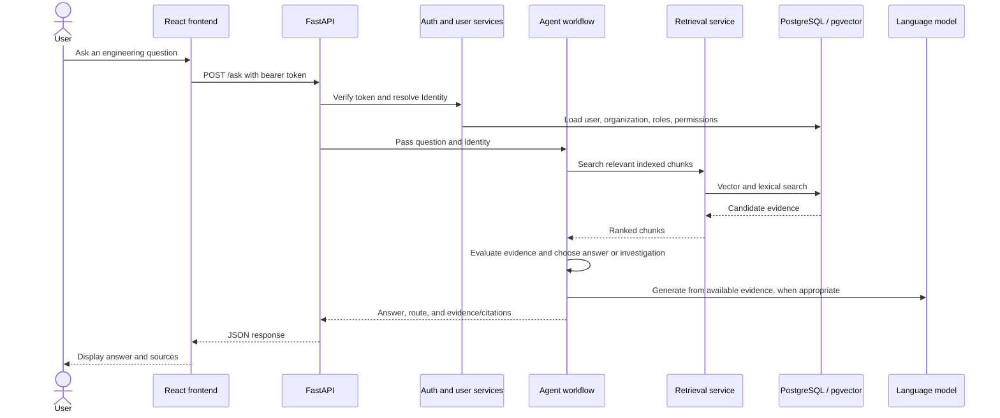
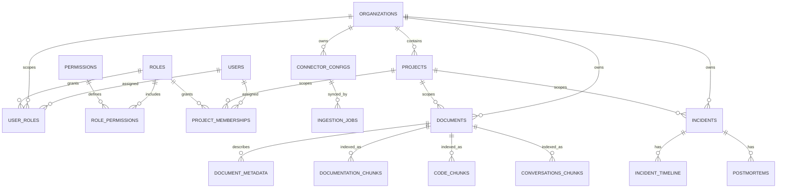
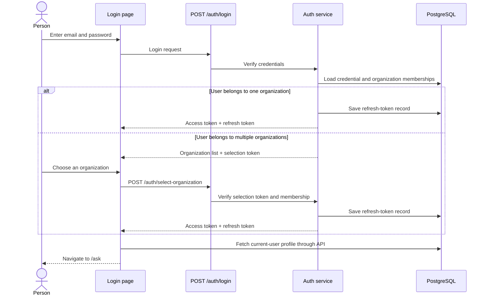
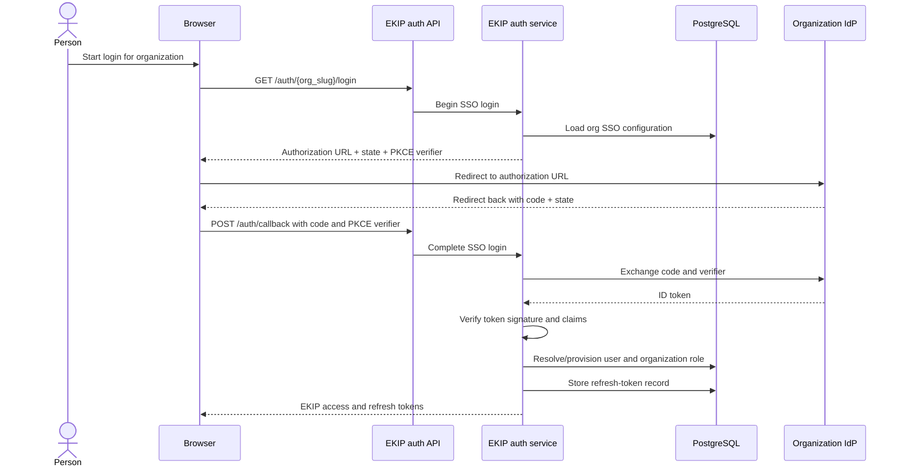

# Stage 1 — System overview

I inspected the source code and the main frontend, API, authentication, database, worker, agent, and MCP entry points. This lesson is the overview only; I’ll stop afterward for your understanding check rather than move on to signup or login internals.

## A. Purpose: what EKIP does

EKIP is for engineering teams that need to find and use knowledge scattered across their tools—such as code repositories, chat, and incident records. It brings that information into one system so people can ask engineering questions and get answers based on retrieved evidence.

The important product idea is: **when EKIP cannot find enough evidence for a reliable answer, it should investigate or say it does not know, rather than confidently inventing an answer.** That is the product goal described in `README.md`, and the answer/investigation routing is represented in `graph.py`.

For example, an engineer might ask, “Have we seen this payment timeout before?” EKIP can search indexed engineering knowledge and incident evidence, then return relevant findings and citations—or route the question into investigation if the evidence is insufficient.

## B. The basic terms

- **Organization / tenant:** The company or customer boundary in EKIP. The database uses an organization’s ID as the tenant ID; there isn’t a separate tenant entity above it. Organization records are defined in `tenancy_models.py`.
- **User:** A person with an EKIP account. A user can belong to more than one organization; membership and role assignments are stored separately from the user record, in `user_roles`. See `core_models.py`.
- **Role:** A named bundle of permissions, such as the `admin` role used in initial signup.
- **Permission:** A code representing an allowed action. The system loads these for the caller and checks them when protected actions are requested.
- **Project:** A scope within an organization, such as “Payments.” Records such as incidents and documents are associated with a project as well as an organization.
- **Connector:** A configured connection to an external knowledge source. The ingestion process uses connectors to fetch and process content.
- **Incident:** An engineering incident record, with related timeline and postmortem workflows.
- **Knowledge document:** A database record representing content from a connector or a manually proposed document/runbook. It is **not** a file in `app/core/knowledge/`.

Roles, permission assignments, and identity are covered in later lessons; I’m defining them here just enough to make the architecture map understandable.

## C. Main components

EKIP is a **modular monolith**: one application codebase with separated modules and responsibilities. It is not one undivided program, and its production-style setup runs several processes from the codebase.

| Component | Responsibility |
|---|---|
| **Frontend** | React/TypeScript UI: login, asking questions, incidents, knowledge, connectors, and settings. It lives in `frontend/src`. |
| **REST API** | FastAPI endpoints that receive browser requests and pass work to the appropriate service. Main wiring is in `main.py`. |
| **Core services** | Business rules for authentication, users, organizations, incidents, knowledge, and audit. For example, `core/knowledge/service.py` owns document proposal and review behavior. |
| **Database layer** | SQLAlchemy models, migrations, and database sessions. PostgreSQL stores organization, user, incident, document, and related records. |
| **Ingestion** | Connectors fetch external content; processing cleans and chunks it before writing records and searchable chunks. |
| **Retrieval** | Searches indexed content. The current retrieval service uses vector and lexical (text keyword) search; its facade is `retrieval/service.py`. |
| **Agents** | Orchestrate AI workflows, including question answering, investigation, postmortems, and knowledge-gap detection. |
| **MCP server** | Offers selected capabilities to MCP clients through tools and resources, using the same core/agent logic rather than a separate business-logic implementation. |
| **Workers** | Background processes that consume jobs or run scheduled tasks, so long-running ingestion and agent work does not have to run inside an HTTP request. |

**Redis** is used for background job queues. **PostgreSQL with pgvector** is used for the application database and vector-search storage. The database models for documents are in `ingestion_models.py`; searchable chunks are represented in `retrieval_models.py`.

## D. How a question travels through the system

Here is the high-level path for an authenticated user asking a question:



In plain English:

1. The user submits a question from the frontend.
2. The API checks the caller’s token and resolves their identity and permissions.
3. The agent workflow searches content indexed by the retrieval layer.
4. The workflow evaluates the evidence and decides whether to answer or investigate.
5. The API returns the result for the UI to display.

The REST question endpoint is in `routers/ask.py`; it calls the agent service in `agents/service.py`.

## E. Where the information is stored

The Python files in `app/core/knowledge/` define **how the application manages knowledge records**. They are not the documents.

The actual document records live in PostgreSQL:

- `documents` stores document-level information, such as its organization, project, source, title, and status.
- `document_metadata` stores flexible key/value data. Manually proposed document text is currently stored there under the `content` key.
- Tables such as `documentation_chunks` store text chunks and embeddings used for retrieval.

That distinction is useful: **the document record tracks ownership and lifecycle; chunks provide searchable text for the AI workflow.** The knowledge service also handles publishing or rejecting a manual proposal, including its effect on retrieval. See `core/knowledge/service.py` and `retrieval_models.py`.

## F. High-level map of the main flows

### Signup and login

The backend has both email/password and OIDC-based single sign-on (SSO) paths. For email/password signup, the service creates a new organization and its default project, creates the first user, assigns the initial admin role, and issues tokens. The corresponding service logic is in `core/auth/service.py`, with REST routes in `routers/auth.py`.

**One integration detail to be aware of:** the current `LoginPage.tsx` shows an email/password form; it does not show an SSO option there. The backend has SSO endpoints and service logic, but that alone does not demonstrate that SSO is connected to this frontend login screen.

There is also a frontend setting that affects whether the UI talks to the real API: `config.ts` defaults `VITE_USE_MOCK_DATA` to enabled unless it is explicitly set to `"false"`. So the presence of real API code does not, by itself, prove that a particular frontend build is using it.

### Authenticated REST requests

For protected endpoints, the frontend API client attaches a bearer token. The API dependency verifies the token, asks the user service to load the caller’s identity, and sets the organization context used by PostgreSQL’s Row-Level Security (RLS). RLS is a database-level filter that helps ensure queries only see rows for the selected organization.

The relevant code is in `frontend/src/api/client.ts`, `api/deps.py`, `core/users/service.py`, and `database/session.py`. I’ll trace the exact sequence and permission checks in a later lesson.

### MCP requests

MCP clients use a separate server entry point, but the design shares the same underlying authentication and core/agent services. MCP dispatch resolves the identity from the bearer token before calling a tool handler; it also records request outcomes. See `mcp/dispatch.py` and `mcp/auth.py`.

### Knowledge ingestion and AI retrieval

At a high level, a connector job fetches content, ingestion processes it, and retrieval stores searchable chunks. When a question arrives, the agent calls retrieval to search those chunks. A separate ingestion worker is configured in `ingestion/workers/main.py`; the API can enqueue work, while the worker consumes it.

The agents worker is a separate process too. It runs scheduled tasks such as knowledge-gap and pattern scans; it is not the same thing as the per-question answer flow. See `agents/workers/main.py`.

## G. What is implemented versus what deployment files establish

The source code connects the main REST routes to core services and agent services, and the repository includes configurations for separate backend, ingestion-worker, agents-worker, and MCP processes.

However, configuration files do **not** prove that a live deployment is currently running. The README says Azure infrastructure has not yet been provisioned, and the Railway guide describes dashboard setup steps rather than claiming the repo deployed itself. So I can explain the deployment shape from the repository, but I cannot confirm which services or frontend settings are active in a particular live environment from this code alone.

## H. Source files for Stage 1

These are the main files I used to establish the overview:

- `README.md` — product description and module map.
- `Architecture.md` — documented module boundaries; useful context, checked against code.
- `app/api/main.py` — REST app setup and router registration.
- `app/api/deps.py` — REST identity dependency.
- `app/api/routers/ask.py` — question endpoint.
- `app/core/auth/service.py` — signup, login, and SSO service behavior.
- `app/core/users/service.py` — identity and permission loading.
- `app/database/session.py` — database sessions and tenant context.
- `app/database/models/core_models.py` and `app/database/models/tenancy_models.py` — user, organization, role, and project records.
- `app/agents/graph.py` and `app/agents/service.py` — AI workflow structure and entry points.
- `app/retrieval/service.py` and `app/database/models/retrieval_models.py` — search and chunk storage.
- `app/mcp/auth.py` and `app/mcp/dispatch.py` — MCP identity resolution and tool execution.
- `app/ingestion/workers/main.py` and `app/agents/workers/main.py` — background worker roles.
- `frontend/src/api/config.ts`, `frontend/src/api/client.ts`, and `frontend/src/context/AuthContext.tsx` — frontend API mode and session handling.

## I. Completion

You now have the top-level mental model: the UI or an MCP client calls an entry point; authentication establishes who is acting and in which organization; core services enforce business rules; ingestion and retrieval make engineering content searchable; and agents use that evidence to answer or investigate.

## J. Understanding check

Before we move on, try these in your own words:

1. Where does EKIP store the actual knowledge text, and what is the role of the files in `app/core/knowledge/`?
2. What is the difference between ingestion, retrieval, and the agents?
3. Why does the system need to resolve an organization-specific identity before handling a protected request?
4. What did we establish about the backend’s SSO support versus the current frontend login screen?

I’ll wait for your answers before moving to the next stage.


# Stage 2 — Database entities and relationships

The goal of this lesson is to understand **what EKIP stores, how the records connect, and where tenant isolation is enforced**. Think of the database as a set of related tables: each table stores one kind of fact, and foreign keys connect those facts.

> **Important:** SQLAlchemy model files show how the application maps Python classes to database tables. Alembic migrations create or change the deployed schema. The live database only matches the repository’s current schema if its migrations have been applied. Also, `DATABASE_DESIGN.md` explicitly says parts of its earlier schema are superseded by later multi-tenant changes; for current relationships, I’m following the models and migrations.

## A. Purpose

EKIP needs to keep several kinds of information separate but connected:

- Who a person is.
- Which organizations they belong to.
- What roles they hold in each organization or project.
- Which incidents, documents, and connectors belong to which organization.
- What derived search data was created from those documents.
- What agents and users did, for auditing and troubleshooting.

Separating these facts makes them easier to query and lets the system apply organization and project boundaries consistently.

## B. A table is not a file

For example, `app/database/models/ingestion_models.py` defines the Python mapping for the database table named `documents`. It does **not** contain any customer’s document records.

A database table is like a spreadsheet maintained by PostgreSQL:

- A **row** represents one instance, such as one organization or one document.
- A **column** represents one property, such as `title` or `organization_id`.
- A **foreign key** is a database-enforced link from one row to another.

The model files live in the repo, such as `tenancy_models.py`. Actual customer data lives in the configured database.

## C. Main relationships

This diagram shows the important relationships. A line means records are linked; it does not mean every row in one table must have every possible related row.



The core organization and project records are in `tenancy_models.py`; users and organization-level role assignments are in `core_models.py`.

## D. Identity and authorization records

### Organization and project

- `organizations` stores an organization’s name, unique slug, and status.
- `projects` belongs to one organization. Each project has an `organization_id`; project names are unique **within** an organization.
- Signup creates a default “General” project, so an organization can have a project scope from the beginning.

An organization is the main tenant boundary. A project is a narrower scope inside it.

### User and roles

A subtle but important design choice: the `users` table has **no `organization_id`**. The same person’s account can belong to multiple organizations. Their membership and organization-level role are represented by `user_roles`, which connects:

- A user.
- An organization.
- A role.

The `roles` and `permissions` tables are shared catalogs. `role_permissions` connects a role to the permissions it grants. So the relationship is:

> user → organization-specific role assignment → role → permission codes

That is why a user’s account alone does not tell you what they may do in a particular organization.

Project-specific assignments are stored separately in `project_memberships`, connecting a user, a project, and a role. This allows project-level role assignments without changing the user’s organization-level membership.

The precise permission-loading and checking rules belong to the later identity/authorization lesson; here, the key is which records make that possible.

## E. Settings and membership records

Other organization-related tables include:

- `sso_configurations`: SSO provider settings for an organization. The secret is represented by a reference, not stored as a usable plaintext secret in this row.
- `external_identity_mappings`: connects an organization’s external identity-provider subject to an EKIP user.
- `connector_configs`: a configured external source such as GitHub or Slack. It belongs to an organization and may optionally be scoped to a project. It stores source settings in JSON and a credential reference.
- `organization_access_rules`: rules that can allow SSO-based organization provisioning, for example by email domain or identity-provider group.
- `invitations`: an invitation for a particular email to join an organization with a specified role.

These are all defined in `tenancy_models.py`. Their presence in the schema does not, by itself, establish that every related screen or workflow is available in the deployed frontend; we’ll trace those paths later.

## F. Documents and searchable chunks

The document model in `ingestion_models.py` represents content from two different sources:

1. **Ingestion:** content synchronized from a connector.
2. **Manual proposal:** knowledge content submitted for review.

A `documents` row identifies the organization and project, source, title, status, and version. Flexible source-specific details go in `document_metadata`, which is associated with a document by `document_id`.

For manually proposed documents, the text is currently stored in `document_metadata` under the key `content`; there is no `documents.content` column. That’s why the earlier explanation said the files in `app/core/knowledge/` are business logic, not the documents themselves.

The retrieval layer stores **derived chunks** in tables such as `documentation_chunks`, `code_chunks`, and `conversations_chunks`, defined in `retrieval_models.py`. A chunk holds text, its embedding (a numerical representation used for semantic search), and offsets back into the source text.

In other words:

> `documents` and `document_metadata` represent the source record and its details; chunk tables represent searchable, derived copies of its content.

Chunk rows repeat organization and project IDs so retrieval can filter efficiently. They also point back to the document. The database enforces uniqueness for each document’s chunk index within a collection.

## G. Incidents, history, and generated work

The main incident records are in `core_models.py`:

- `incidents` stores an incident’s organization, project, reporter, status, severity, title, and description.
- `incident_timeline` stores chronological events for an incident, such as notes or status changes.
- `postmortems` stores postmortem content and its review status.

Timeline entries label their actor as a string such as `user:<id>` or `agent:<name>`. This lets the record represent an agent action even though an agent is not a row in `users`.

There are also tables that record activity rather than the primary business objects:

- `audit_logs` records auditable actions, such as document publication.
- `agent_executions` records agent runs and their outcomes.
- `knowledge_gap_reports` stores documentation-gap recommendations, which may refer to an existing document.

These models are in `core_models.py` and `agent_models.py`. Audit records and agent execution records answer different questions: **audit logs describe actions; agent executions describe AI runs.**

## H. Tenant isolation: organization IDs and RLS

Many business tables store `organization_id` directly. The application also sets a transaction-local PostgreSQL setting, `app.current_organization_id`, after resolving the caller’s organization. See `database/session.py`.

The RLS migration, `c7d4e8f19a2b_milestone_10_row_level_security.py`, configures policies that compare a row’s organization to that setting. For tables without their own `organization_id`, it scopes them through a parent:

- `document_metadata` is scoped through its document.
- `project_memberships` is scoped through its project.

This is a database-level backstop: if the application accidentally queries without an organization filter, the database should still restrict which tenant’s rows are visible. If the context is missing, the migration’s policy is designed to fail closed—queries return no protected tenant rows, rather than every organization’s rows.

RLS is not the same as role/permission authorization. **RLS limits which organization’s rows the database can access; permission checks decide whether the caller may perform a particular action.** The permission-check details come in a later stage.

## I. Example: Alice, Bob, Payments, and another company

Suppose Alice and Bob belong to **Acme**, which has a **Payments** project. Bob also must not access **Globex**, a separate organization.

- `organizations` contains one row for Acme and one for Globex.
- `projects` contains a Payments row linked to Acme.
- `users` contains Alice and Bob as person accounts; neither row needs an organization ID.
- `user_roles` contains the assignments that say which roles Alice and Bob have **in Acme**. Membership in Globex would require its own assignment.
- `project_memberships` can give Bob a role specifically in Payments.
- A Payments incident or document has `organization_id = Acme` and `project_id = Payments`.
- When Bob makes a request scoped to Acme, the database transaction gets Acme’s tenant context. RLS then prevents that database session from reading Globex’s tenant-scoped records.

So, **Bob’s user record identifies the person, but the organization-scoped membership and the request’s tenant context determine which company’s data is in scope.**

## J. Important code locations

- `tenancy_models.py` — organizations, projects, connector settings, invitations, and access rules.
- `core_models.py` — users, roles, permissions, incidents, timeline, postmortems, and audit logs.
- `ingestion_models.py` — ingestion jobs, documents, and document metadata.
- `retrieval_models.py` — chunk and vector-search tables.
- `agent_models.py` — agent execution and knowledge-gap records.
- `session.py` and `the RLS migration` — tenant context and database-level isolation.

## Completion

You now have the database mental model: an account is separate from organization membership; roles connect to permissions; projects scope work within organizations; source documents and searchable chunks are separate; and database RLS adds an organization-level safety boundary.

## Understanding check

Before I continue to **Stage 3: organization signup and initial admin setup**, answer these in your own words:

1. Why does the `users` table not need an `organization_id`?
2. What is the difference between a `documents` row and a row in `documentation_chunks`?
3. How are `user_roles` and `project_memberships` different?
4. What does RLS protect, and how is that different from a permission check?


# Stage 3 — Organization signup and initial admin setup

## A. Purpose

Signup does more than create a login. It bootstraps a new EKIP customer space:

- A new organization
- Its initial project
- The first user account
- An organization-level admin role for that user
- A session so the user is signed in immediately

The key result is: **the person’s account is created, and that account is given admin access inside the new organization.**

## B. What starts the flow?

In the frontend, the user visits the signup page, fills in their name, work email, password, and organization details, then submits the form. The organization slug is suggested from the organization name, but the user can edit it. See `SignupPage.tsx`.

The frontend calls `POST /auth/signup`. The endpoint is public, returns `201 Created` on success, and applies a rate limit of 10 signup requests per IP per minute. See `auth.py`.

**Frontend caveat:** the frontend defaults to mock data unless `VITE_USE_MOCK_DATA=false`. If mock mode is enabled, signup returns a mock session instead of contacting the real backend. See `config.ts`.

## C. What does the request contain?

The backend expects:

- `email`
- `password` — at least 8 characters
- `display_name`
- `organization_name`
- `organization_slug` — lowercase letters and numbers, separated by single hyphens

These rules are in `schemas.py`. The password is hashed with bcrypt before being stored; the plaintext password is not saved. See `service.py`.

## D. Step-by-step execution

When the real backend receives the request, the signup service does the following:

1. **Check whether the email already has an account.**  
   If it does—including an account originally created through SSO—signup returns an “email already exists” conflict. Signup is not a way to join an existing organization.

2. **Create the organization and its default project.**  
   The organization is created with the submitted name and slug. The tenancy service also creates a default project named **General**. The organization begins with status `onboarding`. See `tenancy service` and `tenancy models`.

3. **Create the user account and password credential.**  
   The `users` row stores the person’s email and display name. Its `password_hash` stores the bcrypt hash. The user row itself has no `organization_id`; the organization relationship is added in the next step. See `core models`.

4. **Give the user the admin role in this organization.**  
   The system ensures the shared `admin` role and its permission grants exist, then creates a `user_roles` assignment linking this user, this organization, and that role. This is how the app knows the user is an admin *in this organization*. See `users service`.

5. **Issue a session.**  
   The backend returns an access token and a refresh token. The refresh token is persisted, and the session is scoped to the new organization. See `auth service`.

6. **Load the signed-in user in the frontend.**  
   The frontend stores the tokens, uses the access token to fetch the current user and their organization-specific permissions, then the signup page navigates to `/ask`. See `AuthContext.tsx` and `SignupPage.tsx`.

## E. Data movement

```mermaid
sequenceDiagram
    actor Person
    participant UI as Signup page
    participant API as POST /auth/signup
    participant Service as Auth and tenancy services
    participant DB as PostgreSQL
    participant Browser as Frontend session

    Person->>UI: Submit account and organization details
    UI->>API: Signup request
    API->>Service: Validate and provision
    Service->>DB: Check email; create organization and General project
    Service->>DB: Create user and password hash
    Service->>DB: Ensure admin role; assign it within organization
    Service->>DB: Save refresh-token record
    Service-->>API: Access token + refresh token
    API-->>UI: Session tokens
    UI->>Browser: Store tokens and load current-user profile
    UI-->>Person: Navigate to /ask
```

The request uses one database session. It commits when the request succeeds and rolls back if an error is raised, so a failed signup should not leave only some of the records behind. See `session.py`.

## F. Security and behavior to remember

- **Signup creates a new organization.** It does not let someone join an existing one. Inviting another person is a separate flow.
- **Email uniqueness is global.** One person has one `users` record, even if they later belong to multiple organizations.
- **The admin assignment is organization-scoped.** The role assignment ties the user to this organization; the role catalog itself is shared.
- **Tenant context is set during provisioning.** The database uses it to allow tenant-scoped writes such as creating the default project.
- **The endpoint is rate-limited.** That limits repeated signup attempts from a single IP.
- **A duplicate organization slug is rejected.** The slug is unique; there is a narrow concurrency case where the database uniqueness constraint may reject a simultaneous duplicate request less cleanly than the normal conflict response.

## G. Example

Suppose Priya signs up with organization name **Acme Engineering** and slug **acme-engineering**. The backend creates:

```text
organizations
  Acme Engineering / acme-engineering / onboarding

projects
  General / belongs to Acme Engineering / default

users
  Priya's email / Priya's name / bcrypt password hash

user_roles
  Priya / Acme Engineering / admin
```

It then issues Priya a session scoped to Acme Engineering. The app can use that identity and its permissions on the next request.

## Completion and understanding check

The signup flow turns a visitor into the first administrator of a newly created organization: it provisions the organization and `General` project, creates the account, assigns the admin role within that organization, and signs the user in.

Before I continue to the next stage, answer these in your own words:

1. Why does signup create an organization and a `General` project, rather than just a user?
2. Where is the fact “this user is an admin in this organization” stored?
3. What happens if someone tries to sign up with an email that already belongs to an SSO-created account?
4. What frontend setting determines whether signup reaches the real backend or uses mock data?


# Stage 4 — Email/password login

## A. Purpose

Signup created the account and the first organization. Login is how someone with an existing account proves their identity and gets a session to use EKIP.

The important detail is that **a person’s account and their organization are separate**. After validating the password, EKIP also needs to know which organization’s data and permissions to use.

## B. What starts the flow?

The user enters their email and password on the login page. The frontend sends them to `POST /auth/login`. This endpoint is rate-limited to 10 requests per IP per minute. See `LoginPage.tsx` and `auth.py`.

As with signup, the frontend defaults to mock mode unless `VITE_USE_MOCK_DATA=false`; in mock mode, it does not contact the real login endpoint. See `config.ts`.

## C. Step-by-step execution

1. **Look up the account by email.** The backend retrieves the credential record for that email.

2. **Verify the password.** It compares the entered password with the stored password hash. An unknown email, a wrong password, or an account without a password credential (such as an SSO-only account) gets the same “Invalid email or password” response. This avoids revealing which emails have accounts.

3. **Check account status and organization memberships.** An inactive account is rejected. If the user has no organization membership, login is also rejected.

4. **Choose the right login outcome based on memberships:**
   - **One organization:** EKIP issues a session for it immediately.
   - **More than one organization:** EKIP does **not** choose one automatically. It returns a list of organizations and a short-lived `selection_token`, but no access token yet.

5. **If needed, let the user choose an organization.** The frontend shows an organization picker. When the user chooses, it sends the selection token and organization ID to `POST /auth/select-organization`. The backend checks that the user really belongs to that organization before issuing a session. The organization ID from the browser is a request—not proof of membership.

6. **Load the signed-in profile.** Once the frontend has session tokens, it stores them and fetches the current user’s profile for the selected organization. It then navigates to `/ask`.

The password and organization-membership logic is in `service.py`. The frontend’s token and profile handling is in `AuthContext.tsx`.

## D. What is the `selection_token`?

It is **not** an access token. It proves that the password check succeeded and allows the user to complete the organization-selection step. On its own, it does not grant access to protected API data. Only after the backend verifies membership in the selected organization does it issue the real access and refresh tokens.

That distinction prevents “I know a user’s organization ID” from being enough to sign in as them.

## E. What does the session provide?

- The **access token** is used to authenticate requests, and is scoped to one organization.
- The **refresh token** lets the frontend request a new access token later without making the user repeat the full login.

Once a session exists, the backend can resolve the user’s identity and permissions within the organization in that session. The next stage will explain that identity and authorization process in more detail.

## F. Login flow diagram



## G. Key takeaways

- A correct password proves the person’s account, but it does not by itself choose an organization.
- A single-organization user goes straight to a session.
- A multi-organization user must choose; the server independently verifies that membership.
- The login screen is an email/password form. The backend also has SSO paths, but those are a separate flow.
- Mock mode can make the frontend appear to log in successfully without calling the real backend.

## Understanding check

Before I continue to the next stage, answer these in your own words:

1. Why does EKIP ask a multi-organization user to choose an organization after password verification?
2. What does the `selection_token` prove, and what does it *not* grant?
3. Why do unknown emails and wrong passwords receive the same error?
4. What is the difference between the access token and the refresh token?


# Stage 6 — SSO login with OIDC

This lesson follows the email/password and identity-resolution lessons. SSO is a second way to prove who a user is: instead of checking a password stored by EKIP, the user authenticates with their organization’s identity provider (IdP), such as Microsoft Entra ID, Okta, Auth0, or Google Workspace.

The SSO implementation is **partly connected**: the backend has OIDC login and the frontend has an SSO settings screen for administrators, but the current login page does not offer a “Sign in with SSO” flow. So the backend capability and its configuration UI exist, but the full employee-facing browser journey is not wired into that login page.

## 1. An administrator configures the organization’s IdP

Before employees can sign in through SSO, the organization needs an SSO configuration. It identifies the provider, issuer URL, client ID, and client secret.

In the current frontend, an administrator can enter these under **Settings → SSO**. The API requires the `tenancy:manage` permission. The backend encrypts the client secret before storing it and does not return the real secret to the browser when the configuration is read back. See `SsoSettingsPage.tsx` and `service.py`.

The database stores the configuration in `sso_configurations`, linked to one organization. Although the configuration schema recognizes `oidc` and `saml` as protocol values, the login flow described here performs **OIDC** discovery and authorization-code exchange. That protocol choice in the settings schema does not, by itself, mean there is a working SAML login flow. See `tenancy_models.py` and `schemas.py`.

## 2. The user starts login for a particular organization

The backend login entry point is:

```text
GET /auth/{org_slug}/login?redirect_uri=...
```

The organization slug tells EKIP which organization’s IdP configuration to use. For example, the request identifies Acme’s configuration rather than asking the user to choose from every organization in the system.

The backend checks that the redirect URI’s **origin** is in the deployment’s allowed CORS origins. It then finds the organization by slug, loads its SSO configuration, and discovers the IdP’s authorization endpoint using its OIDC discovery document. Discovery results are cached for an hour. See `auth.py` and `service.py`.

## 3. EKIP prepares a protected authorization request

Before sending the user to the IdP, EKIP generates two random values:

- **`state`**: correlates the login attempt and is intended to protect the redirect round-trip against cross-site request forgery.
- **`code_verifier`**: a secret value used by PKCE to prove that the party completing login started it.

EKIP derives a **`code_challenge`** by hashing the verifier with SHA-256, then builds an authorization URL containing the client ID, redirect URI, requested OIDC scopes (`openid email profile`), state, and PKCE challenge. The verifier itself is not sent as the challenge. See `service.py` and `schemas.py`.

The API returns the authorization URL, state, and verifier to the caller. The intended browser client stores the state and verifier for this particular login attempt, then redirects the user to the IdP.

## 4. The IdP authenticates the user

The IdP presents its own login and any organization-required checks, such as multifactor authentication. EKIP does not see or validate the user’s IdP password; that is handled by the IdP.

After successful authentication, the IdP redirects the browser back to the configured callback URI with an authorization **code** and the state value. The code is temporary; it is not EKIP’s access token.

## 5. The callback exchanges the code for verified claims

The callback endpoint is:

```text
POST /auth/callback?redirect_uri=...
```

Its body includes the organization slug, authorization code, state, and PKCE verifier. The redirect URI must match the one used to begin login.

The auth service loads the organization’s SSO configuration and exchanges the authorization code at the IdP’s token endpoint. It decrypts the stored client secret for this exchange and sends the code verifier, allowing the IdP to check that the caller has the PKCE secret corresponding to the original challenge.

EKIP then retrieves the IdP’s JWKS signing keys and verifies the returned ID token. It checks the token’s signature, issuer, audience, and expiry before trusting its claims. The implementation requires an email claim; it also reads the subject, optional name, and standard `groups` claim. Provider-specific custom group claims and directory lookups are not implemented in this path. See `service.py`.

## 6. EKIP decides whether this person may join the organization

A verified IdP login proves identity to EKIP; it does **not automatically mean the person is authorized to join that EKIP organization**.

If EKIP already has a mapping for this IdP subject and organization, it reuses the associated EKIP user. Otherwise, it evaluates the organization’s provisioning rules in this order:

1. A valid pending invitation for the user’s email.
2. An active rule matching the email domain.
3. An active rule matching one of the IdP’s standard `groups` values.

A matching rule must specify which role to grant. If no rule or valid invitation matches, EKIP denies provisioning and does not issue a session. See `service.py`.

If access is allowed, EKIP finds or creates the global `users` account, assigns the chosen role **within this organization**, accepts a matched invitation if applicable, and writes an `external_identity_mappings` row linking the organization and IdP subject to that EKIP user. That mapping makes later logins resolve back to the same user account. See `service.py` and `tenancy_models.py`.

## 7. EKIP creates its own session

Once the identity is mapped or provisioned, EKIP issues its own access and refresh tokens, scoped to the organization whose IdP was used. From then on, protected requests use EKIP’s normal identity-resolution process—the same general authorization path as other signed-in users.

The important distinction is:

> **The IdP authenticates the person. EKIP decides whether that person may join the organization, assigns their EKIP role, and issues an EKIP session.**

## Full flow at a glance



## What is implemented, and what is not connected?

**Implemented in the backend:**

- Organization-specific OIDC configuration lookup
- Authorization-code login with PKCE
- IdP token verification
- Invitation/domain/group-based just-in-time provisioning
- Mapping IdP identities to EKIP users
- EKIP session issuance

**Present in the frontend:**

- An administrator’s SSO configuration page

**Not shown as connected in the current employee login screen:**

- A button or flow to begin SSO login
- Browser handling that stores the state/verifier, redirects to the IdP, receives the callback, and submits it to the API

There is also an important boundary in the implementation: the auth-service documentation says the caller is expected to match the callback’s `state` with the saved login attempt before completion. The visible callback router passes the submitted data to the service, but does not itself show that state lookup or comparison. Because the current login page does not implement SSO, I can’t confirm from these files that a browser callback client performs that required check.

## Example

Suppose Acme has configured Entra ID and has an active rule allowing `acme.example` email addresses to join as engineers.

- Priya signs in with Entra ID.
- Entra returns a verified ID token for her.
- EKIP checks whether her IdP subject is already mapped.
- If not, EKIP checks her invitation or access rules. Her email domain matches Acme’s rule.
- EKIP creates or reuses Priya’s user account, assigns the engineer role in Acme, records the external identity mapping, and issues an Acme-scoped EKIP session.

If she later signs in again through that same organization and IdP subject, EKIP can use the mapping rather than provisioning her again.

## Understanding check

Before I continue, try these in your own words:

1. What does the IdP authenticate, and what does EKIP still decide after receiving the IdP result?
2. Why does EKIP use both `state` and a PKCE verifier/challenge?
3. What are the three provisioning routes EKIP checks for a first-time SSO user?
4. What is the difference between `external_identity_mappings` and `user_roles`?
5. Which part of the SSO journey is configured in the frontend, and which employee-facing part is not currently visible in the login page?


# Stage 7 — Using and maintaining a signed-in REST session

Stages 3–6 covered how an account is created, how a user signs in, and how EKIP resolves their identity. This stage follows the session into normal API use: what happens on each protected request, how the browser restores a session after a reload, and what refresh and logout do.

## 1. The browser holds two different tokens

After successful signup or login, EKIP returns an **access token** and a **refresh token**. They serve different purposes:

- The **access token** goes in the `Authorization: Bearer …` header on protected API calls. It contains the user and organization claims and is signed so the backend can verify it.
- The **refresh token** is a longer-lived credential that can be exchanged for a new token pair when the access token expires.

In this project, the access token lasts **60 minutes by default** (`jwt_expiry_minutes`). The refresh-token lifetime is **30 days**. See `settings.py` and `service.py`.

The browser stores these differently: the access token stays **in memory**, while the refresh token is stored in `localStorage`. So a page reload loses the in-memory access token, but the browser can use the stored refresh token to get a replacement. See `tokenStore.ts`.

## 2. A normal protected API request

Imagine the user submits a question to `POST /ask`. The frontend’s shared API client attaches the access token to the request. The `/ask` route declares a `CurrentIdentity` dependency, so FastAPI resolves and verifies the caller before the route handler runs.

The process is:

1. **Attach the bearer token.**  
   The client reads the access token from memory and adds it to the `Authorization` header. Resource API calls use the shared `apiRequest` helper. See `client.ts`.

2. **Extract and verify the token.**  
   The API requires a bearer token and asks the auth service to validate its signature, expiry, and token type. An organization-selection token, for example, is not accepted as an access token. This verification is about the token’s validity and its claims; it does not yet load the user’s permissions. See `deps.py` and `service.py`.

3. **Build the user’s current identity.**  
   The API takes the user ID and organization ID from the verified claims and calls the user service. That service checks that the user exists and is active, then loads their roles and permissions for that organization. The result is an `Identity` object passed into the endpoint. See `users service` and `identity.py`.

4. **Set the database tenant context.**  
   The organization from the verified token is placed into the PostgreSQL transaction’s tenant context. RLS then restricts tenant-owned rows to that organization for the transaction. This protects the data boundary, but does not grant action permissions. See `session.py`.

5. **Check permission and perform the work.**  
   The route or a service can check that the identity has the permission needed for the operation. For example, the `/ask` route passes the identity to the agent service; a route that manages SSO settings requires `tenancy:manage`. If the required permission is absent, the action is denied. See `ask.py` and `users service`.

6. **Finish the request transaction.**  
   The database session commits if the request succeeds, rolls back if an error occurs, and is then closed. See `session.py`.

```text
Browser sends access token
        ↓
FastAPI resolves CurrentIdentity
        ↓
Verify signature, expiry, and token type
        ↓
Load active user, roles, and permissions for the token's organization
        ↓
Set PostgreSQL tenant context
        ↓
Check permission, then run the endpoint
        ↓
Commit on success; rollback on error
```

The token is not a complete snapshot of all permissions. EKIP loads roles and permissions from the database while resolving the identity, then uses the resulting `Identity` for the request.

## 3. What happens when the page reloads?

A reload clears the in-memory access token. On startup, `AuthContext` checks whether a refresh token is stored:

1. If none exists, it finishes loading as unauthenticated.
2. If one exists, it sends that token to `POST /auth/refresh`.
3. If refresh succeeds, the frontend stores the new access and refresh tokens, then fetches the current user’s profile.
4. If refresh fails, the frontend clears the stored session and user state.

Refresh tokens are **single-use and rotated**: the token presented to the refresh endpoint is revoked, and a new refresh token is returned. Because two simultaneous refreshes with the same token could look like token reuse, the frontend coalesces concurrent refresh calls into one request. See `AuthContext.tsx` and `tokenStore.ts`.

## 4. Refresh-token rotation and reuse detection

When the backend receives `POST /auth/refresh`, it:

1. Hashes the presented refresh token and looks up its organization.
2. Sets the tenant context, then performs the RLS-scoped lookup.
3. Rejects the token if it is unknown or expired.
4. If the token has already been revoked, treats that as possible reuse and revokes the rest of its token family.
5. Otherwise, revokes the presented token and issues a fresh access/refresh pair in the same family.

The database stores the **hash** of the refresh token, not the raw value. Each token in a refresh chain shares a `family_id`, which lets EKIP revoke the chain if an already-rotated token is presented again. See `auth_models.py` and `service.py`.

## 5. What happens if an API request gets a 401?

The API client detects a `401` on a request that carried an access token. It clears both stored tokens and notifies `AuthContext`, which clears its user state. That makes the app’s normal protected-route behavior send the user to login. See `client.ts` and `tokenStore.ts`.

**Important distinction:** the frontend restores the session with a refresh call on startup, but the shared API client does **not** currently perform silent refresh-and-retry when an ordinary API request gets a 401. So an expired access token during an active session can cause the session to be cleared instead of transparently refreshed.

A 401 from a request with **no access token attached**—such as an incorrect password on login—does not trigger the “session expired” behavior. There is no existing signed-in session to clear.

## 6. Logout options

EKIP has two logout paths:

- **`POST /auth/logout`** takes a refresh token and revokes that one session’s refresh token. The frontend then clears its local token and user state.
- **`POST /auth/logout-all`** requires a valid current identity and revokes active refresh-token sessions for that user in the current organization. It also records an audit event.

The access token is a signed, stateless JWT; ordinary access-token verification does not look up the refresh-token row. Therefore, revoking a refresh token prevents future refreshes, but does not itself invalidate an already-issued access token immediately. That token can remain usable until it expires. See `auth.py` and `service.py`.

## 7. Where does `GET /auth/me` fit?

After signup, login, or refresh, the frontend calls `GET /auth/me` to load the signed-in user’s profile—such as their name, roles, and permissions. This route is protected by the same `CurrentIdentity` mechanism as other protected routes. It does not accept a user ID from the browser to decide whose profile to return; it uses the identity resolved from the token. See `auth.py`.

## Example: the user reloads EKIP

Priya signed in to Acme and has a refresh token saved in the browser. She closes and reopens the page:

1. The access token is gone because it was only held in memory.
2. The app finds the refresh token in `localStorage`.
3. It sends that token to the backend.
4. The backend validates it, marks it used, and returns a new access token and refresh token.
5. The app stores the new pair and loads Priya’s Acme profile.
6. When Priya submits an authenticated request, the API verifies the access token and resolves her Acme-scoped identity.

## Main takeaway

The **access token** is what accompanies routine API calls; the **refresh token** is the credential used to obtain a replacement session. On each protected REST request, EKIP verifies the access token, resolves the user’s current organization-specific identity, sets tenant context, and lets permissions and RLS protect different boundaries.

## Understanding check

1. Why does the browser persist the refresh token but keep the access token only in memory?
2. What does refresh-token rotation do, and why does EKIP track a token family?
3. What is the difference between revoking a refresh token and invalidating an already-issued access token?
4. Does the frontend transparently refresh and retry an ordinary API request after a 401?


# Stage 8 — Organization, project, and team management

Now that we’ve seen how a user signs in and gets an organization-scoped session, let’s look at what they can do inside that organization: view teammates, invite people, configure SSO join rules, and work with projects.

A useful distinction throughout this stage:

- **Implemented API capability** means the backend has a route and service logic for it.
- **Visible UI capability** means the frontend provides a screen or control to use it.
- Having a database table for something does not automatically mean the app has a complete workflow to manage it.

## 1. The current organization comes from the session

After sign-in, the access token is scoped to one organization. The frontend uses that token to load the user’s organization memberships, then identifies the current organization from the organization ID in the token—not by simply choosing the first organization in the list.

If the user belongs to more than one organization, the frontend’s tenant switcher can request a switch. The backend verifies the user’s membership and issues a **new token pair** scoped to the selected organization. The UI does not make itself a member just by changing a displayed organization ID. This is handled by `TenantContext.tsx` and the organization-switch endpoint in `auth.py`.

Once the current organization is known, the app loads that organization’s projects and uses the selected project as UI context. The organization is the tenant boundary; a project is a narrower scope within that organization.

## 2. Organization settings: currently read-only

The organization settings page displays its name, slug, and ID. Those fields are disabled because the backend currently supports creating and reading an organization, but has no update-organization operation. So the settings page is not a form that saves changes; it is a display of the current organization’s details. See `OrganizationSettingsPage.tsx`.

The backend does have an endpoint to create an additional organization, but that is different from editing the current one. Creating another organization requires `tenancy:manage`. For the ordinary organization list, the user sees only their own current organization from that API surface; internal scheduled jobs have a separate unscoped listing for system work.

## 3. Projects: what the API can do versus what the UI does

An organization gets a **General** project during signup. It provides a project scope from the start, even for customers who never divide their work into multiple teams.

The backend supports:

- Listing projects belonging to the caller’s organization.
- Creating a project, provided the caller has `tenancy:manage`.

Creating a project records an audit event. The project model stores its name, organization ID, and whether it is the default project. See `tenancy.py`, `service.py`, and `tenancy_models.py`.

The frontend’s Project settings page is more limited: it displays the active project and the project list, but does not offer a create or edit form. There is no backend project-update operation, either. The tenant switcher can select a project in frontend state; that selection is not the same as assigning a user a role on that project. See `ProjectSettingsPage.tsx` and `TenantSwitcher.tsx`.

**Important gap:** the database has a `project_memberships` table and identity resolution can load project-specific permissions, but I did not find a corresponding project-membership management endpoint or service flow. In other words, the schema supports that model, but an administrator cannot currently use the visible UI to assign project-specific roles.

## 4. The Users page shows members and invitations separately

The Users settings page has two related but distinct views:

1. **Users**: people who already have a role assignment in the organization.
2. **Invitations**: invitations that have been created but may not yet have been accepted.

The members endpoint returns users who hold a role in that organization. The current service allows an organization member to view teammate names, emails, and roles; it does not require `tenancy:manage` just to view the member list. See `users service` and `tenancy.py`.

The frontend simplifies roles to one displayed role per user. The backend can return multiple role names, but the UI shows the first one it receives; that should not be read as “the user has exactly this one role” or necessarily “this is their most powerful role.” Also, the membership list represents people who have joined, not pending invitations. See `tenancy.ts` and `UsersSettingsPage.tsx`.

## 5. Inviting someone to join

An administrator with `tenancy:manage` can create an invitation for an email address and specify the role to grant. The server checks that the invitation is for the caller’s own organization and resolves the requested role name to an existing role. If an invitation for that email is already pending in that organization, it rejects the duplicate.

The backend then:

1. Generates a random invitation token.
2. Stores only a hash of that token—not the raw secret.
3. Saves the invitation with its organization, email, role, inviter, expiry, and `pending` status.
4. Returns the raw token **once**, in the creation response, so it can be put into an invitation link.
5. Records an audit event.

The invitation is not yet the same as a member assignment: the invitee only becomes a member after successfully accepting or joining through an allowed SSO flow. See `service.py` and `tenancy_models.py`.

### A practical UI limitation

The frontend creates a link and offers to copy it, but the app does **not** send invitation emails. An administrator has to share the link through another channel. Since the raw token is returned only at creation time and is not recoverable from the stored hash, if the link is lost, the admin must revoke the invitation and create another one. See `UsersSettingsPage.tsx`.

## 6. Accepting an invitation with a password

For a password-based organization, the invitee opens a link containing both:

- The invitation ID, which identifies the database record.
- The invitation token, which proves possession of the secret link.

The invitee enters a password and may enter a display name. The backend checks that the token matches the stored hash, that the invitation is still pending, and that it has not expired. It then creates or reuses the user account, sets the password, grants the invitation’s role in the target organization, marks the invitation accepted, and issues a session.

The raw token—not the invitation ID—is the proof that the person has the invitation link. The accept endpoint is public because the invitee does not have a session yet, but it is rate-limited and requires that token. See `AcceptInvitationPage.tsx`, `auth.py`, and `service.py`.

## 7. Invitation versus SSO access rules

Invitations are **individual and specific**: one email address, one organization, and one role.

Access rules are **broader SSO provisioning policies**. An administrator can allow users to join based on either:

- A verified email domain, such as `acme.example`.
- A group in the IdP’s standard `groups` claim, such as `engineering`.

The rule also specifies which role the newly provisioned user receives. On first SSO login, EKIP checks a valid invitation first, then an active matching domain rule, then an active group rule. If none match, provisioning is denied. An access rule does not itself create a user at the time it is configured; it is evaluated when an SSO login occurs. See `AccessRulesSettingsPage.tsx` and `service.py`.

An inactive access rule can be deactivated, but the current API does not provide a reactivation operation. Similarly, SSO can be configured from the settings screen, but replacing an existing configuration is not supported by the current backend flow.

## 8. Where roles fit—and what isn’t managed yet

Both invitations and SSO access rules name a role to grant. The service looks up that role by name; it does not invent a new role when an invitation or rule is saved.

The app automatically creates the `admin` role and its permissions during signup. The current UI defaults invitation roles to `admin` and warns that this is the only role the app creates automatically today. It also accepts free text for a role, but an unknown role will be rejected by the backend.

This means the role catalog and role assignment are not yet fully administered through this screen: the UI does not offer a role picker backed by a list-roles endpoint, and there is no visible control here for changing an existing member’s role.

## Whole flow at a glance

```text
Organization admin
    │
    ├── creates an invitation for one email
    │       └── shares the one-time link manually
    │               └── invitee proves possession, sets password,
    │                   receives role + EKIP session
    │
    ├── configures an SSO access rule
    │       └── a verified SSO user matches invite/domain/group policy
    │               └── EKIP provisions user, grants role, records mapping
    │
    └── creates organization projects
            └── projects scope records within the organization
```

## What is actually available in the app?

- **Available:** view organization details; list projects; select a project in the UI; create projects through the backend API; list organization members; invite and revoke invitations; accept a password invitation; configure and deactivate SSO access rules.
- **Limited or absent:** organization editing; project editing; a project creation form in the frontend; project-member/role assignment management; editing existing member roles; automatic invitation email delivery; reactivating a deactivated access rule.
- **Remember:** the frontend defaults to mock data unless `VITE_USE_MOCK_DATA=false`. In mock mode, the screens may show simulated results rather than exercising these real backend flows. See `config.ts`.

## Understanding check

1. What’s the difference between an organization member and a pending invitation?
2. Why does the invitation link need both an invitation ID and a separate token?
3. How does an access rule differ from an invitation?
4. Which project-management features exist in the backend but are not exposed as controls in the current UI?


# Stage 9 — MCP: connecting AI clients to EKIP

The lesson notes currently stop at Stage 8, so **Stage 9 is the next topic by sequence, not a numbered stage already written in the notes**. We’ll look at how a client such as an AI assistant connects to EKIP through MCP, how it authenticates, and what happens when it calls a tool or reads a resource.

## 1. What MCP provides

MCP is a protocol for exposing capabilities to AI clients. In EKIP, it exposes three kinds of things:

- **Tools** — actions the client can ask EKIP to perform, such as asking a question, investigating an incident, or creating a project.
- **Resources** — information the client can read using a URI, such as an incident or knowledge document.
- **Prompts** — reusable instruction templates, such as a prompt that tells the client how to approach incident triage.

The MCP layer is an **interface**, not a second implementation of EKIP’s business logic. Its handlers are designed to validate inputs, resolve the caller, call existing services, and translate the result into MCP’s response format.

## 2. How the MCP server runs

EKIP’s MCP server is configured for **streamable HTTP**. It runs as a hosted service that can serve multiple organizations and users—not as a separate local process for every user. Its process entry point is `run_mcp_server.py`.

At startup, that entry point:

1. Imports the MCP assembly module, which registers the tools, resources, and prompts.
2. Supplies the server with a database-session factory and tenant-context function.
3. Starts the MCP server using streamable HTTP.

The database functions are injected at startup because of an architectural boundary: modules under `app/mcp` are not allowed to import the database implementation directly. Instead, the server declares what it needs, and the process entry point supplies it. See `server.py` and `main.py`.

Because this server is hosted, **each MCP request carries its own authentication token**. EKIP resolves the identity for each tool/resource call rather than treating a long-lived client connection as one permanent user session.

## 3. How an MCP client authenticates

There are two relevant ways a client can present a credential:

- A client can send an EKIP access token as a bearer token, if that client supports the token mechanism.
- A remote MCP client that expects OAuth can use EKIP’s MCP OAuth endpoints to obtain an EKIP session.

In either case, a tool request has an `Authorization: Bearer …` header. The MCP server’s `extract_bearer_token` helper reads that header from the request context. Missing or malformed bearer credentials are rejected. See `server.py`.

### The OAuth flow EKIP currently offers

EKIP’s MCP OAuth provider adapts OAuth’s expected flow to EKIP’s existing session system:

1. **The MCP client registers itself.**  
   Dynamic client registrations are stored persistently in the database, so restarting the server does not erase registered clients.

2. **The client starts OAuth authorization.**  
   EKIP creates a short-lived pending flow and directs the browser to EKIP’s own confirmation page.

3. **A person confirms their identity.**  
   The current confirmation page asks the person to provide an EKIP access token they already hold. EKIP verifies that token and resolves its user and organization. This is **not** a “sign in to EKIP with SSO” page: it relies on an existing EKIP session as proof of identity.

4. **EKIP issues a fresh session for the client.**  
   After the existing identity is verified, EKIP creates a new access/refresh token pair for that same user and organization. The new session is associated with the OAuth authorization code; the client exchanges that code for the tokens.

5. **The client uses and refreshes its tokens.**  
   When it calls an MCP tool, it sends the access token as a bearer token. For token refresh, the OAuth provider delegates to EKIP’s existing refresh-token rotation logic.

The OAuth provider and confirmation page are in `provider.py`. The MCP server enables OAuth and dynamic client registration in `server.py`.

**Implementation detail:** registered OAuth clients are persisted, but pending authorization flows and unexchanged authorization codes are held in process memory. A restart can therefore interrupt a login that is in progress, even though it does not remove the registered client or invalidate an already-issued EKIP session.

## 4. What happens when a client calls a tool?

Consider an MCP client calling `ask_question`.

1. **The handler reads the bearer token.**  
   The tool handler extracts the token from the request context. For example, `ask_question.py` does this before calling the shared dispatcher.

2. **The dispatcher opens a database session.**  
   The MCP layer uses the injected session factory. It opens a session for identity resolution and the actual tool operation.

3. **EKIP verifies the token and resolves an `Identity`.**  
   The dispatcher calls `resolve_mcp_identity`. This verifies the access token, then asks the shared users service to load the user’s roles and permissions for the organization in that token.

4. **EKIP applies per-user, per-tool rate limiting.**  
   The limit is checked after identity resolution, so it can be keyed to the caller and tool. Expensive work should not run if that caller has exceeded the limit.

5. **The dispatcher establishes tenant context.**  
   It sets the organization context required by PostgreSQL RLS before the tool’s business logic accesses tenant-owned data.

6. **The tool calls the existing EKIP service.**  
   `ask_question` calls the agent service, passing the resolved identity. It explicitly marks the trigger source as MCP so the execution record can distinguish MCP activity from REST activity. Other tools follow the same general pattern—for example, `create_project.py` calls the tenancy service, where the `tenancy:manage` permission is enforced.

7. **The dispatcher commits or rolls back and records the outcome.**  
   The operation runs in the request’s database session. The dispatcher also records tool name, identity, request summary, outcome status, and latency in a separate session. Using a separate session allows the failure record to persist even if the main operation rolls back. See `dispatch.py`.

A simplified version:

```text
MCP request with bearer token
        ↓
Extract token
        ↓
Verify token and resolve user + organization + permissions
        ↓
Rate-limit this caller/tool
        ↓
Set tenant context for RLS
        ↓
Call shared EKIP service or agent
        ↓
Commit or roll back; record MCP request outcome
        ↓
Return result to MCP client
```

## 5. What EKIP exposes

The server assembly imports the modules that register the current MCP surface. It includes **10 tools**, **2 resources**, and **2 prompts**. See `main.py`.

### Tools

The tools include:

- `ask_question` — answer an engineering question using EKIP’s knowledge.
- `investigate_incident` — run an investigation for a known incident.
- `search_similar_incidents` and `search_recent_changes` — search for relevant past incidents or changes.
- `generate_postmortem` — generate postmortem content.
- `propose_runbook_update` — create a proposed knowledge document.
- `create_project`, `create_invitation`, `configure_sso`, and `create_access_rule` — perform organization-management operations.

These are not all unrestricted. They call the same core services used elsewhere, and those services enforce the relevant permissions. For example, project creation requires `tenancy:manage`; asking a question goes through the agent service with the caller’s organization-scoped identity.

### Resources

The resources are:

- `incident://{incident_id}` — fetches an incident through the incident service.
- `document://{document_id}` — fetches a knowledge document through the knowledge service.

The document service applies its access rules: published documents are available to ordinary users, while access to unpublished documents requires `knowledge:review`. See `document_resource.py` and `incident_resource.py`.

### Prompts

The prompts provide reusable starting instructions, including incident triage and postmortem drafting. A prompt is not the same as performing the task: it guides the client’s model toward using the relevant tools. The tool call is what reaches EKIP’s authenticated execution path. See `triage_incident_prompt.py`.

## 6. How MCP authorization relates to REST

The intended design is to have **consistent business authorization across REST and MCP**:

- Both verify EKIP access tokens.
- Both resolve the user’s organization-specific roles and permissions.
- Both call shared core or agent services, rather than duplicating the business rules in the interface layer.
- Both rely on organization scope and database RLS to protect tenant data.

The MCP handler itself should remain thin. For example, an MCP project-creation tool should not invent a separate rule about who may create projects; it calls the tenancy service, which applies the permission check.

## 7. Important deployment and behavior caveats

- **OAuth must use the server’s public URL.** The MCP client must be able to reach the URL advertised during OAuth discovery. A localhost URL will not work for a remote client.
- **The OAuth confirmation step expects an existing EKIP token.** The current provider does not redirect a person through their organization’s SSO login as part of that OAuth flow.
- **Rate limits are in process memory.** If the MCP server runs as multiple replicas, each replica has its own rate-limit state rather than one shared global budget.
- **A request is authenticated separately from the connection.** Each tool/resource request needs a valid bearer token.
- **The current tool list includes admin operations.** Those are still protected by the permissions checked in the underlying service; having an MCP client does not itself grant `tenancy:manage`.

## Main takeaway

MCP is another doorway into EKIP, not another copy of the application. It translates MCP requests into calls to shared EKIP services, resolves a user and organization from the bearer token on each request, and relies on the same permission and tenant-isolation rules as the rest of the app.

## Understanding check

1. What is the difference between an MCP tool, resource, and prompt?
2. In the current OAuth confirmation flow, what must the person already have before authorizing a client?
3. After an MCP request presents a valid token, what else does EKIP load before running the tool?
4. Why does the MCP dispatcher set tenant context even though identity resolution also sets it?
5. Which parts of the current MCP OAuth flow or rate limiting are held in memory rather than persisted/shared?


## MCP authentication: how EKIP knows which user is calling

The key thing is that EKIP does **not** identify the person from the AI’s prompt, the MCP tool arguments, or the client application’s name. It identifies the caller from the **EKIP access token** that the MCP client sends with the request.

The AI client (for example, Claude) is the messenger. The access token tells EKIP **which EKIP user and organization the request represents**.

### 1. The user authorizes the MCP client

With the current OAuth flow, the client starts an authorization request and EKIP asks the person to confirm using an **existing EKIP access token**. EKIP verifies that token, loads the corresponding user and organization, then issues a fresh access/refresh token pair for the MCP client. The new token represents the **same user and organization** as the token used to confirm.

So, in this flow:

- Registering the AI client does not identify a user by itself.
- The person completing authorization establishes the user identity.
- EKIP gives the client its own session tokens for making subsequent requests.

The OAuth provider’s confirmation and token-issuance logic is in `provider.py`. The general token-signing logic, including the user and organization claims, is in `auth/service.py`.

### 2. The AI client sends a token with each request

When the AI client calls a tool such as `ask_question`, it sends an HTTP authorization header in this shape:

```http
Authorization: Bearer <EKIP access token>
```

The MCP server reads the token from that request header. It does not rely on a previous request having authenticated the connection: the hosted MCP server resolves identity **for each tool call**. The header extraction is in `server.py`.

### 3. EKIP verifies the token and reads its identity claims

The access token is a signed token. Its claims include:

- `sub`: the EKIP user ID
- `organization_id`: the organization for this session
- `type`, `iat`, and `exp`: token type, issue time, and expiry

EKIP checks the token’s signature and expiry. This answers: **“Was this token issued by EKIP, is it still valid, and which user and organization does it name?”** The check is performed by `verify_access_token`.

The client does **not** get to choose a user by putting someone else’s user ID in the MCP tool arguments. The identity comes from the signed token.

### 4. EKIP loads that user’s current roles and permissions

A valid token establishes the user ID and organization ID, but it does not carry the complete current permission list. EKIP uses those claims to load the user’s active account, organization roles, permissions, and project-level permissions from the database. It packages those into a shared `Identity` object.

That token-to-identity step is in `resolve_mcp_identity`, which calls the shared `resolve_identity`.

This distinction matters: **the token identifies the user and organization; the database supplies their current authorization.**

### 5. The tool runs as that resolved identity

For `ask_question`, the tool extracts the bearer token and passes it to the MCP dispatcher. The dispatcher resolves the identity, applies rate limiting, establishes organization context for database row-level security, and then calls the shared agent service with that identity. It does not pass a user ID supplied by the model. See `ask_question.py` and `run_mcp_tool`.

For example, if the token belongs to **Simran in Organization A**, EKIP treats the request as Simran acting within Organization A. If the tool tries to create a project, the existing tenancy service checks whether that identity has the needed permission; using an MCP client does not grant extra permissions.

## One important distinction: the AI user versus the EKIP user

EKIP knows the **EKIP account represented by the token**. It does not automatically know who typed a particular prompt into an AI client.

For example, if a shared AI client is configured with a token issued for Simran, requests made with that token represent Simran from EKIP’s perspective—even if another person types into the shared AI interface. To have EKIP distinguish those people, they need to use credentials representing their own EKIP accounts.

## The full flow

```text
Person authorizes the MCP client
        ↓
EKIP issues the client a token for that person + organization
        ↓
AI client sends an MCP request with Authorization: Bearer <token>
        ↓
EKIP verifies the signed token
        ↓
EKIP reads user ID + organization ID from the token
        ↓
EKIP loads the user's current roles and permissions
        ↓
EKIP runs the tool using that identity and tenant scope
        ↓
The tool result goes back to the AI client
```

**In one sentence:** the AI client carries the request, but the signed EKIP bearer token tells EKIP which user and organization the request is acting for.


# Stage 10 — Connector sync and knowledge ingestion

So far, we’ve covered how people sign in and what they’re allowed to do. This stage follows a different kind of input: **how information from tools like Slack, GitHub, and Jira gets into EKIP so it can be searched later.**

The key idea is:

> A connector fetches information from another system; the ingestion pipeline turns it into EKIP documents and searchable chunks.

## 1. An authorized user configures a connector

In the frontend’s **Connectors** page, a user with the `tenancy:manage` permission can connect supported services, view their status, and trigger a sync. The page and setup form are in `ConnectorsPage.tsx` and `ConnectConnectorModal.tsx`.

When the frontend sends credentials and settings, the backend creates a connector configuration. The database row records details such as:

- Which organization owns the connector
- Optionally, which project it belongs to
- The source, such as Slack or GitHub
- Source-specific settings, such as channel IDs or repositories
- Its status and last sync time

That configuration is represented by the `ConnectorConfig` model in `tenancy_models.py`.

**Credentials are protected:** the backend encrypts the credential before storing it. The stored connector record should not contain the usable plaintext token. The ingestion worker decrypts it only when it needs to authenticate to the source. The registration logic is in `tenancy/service.py`.

The frontend currently has configuration forms for a subset of the backend’s registered connectors. Having a connector implementation in the backend does not by itself mean there is a setup form for it in the UI.

## 2. Someone starts a sync—but the API does not do the work

When a user selects **Sync now**, the frontend calls the connector sync API. The backend checks that the caller is authorized and then puts a job onto a Redis-backed queue. It responds that the job was enqueued; it does **not** wait for every external record to be downloaded and processed.

This separation matters: a large sync does not need to keep a browser request open for minutes. The user-facing trigger is wired through `connectors.ts`, and the backend route is in `tenancy.py`.

There are also other ways sync work can be queued, including connector events and a scheduled reconciliation. The scheduled task periodically finds connectors that need attention and enqueues jobs; it does not perform the sync itself. That logic is in `workers/tasks.py`.

## 3. A separate worker fetches data from the source

A separate ingestion worker consumes the queued job. Its job is to:

1. Load the connector configuration.
2. Resolve its source implementation.
3. Decrypt the stored credential and authenticate.
4. Fetch source records in batches or pages.
5. Pass those records into EKIP’s shared processing pipeline.

The available implementations are registered in `ingestion/service.py`. Each connector knows how to talk to its source and translate the source’s records into EKIP’s common `RawDocument` shape. The shared connector contract is described in `connectors/base.py`.

This division avoids implementing cleaning, chunking, and embedding separately for every service. A Slack connector and a GitHub connector fetch different kinds of data, but they hand the pipeline a common kind of input.

## 4. EKIP cleans and classifies each record

The pipeline prepares a fetched record for storage and search. In broad terms, it:

- Cleans up the content
- Computes a hash of the cleaned content
- Extracts metadata
- Classifies the content, for example as documentation, code, conversation, or incident
- Splits the content into chunks suitable for retrieval

The shared processing flow is in `processors/pipeline.py`. The classification-to-retrieval mapping is in `ingestion/service.py`.

Chunking is important because search generally works better on focused passages than on one enormous page. The chunks also retain offsets so a result can point back to the relevant part of the source document.

## 5. EKIP decides whether the record is new, unchanged, or changed

The cleaned content hash lets the system compare a fetched item with the latest version EKIP has stored for that source item.

- **Unchanged content:** it can be skipped rather than stored and embedded again.
- **Changed content:** EKIP creates a new document version, preserving the earlier version rather than simply overwriting it.
- **New item:** EKIP creates the first version.

The identity of an item from an external source is based on the source and its external ID, within the organization. This is how repeated syncs can safely encounter the same source record without creating a duplicate document each time. The document lookup and persistence functions are in `ingestion/repository.py`.

## 6. The document and its searchable chunks are saved

For a new or changed item, EKIP stores document information such as its title, source, URL, version, and content hash. It also stores extracted metadata.

Connector-ingested documents are currently created as **published**; they do not go through the same manual review process as documents entered through the manual knowledge workflow. The corresponding insertion logic is in `ingestion/repository.py`.

The processed text is also split into chunks and handed to the retrieval service. That service generates embeddings and stores the searchable chunks. The retrieval tables include vector data and full-text search support, allowing retrieval to use both semantic and lexical search. The handoff is in `retrieval/service.py`.

So “document” and “chunk” are related, but not interchangeable:

- The **document** represents the source item and its version.
- The **chunks** are smaller pieces of its text that search can return.

## 7. Organization and project scope still matter

A connector may be attached to a particular project or be organization-wide. Organization-wide content is assigned to the organization’s default project when needed.

This determines where the ingested knowledge belongs; it does not make the connector’s content global across EKIP. Tenant boundaries still matter. Also, the current ingestion path does not assign a per-document ACL permission code by default, so you should not assume that each imported page automatically inherits a fine-grained source-system permission rule. Organization and project scope are not the same as reproducing every access rule from Slack, GitHub, or another connected service.

## 8. What happens if a sync fails or is interrupted?

A sync records its job status and counters, such as how many pages were fetched and documents processed. The worker saves a page checkpoint after that page’s items have been durably processed. If the job is retried, that checkpoint helps it resume, while the content-hash comparison helps make repeated processing safe.

The worker also handles retries and exhausted jobs; the job and retry behavior is implemented in `workers/tasks.py` and `workers/main.py`. In the frontend, connector status and run details are displayed on the Connectors page, and run details are refreshed while open.

## The roles of the main systems

| System | Role in this stage |
|---|---|
| **PostgreSQL** | Stores connector configurations, ingestion job records, documents, and metadata. |
| **Redis / ARQ** | Holds background jobs for the ingestion worker to process. |
| **External service** | Provides the source records, such as messages, tickets, or code. |
| **Embedding model and pgvector** | Turn text chunks into vectors and store them for semantic retrieval. |
| **Frontend** | Lets authorized users configure connectors, start syncs, and view status. |

One practical caveat: frontend mock data is enabled by default unless `VITE_USE_MOCK_DATA=false` is set. In mock mode, the page may appear to connect or sync a connector without exercising the real backend. The setting is defined in `config.ts`.

## End-to-end picture

```text
Authorized user
    → configure connector
    → credential encrypted and settings stored
    → request sync
    → job queued in Redis
    → ingestion worker fetches source records
    → records cleaned, classified, and chunked
    → documents and metadata saved in PostgreSQL
    → chunks embedded and stored for retrieval
    → later searches can retrieve those chunks
```

The most important distinction is that **syncing is a background ingestion process, not the search itself**. Ingestion prepares knowledge; a later search or assistant request uses the stored chunks.

**Comprehension check:** If a connector sync finishes but the content still cannot be found in an assistant answer, which stage would you investigate first: fetching, document processing and persistence, or retrieval/search?


# Stage 11 — How EKIP answers a question

Stage 10 followed information **into** EKIP through connector ingestion. This stage follows a question **through** EKIP: from the authenticated user’s request, through search and the agent workflow, to either a cited answer or an investigation.

The same question-answering service can be called through REST or MCP. The entry points differ, but they converge on shared agent logic.

## 1. A user asks a question

Through REST, the user submits a request to `POST /ask`. The API layer supplies the already-authenticated user identity to the agent service; the user ID is not taken from the question text. The route is in `ask.py`, and the shared service is `answer_question`.

Through MCP, the client calls the `ask_question` tool. As we covered in the previous stage, the MCP boundary resolves the bearer token into an `Identity`, then the tool passes that identity to the **same** agent service. The MCP handler is in `ask_question.py`.

That identity carries the caller’s user and organization IDs, roles, and resolved permissions. The agent workflow uses it to scope its work; it does not ask the AI client to provide a user ID in the query.

## 2. EKIP prepares the request and starts an agent run

The service builds a graph for this request and loads any relevant saved memory for the user. Memory is optional background context: if recalling it fails, EKIP logs the problem and continues without it rather than failing the whole question.

The service also creates an agent-execution record. That record helps track whether the run succeeded, its confidence, and its usage. A configured cost-budget check can stop work before the graph runs if the organization has exceeded its budget. This setup and bookkeeping are in `agents/service.py`.

The graph’s working state carries the original query, optional incident ID, authenticated identity, retrieved evidence, confidence information, and eventually the result. The state and workflow wiring are in `graph.py`.

## 3. The Retrieval Agent finds relevant content

Before searching, the Retrieval Agent may clarify the query. For example, it can expand known abbreviations or use an incident’s description to clarify a vague phrase such as “this error.” Clear questions usually pass through without an extra rewriting call. See `rewriting.py`.

Then it searches EKIP’s indexed chunks using two approaches:

- **Semantic search:** compares the question’s embedding with stored chunk embeddings. This can find conceptually related content even if it uses different wording.
- **Lexical search:** looks for words and phrases that match the question directly.

EKIP combines the ranked results using reciprocal rank fusion. This is useful because the semantic and lexical searches produce scores on different scales; fusion combines their rankings rather than comparing those raw scores directly. The retrieval path is in `retrieval/service.py` and `fusion.py`.

The search is scoped using the caller’s organization and permission codes. It also excludes soft-deleted documents and applies the chunk-level ACL condition where one exists. The database search filters are implemented in `store.py`.

One distinction to keep in mind: **organization scope is not the same as reproducing every permission from the connected source system.** Also, the current retrieval node does not pass a project-ID filter, so you should not assume that project-specific retrieval restrictions are fully applied just because the identity model can represent project permissions. The retrieval setup is visible in `retrieval/node.py`.

## 4. EKIP refines the search results

The initial search favors finding a useful set of candidates. The agent then improves precision:

1. Hybrid search gathers up to **24** candidates.
2. A cross-encoder can re-score those candidates against the question and keep the best **12**.
3. Context assembly takes the ranked chunks that fit within an approximate **4,000-token** budget.

If reranking is disabled or unavailable, EKIP can fall back to the fused search order. These steps are implemented in `retrieval/node.py`, `reranking.py`, and `context_assembly.py`.

The result at this point is not yet the final answer. It is a **ranked evidence set** for the next decision.

## 5. EKIP decides whether to answer or investigate

The Confidence Evaluation node combines signals such as the best semantic match, the top reranking score, and the number of distinct documents represented. For an incident-scoped request, it can also use similarity to historical incidents.

The confidence score then directs the graph down one of two paths:

- **Answer path:** the evidence appears strong enough to try a grounded answer.
- **Investigation path:** the evidence looks too weak or uncertain for a straightforward answer, so EKIP gathers broader evidence and prepares an investigation result.

The routing is wired in `graph.py`, with the scoring logic in `confidence.py`.

**Important caveat:** confidence is a routing signal, not a guarantee that the answer is correct. The code documents parts of its scoring and threshold configuration as provisional and in need of empirical tuning.

## 6. On the answer path, EKIP checks the evidence before generating text

The Answer Agent has more safeguards than simply asking an LLM to summarize the search results.

First, it checks whether the evidence actually answers the question. Evidence can be about the same general topic while failing to supply the specific fact being asked for; multiple chunks can even disagree. If the evidence is partial, insufficient, or conflicting, EKIP can decline instead of guessing. This check is in `sufficiency.py`.

If the evidence is sufficient, EKIP asks the LLM to answer using the numbered evidence chunks and to cite factual claims with markers such as `[1]` and `[2]`. The prompt says not to use outside knowledge and to return a no-answer marker if the evidence cannot support an answer. The prompt construction is in `generation.py`.

Then EKIP checks the generated sentences against the retrieved evidence. Clearly supported sentences pass a similarity check; ambiguous cases can receive a targeted LLM check. Sentences that do not pass are removed. If no answer text remains grounded, EKIP returns an insufficient-information response. See `grounding.py`.

Finally, EKIP turns valid citation markers into citation objects containing document and chunk IDs, source URL, and an excerpt. See `citations.py`.

Saved memory may help provide context, but it is **not** used as a citable source. Citations must refer to retrieved evidence chunks.

## 7. On the investigation path, EKIP gathers evidence and forms hypotheses

The Investigation Agent is a different path from the normal answer generator. It gathers evidence items—for example, from indexed code, GitHub history, organization knowledge, Slack, and postmortems—and can add targeted live evidence for certain investigations. Its evidence-gathering stage is in `evidence.py`.

The agent keeps two things separate:

- **Evidence:** retrieved or collected material, with source and reference information.
- **Hypotheses:** AI-generated possible explanations supported by references to that evidence.

It may then run a critique step to review the hypotheses and suggest next steps. The orchestration is in `investigation/node.py`.

A hypothesis is therefore **not the same thing as a verified fact**. The result includes review status so a caller can distinguish hypotheses that were reviewed from those that were not or whose review failed.

There is also a direct incident-triage path: `POST /incidents/{incident_id}/investigate` goes straight to investigation rather than first running the question-answer confidence routing. That route is in `ask.py`, and the dedicated graph is built in `graph.py`.

## 8. The response tells you which path EKIP took

The returned `AskResponse` can include the route, confidence, and either an answer with citations or an investigation result. On the answer path, `answer_mode` distinguishes a grounded answer from a no-answer outcome. On the investigation path, the investigation result contains evidence, hypotheses, and next steps. The response shape is defined in `agent_contracts.py`.

In simplified form:

```text
Authenticated question
        ↓
Agent service starts a run and prepares context
        ↓
Rewrite/clarify query if useful
        ↓
Search organization-scoped knowledge
        ↓
Fuse and rerank evidence
        ↓
Estimate confidence
        ├── Strong enough → check evidence → generate → ground → cite
        └── Uncertain      → gather broader evidence → form/review hypotheses
        ↓
Return an answer or an investigation result
```

### Main takeaway

**Ingestion makes knowledge available; retrieval finds relevant pieces; the agent decides whether those pieces support an answer or call for investigation.** The LLM produces text, but the answer path checks the evidence and builds citations before returning it.

**Comprehension check:** If EKIP finds chunks about the right topic, but they do not clearly answer the specific question—or they disagree—should it confidently choose one and answer, or decline / route to investigation?


# Stage 12 — How EKIP monitors agent runs, MCP calls, and ingestion

The lesson notes currently go through Stage 11, which explained how EKIP answers a question. The natural next topic is **observability**: how EKIP records whether that work happened, how long it took, what it cost in model tokens, and where operators can view aggregate results.

The important distinction is:

> Observability helps operators understand how the system is behaving. It is not the same as authorization, audit history, or a complete replay of every conversation.

## 1. What “observability” means here

When EKIP handles a request, several things may need to be understood later:

- Did the API request complete, and how long did it take?
- Did an agent run succeed, fail, or produce a low-confidence result?
- How many model tokens did a run use?
- How long did an MCP tool call take, and how often did it fail?
- Are ingestion jobs building up in the queue or ending in failure?

EKIP records this information in a few different forms:

1. **Structured logs** for events and errors.
2. **Database records** for agent runs, MCP tool calls, and ingestion jobs.
3. **Aggregate API endpoints** for dashboard-style statistics.
4. **OpenTelemetry traces** at the HTTP request boundary.

These forms complement each other. For example, a dashboard can show that an agent had several failures, while structured logs may contain the event and error details that help an operator investigate one of them.

## 2. Agent runs are recorded in `agent_executions`

When EKIP starts a question-answer or incident-triage agent workflow, it creates an `agent_executions` row. The row starts with status `running`; when the workflow finishes, it is updated to `succeeded` or `failed`.

A record can include:

- Which agent ran, such as `answer_question`
- Which organization it belonged to
- What triggered it, such as `core_api`, `mcp`, or `scheduled`
- A structured input summary
- Whether the run succeeded
- Its confidence score, where applicable
- Its start and completion times
- Error details for failed runs
- Model name and token usage, when the provider reports them

The table is defined in `agent_models.py`. The insert-and-update behavior is in `agents/repository.py`, and a question-answer run records its outcome in `agents/service.py`.

### It stores a summary, not a full conversation transcript

The input field is intended to be a structured summary for monitoring, not the full prompt, all retrieved documents, or the entire internal context. For example, an agent run can record the query and incident ID as a summary. The service specifically records the **count** of recalled memories rather than their text.

However, “summary” should not be read as “no user text is stored”: the `answer_question` execution summary includes the query itself. So it is not a full transcript, but it may contain the user’s question. The schema and service comments document the intended distinction in `agent_models.py` and `agents/service.py`.

### Why create the row before the run finishes?

A run can take time and can fail partway through. Starting with `running` and then updating the row gives EKIP a lifecycle record rather than just a final success count.

For example:

```text
Create row: answer_question, running
      ↓
Run retrieval, confidence checks, and answer/investigation steps
      ↓
Update row: succeeded + result confidence + completion time
```

If an expected domain error or unexpected exception happens, the service records the run as failed. Some unexpected failures are returned to the user as a generic failure-shaped answer, but the execution record still marks the run as failed. The exception handling and final update are in `agents/service.py`.

The run can be attributed to the organization and, when the caller identity has a user ID, to that user. The actual insert passes `actor.user_id` into the repository. This is useful for the user’s question history as well as organization-level statistics.

## 3. Token usage and estimated AI cost

For a graph-based run, EKIP attaches a LangChain usage callback around the graph invocation. The callback can accumulate token usage across the LLM calls made during that run—query rewriting, answer generation, sufficiency checks, grounding checks, and investigation hypothesis work—without every node implementing separate bookkeeping.

The telemetry helper converts that usage into model name, prompt tokens, completion tokens, and total tokens. See `telemetry.py` and the callback setup in `agents/service.py`.

There are two important qualifications:

- If a model provider does not report usage, the fields may be **null**. Null means “not captured,” not “zero tokens used.”
- EKIP’s `estimated_cost_usd` is an **estimate** based on captured tokens and a pricing table. It is not a live invoice or actual provider billing data. If the model is not in the price table, EKIP returns no estimate rather than guessing.

The estimate and its limitations are implemented in `telemetry.py`, and the run statistics are assembled in `agents/service.py`.

## 4. MCP tool requests are logged separately

An MCP tool invocation also gets its own record in `mcp_requests`. That record focuses on the tool call itself:

- Tool name
- Caller identity tag, when resolved
- Request summary
- Outcome status
- Latency
- Time of the call

The important detail is that the MCP dispatcher writes this record in a **separate database session after the tool’s main operation commits or rolls back**. That way, if the tool call fails and its transaction rolls back, EKIP can still preserve the record of the failure. The dispatcher’s lifecycle is in `dispatch.py`; the persistence and aggregate query are in `core/observability/repository.py`.

For MCP `ask_question`, the request summary includes the query text. That is a summary of the request, but it is still user-provided text stored in the MCP request record. It is not the full conversation with the AI client or the full internal prompt/context.

### MCP statistics are platform-wide

The MCP request table does not have an `organization_id` column. That means the MCP dashboard groups tool calls by tool name across the platform, rather than showing a separate organization-scoped MCP aggregate. The service explicitly documents this behavior in `core/observability/service.py`.

This differs from agent-execution statistics, which are filtered by the caller’s organization. The two dashboards therefore have different scopes.

## 5. Agent and MCP dashboards show aggregates, not every execution

The REST API exposes aggregate endpoints under `/observability`:

| Endpoint | What it summarizes | Scope |
|---|---|---|
| `GET /observability/agents` | Agent execution counts, success/failure counts, average confidence and latency, token totals, estimated cost | Caller’s organization |
| `GET /observability/mcp` | MCP call counts, error counts, average and maximum latency, grouped by tool | Platform-wide |
| `GET /observability/ingestion` | Ingestion job statistics | Caller’s organization |
| `GET /observability/ingestion/queue` | Current queued-job count, oldest queued age, and configured worker concurrency | Live queue |

The routes are in `observability.py`. They require `observability:read`, either in the router’s called service or through the explicit permission check for queue health.

A useful limitation: the agents endpoint provides **aggregate statistics**, not a general endpoint to list every agent execution. The frontend API comments call out that there is no real `/observability/agents/executions` route. The per-user question-history endpoint is a different thing: it is for one user’s question history, not a replacement for an organization-wide execution list. See `agents.ts`.

## 6. The frontend’s “Agents” and “MCP Tools” pages

The **Agents** page shows the agent pipeline as a static reference and displays aggregate execution statistics from `/observability/agents`. It is not a live view of every individual agent run or a per-node trace of the latest question. The page says so in its UI. See `AgentsPage.tsx`.

The **MCP Tools** page displays statistics returned by `/observability/mcp`, such as counts and latency. The real endpoint does not return a full catalogue of tool descriptions and parameter schemas; any such richer mock presentation should not be mistaken for live backend data. See `McpToolsPage.tsx` and `mcp.ts`.

As with the Connectors page from the previous stage, frontend mock mode matters: mock data is used by default unless `VITE_USE_MOCK_DATA=false`. In mock mode, numbers shown on these screens may be illustrative rather than queried from the live backend. The switch is in `config.ts`.

## 7. Logs connect events to a request

EKIP uses structured logging. In production, logs are JSON events; in development and test, they are rendered for people reading a console. The configuration also redacts fields whose names suggest they contain credentials, tokens, secrets, or similar sensitive values. See `logging.py`.

A request ID helps correlate log events:

- REST middleware accepts an upstream `X-Request-ID` or creates one, then logs the request outcome and duration.
- The MCP dispatcher creates its own request ID for each tool call and adds fields such as tool name, organization, and user once identity is resolved.
- Background jobs use their queue job IDs as request IDs where configured.

The REST middleware behavior is in `middleware.py`; the MCP binding is in `dispatch.py`.

A request ID is primarily for connecting related **log events**. It is not itself a user identity, permission, or agent-run ID.

## 8. Tracing and alerting have an important deployment caveat

EKIP has OpenTelemetry instrumentation that creates spans for API requests. A span is a timed record of an operation, useful for visualizing where time went—if it is exported to a tracing backend.

The current implementation automatically instruments the HTTP boundary, but it does **not** add detailed spans for each internal step such as dense retrieval, lexical retrieval, reranking, or individual agent nodes. Also, the repository documentation says there is no real trace collector configured for the project yet. Without a configured OTLP endpoint, production spans are not reaching an external tracing dashboard. See `tracing.py` and `observability.md`.

Similarly, operational alert conditions are documented, but there is no live alerting backend wired up. A listed condition—such as a long queue or rising failure count—is not an active alert unless a monitoring system is configured to evaluate it and notify someone. The operations notes make that distinction explicit in `observability.md`.

## Putting the pieces together

For an MCP question-answer call, the observability trail broadly looks like this:

```text
MCP call arrives
    → dispatcher resolves user and organization
    → agent execution row starts
    → the agent workflow runs
    → execution row is updated with outcome and available usage
    → MCP request record is written separately with tool outcome and latency
    → logs carry request context for troubleshooting
    → aggregate endpoints summarize recorded data for authorized viewers
```

So, if a user reports that an answer was slow or incorrect, these mechanisms can help answer different questions:

- **Was the tool called and how long did it take?** Check MCP request statistics and logs.
- **Did the agent finish or fail?** Check agent execution statistics and logs.
- **Was the answer low-confidence?** Check the recorded confidence aggregate or execution result where available.
- **Was model usage captured?** Check token fields; null means unavailable, not free.
- **Can we inspect every internal stage in a trace UI?** Not currently from the documented setup: detailed per-stage spans and a deployed trace backend are gaps.

### Main takeaway

**EKIP records useful operational measurements, but the current dashboards are aggregate views—not a complete playback or step-by-step trace of every request.** Logs, database execution records, MCP request records, and tracing each answer different operational questions.

**Comprehension check:** If the MCP dashboard shows an increase in errors but you need to find the details of one specific failed tool call, would you start with the aggregate dashboard, the individual request log, or the authenticated user’s permission configuration?


# Stage 13 — How EKIP spots recurring knowledge gaps

Stage 11 explained how EKIP answers questions, and Stage 12 covered how it records system activity. This stage connects those ideas: **EKIP can look back at questions it struggled to answer and recommend topics that may need better documentation.**

The Knowledge Gap Agent is a **scheduled, organization-by-organization analysis**. It is not part of the live answer graph, and it does not automatically write documentation.

> Low-confidence answers are signals that something may be missing. The agent groups repeated signals into recommendations for a person to review.

## 1. What counts as a possible knowledge gap?

The agent looks at recent `answer_question` runs in `agent_executions`. A run can be a candidate if it:

- Belongs to the organization being scanned.
- Succeeded as an agent execution.
- Has a confidence score below the configured threshold.
- Falls within the configured lookback period.
- Has a recorded query in its input summary.

That makes a low-confidence answer a *candidate signal*, not proof that documentation is missing. A question might be difficult for other reasons—for example, because it is ambiguous or the available sources disagree.

The pipeline deliberately excludes failed runs: a system error is not the same thing as a question the knowledge base could not answer well. It also focuses specifically on `answer_question`, rather than treating every agent run as a candidate. These selection rules are in `knowledge_gap/repository.py` and `knowledge_gap/pipeline.py`.

## 2. A separate worker runs the analysis on a schedule

This analysis does not run each time a person asks a question. The agents worker has a daily scheduled scan configured for **02:00**.

The scan first queues a separate job for each organization in Redis. A worker then handles each organization’s analysis independently. This separation means that a large organization’s scan need not block the scheduler from queueing work for others. The worker also establishes the organization’s database context before accessing tenant-scoped data.

The schedule and queue are configured in `workers/main.py`; the enqueue and per-organization task logic are in `workers/tasks.py`.

If the worker encounters an error, the task schedules a retry with backoff. The worker configuration limits retries and sets a timeout for jobs. **The scan only runs in a deployment where this agents worker is running and connected to Redis**; configuring the schedule in code alone does not execute it.

## 3. EKIP groups questions that mean roughly the same thing

The agent takes the query text from qualifying execution records and creates an embedding for each query. An embedding represents text as a vector so the system can compare meanings, not just exact wording.

It then groups similar queries using cosine similarity. For example, questions phrased as “How do I configure retries for checkout?” and “Where is the checkout retry limit set?” might end up in the same group, even though the wording differs.

The current defaults are:

- Look back **14 days**.
- Require at least **3 similar questions** before surfacing a gap.
- Require a query-to-cluster similarity of **0.82** to join an existing cluster.

These values are configurable in `settings.py`.

The clustering algorithm is a greedy, similarity-threshold method: as it considers each query in order, it compares it to existing cluster centroids and joins the closest cluster if the similarity clears the threshold. Otherwise, it starts a new cluster. It does not need to know the number of clusters in advance, but its results can depend on input order. See `clustering.py`.

A small number of unrelated low-confidence questions therefore does **not** automatically create a report. If there are fewer candidates than the minimum cluster size—or no cluster reaches that size—the pipeline returns no gap report for that run.

## 4. It names the topic and recommends what kind of documentation might help

For each cluster that meets the minimum size, EKIP asks an LLM to produce a short topic label describing the common theme. It uses the questions in that cluster as input to that synthesis step.

Then it searches the **documentation** collection for a closely related document:

- If the top match has a score of at least **0.6**, the report recommends `update_existing` and stores the related document ID.
- Otherwise, it recommends `new_runbook` and has no related document ID.

This is a recommendation based on a search threshold—not a guarantee that the existing document really is the right one to update. A reviewer should inspect it. The synthesis and document lookup are in `knowledge_gap/pipeline.py`.

## 5. Repeat scans update open reports instead of piling up duplicates

Because the agent runs repeatedly over overlapping lookback windows, the same topic can appear in more than one scan. To reduce duplicate open reports, the pipeline compares a new cluster’s centroid with the topic embeddings of existing **open** reports.

If a report is similar enough—currently at least **0.9**—the agent merges the new supporting execution IDs into that report rather than creating another one. Otherwise, it creates a new report. It uses a stricter threshold for merging reports than for clustering individual questions, because incorrectly combining two different topics could make a report confusing.

That means reports can accumulate supporting questions over time while they remain open. Dismissed reports are not part of the open-report merge check, so a similar issue could be surfaced again by a later scan. The merge behavior is implemented in `knowledge_gap/pipeline.py`.

## 6. What gets stored in a gap report?

A report records information such as:

- The organization it belongs to
- A suggested topic
- IDs for the agent executions that support the recommendation
- Whether EKIP recommends a new runbook or updating an existing document
- An optional related document ID
- Its status and timestamps

The table is `KnowledgeGapReport`, and the API response shape is `GapReport`.

The report stores references to the supporting execution records, **not a copied collection of the original questions**. Those IDs let other tooling look up the underlying executions if it has the appropriate access.

## 7. A person reviews the recommendation

The gap reports are available through `GET /knowledge/gaps`. Listing them requires the `knowledge:review` permission, the same review permission used for the knowledge review queue. The endpoint returns reports for the authenticated user’s organization; it does not let the caller request another organization’s data. The route is in `routers/knowledge.py`, and the permission and organization scoping are handled in `agents/service.py`.

The **Knowledge Gaps** frontend page shows the suggested topic, the number of supporting low-confidence questions, and the suggested action. If there is a related document, the page links to it. The page is in `KnowledgeGapsPage.tsx`.

The available action on this page is to **dismiss** the report. Dismissal is one-way in the current UI and is recorded as an audit event. This means “we no longer need to keep this recommendation on the open list”; it does not create or update any content.

## 8. A gap report is not a runbook

This distinction is central:

```text
Repeated weak answers
        ↓
Knowledge Gap Agent recommends a topic
        ↓
Reviewer considers the recommendation
        ↓
A person separately creates or updates documentation
```

The Knowledge Gap Agent **never creates a document row or writes a runbook automatically**. Its job is to suggest, not to silently change the organization’s knowledge base. If the reviewer decides the suggestion is useful, creating or updating documentation is a separate action through the knowledge workflow. The non-automatic behavior is documented in `knowledge_gap/init.py`.

## Example

Suppose employees ask several versions of “Where is the checkout service’s retry limit configured?” over the lookback period, and EKIP repeatedly assigns those runs low confidence.

1. The scheduled worker finds the successful, low-confidence `answer_question` executions.
2. It converts their queries into embeddings and groups sufficiently similar ones.
3. If the group reaches the minimum size, an LLM generates a short topic label.
4. EKIP searches documentation for a related document and recommends either `update_existing` or `new_runbook`.
5. A reviewer sees the recommendation and decides what to do. EKIP does not write the documentation for them.

## What this agent does—and does not—tell you

| It does | It does not |
|---|---|
| Detects repeated, similar, low-confidence question patterns | Prove that the documentation is definitely missing |
| Suggests a topic and a possible documentation action | Automatically create or edit a runbook |
| Groups repeated queries across a configured lookback window | Analyze failed agent runs as if they were knowledge gaps |
| Merges similar topics into existing **open** reports | Guarantee that its suggested related document is the right one |

### Main takeaway

**The Knowledge Gap Agent turns repeated difficulty answering questions into a reviewable recommendation.** It is a feedback loop from answer outcomes back to documentation work, with a human deciding whether and how to act.

**Comprehension check:** If EKIP reports that employees repeatedly ask about a topic, does that mean a runbook has already been created—or does it mean someone with review access should evaluate the recommendation?


# Stage 14 — Turning knowledge-gap recommendations into reviewed knowledge

Stage 13 was about **detecting** repeated questions that EKIP couldn’t answer confidently. The natural next stage is what happens after detection: a person reviews the recommendation and decides whether to create or update knowledge, or dismiss the gap.

This is the next logical lesson in our sequence; the written notes currently end at Stage 12.

## 1. A gap report is a recommendation, not a document

The Knowledge Gap Agent stores a recommendation in `knowledge_gap_reports`. It includes:

- The suggested topic
- The low-confidence agent executions that support the recommendation
- A suggested action: **new runbook** or **update existing document**
- A link to a related document when one was found
- Its status, initially **open**

It does **not** create a document, write runbook content, or change retrieval data. That boundary is intentional: the agent flags a possible gap, and a human decides what to do.

## 2. A reviewer examines open gaps

A user with the `knowledge:review` permission can view open recommendations through `GET /knowledge/gaps`. The **Knowledge gaps** page displays each topic, its suggested action, how many low-confidence questions support it, and—if available—a link to the related document.

For example, the page might show that several low-confidence questions concern “how payment retries are handled,” and suggest either a new runbook or an update to an existing document.

The reviewer then chooses how to handle it:

- **Dismiss it** if it is not a real documentation gap or is no longer relevant.
- **Create or update knowledge** if it points to something worth documenting.

## 3. Dismissing a gap closes the recommendation

The page’s **Dismiss** action calls `POST /knowledge/gaps/{gap_report_id}/dismiss`. The backend checks that the reviewer has `knowledge:review` and that the report belongs to their organization, then changes its status to `dismissed` and records an audit event.

Dismissal is one-way in the current implementation: there is no reopen action. It closes the recommendation; it does **not** create, publish, or delete a document.

## 4. Creating knowledge is a separate human action

If the reviewer decides the topic needs documentation, a person must submit a document proposal separately. EKIP supports proposals through `POST /knowledge` (REST) and the MCP `propose_runbook_update` tool.

A proposal starts with status **proposed**. It remains pending until a reviewer with `knowledge:review` edits, publishes, or rejects it. Proposing and reviewing are separate permissions: an authenticated organization member can propose; publishing or rejecting requires review permission.

## 5. Publishing makes the document searchable

When an authorized reviewer publishes a proposal, EKIP changes its status to **published** and adds its content to the documentation retrieval index. Future questions can then retrieve that content as evidence.

Rejecting a proposal removes it from the review queue and cleans up related indexed content and references. Neither outcome changes the original gap report automatically.

## Important current limitation

The Knowledge gaps page does **not** have a one-click action to turn a gap into a draft or edit the related document. If the recommendation says **update existing**, the page can link to that document, but the report itself does not make the change. A person needs to handle the documentation work separately.

### End-to-end view

```text
Repeated low-confidence questions
    → Knowledge Gap Agent creates an open recommendation
    → reviewer with knowledge:review examines it
    → reviewer dismisses it, or a person separately proposes documentation
    → reviewer edits and publishes or rejects the proposal
    → published content becomes searchable evidence
```

The key idea is: **the agent identifies a likely gap; people decide what knowledge to add and approve it before it becomes published and searchable.**

The main implementation points are `pipeline.py`, `knowledge.py`, `KnowledgeGapsPage.tsx`, and `service.py`.


# Stage 15 — Proactive incident insights: detecting recurring patterns

Stage 13 covered a scheduled analysis of **questions EKIP struggled to answer**. Stage 14 followed that recommendation through human review and possible documentation. This stage covers a different kind of signal: **patterns in structured incident and document records**.

In EKIP’s current implementation, a scheduled detector looks for two specific patterns and stores findings that authorized users can inspect. “Proactive” here means the system can surface a pattern without someone first asking about it—not that it predicts incidents or takes action on its own.

## 1. What a proactive finding means

A finding is an interpretation of multiple existing records. For example:

> “Three high- or critical-severity incidents occurred in this project in the last 14 days.”

The finding is **not itself an incident, document, graph relationship, or proof of a root cause**. It describes a pattern and links to records that support it. EKIP stores findings separately in `proactive_findings`, with their evidence references in `proactive_finding_evidence`; see `pattern_models.py`.

This matters because a pattern is a conclusion *about* source records. It should not be confused with a fact directly recorded in one of those sources.

## 2. Which patterns does EKIP detect?

The current system has two fixed detectors. Their definitions and thresholds are in `contract.py`.

### A. Recurring high-severity incidents in a project

The detector looks for **at least three incidents with severity `high` or `critical` in the same project within a rolling 14-day window**.

For example:

```text
Payments project
  - high incident on Monday
  - critical incident on Thursday
  - high incident the following Tuesday

→ Candidate: recurring high/critical incident pattern
```

This is a count-based signal. It does **not** mean the incidents had the same cause or affected the same service. EKIP’s current schema does not provide a suitable canonical service/team identity for making that claim.

### B. Multiple documents linked to one incident

The second detector looks for **at least two documents linked to the same incident** through the stored `documents` relationship in the knowledge graph.

The graph relationship helps the detector find candidate incidents, but the relationship itself is **not treated as evidence**. The detector resolves the actual incident and document records and stores those as supporting evidence. That distinction is important: a link between records helps identify what to inspect, but the finding should point to the records themselves.

## 3. It is scheduled background work, not live request processing

The detectors run as part of the existing **agents worker** process. A scheduled scan runs every six hours—at 00:00, 06:00, 12:00, and 18:00—and queues one detection job per organization.

The sequence is:

```text
Agents worker's scheduled scan
    → enqueue a job for each organization
    → run the detectors for one organization
    → save/update findings and their evidence
```

Detection doesn’t happen in the middle of an API request or when an incident is created. So a newly created pattern may not appear immediately; it will be picked up on a later scan. The schedule and per-organization tasks are in `main.py` and `tasks.py`.

That also means the agents worker must be running and able to reach Redis for the scheduled jobs to run. Having the cron configuration in the source code alone doesn’t execute it.

## 4. The detectors are deterministic—not LLM agents

Despite the “agent” naming around the worker, **these two pattern detectors don’t call an LLM**. They check structured fields and explicit thresholds:

- incident severity
- project ID
- incident creation time
- graph edges connecting documents and incidents

They don’t summarize free-text descriptions, predict future risk, infer a shared root cause, or recommend remediation. The “proactive” part is that EKIP computes these findings on a schedule, rather than waiting for a user to search for the pattern.

This differs from the Knowledge Gap Agent in Stage 13, which groups low-confidence question text and uses embeddings and LLM calls as part of its analysis.

## 5. How repeated scans avoid duplicate findings

The same scheduled scan may detect the same pattern many times. EKIP therefore gives each finding a stable fingerprint based on its type and canonical grouping key:

- Recurring severity finding: finding type + project ID
- Multiple-document finding: finding type + incident ID

If a later scan finds the same pattern, it updates the existing finding rather than creating a new one. It also refreshes the evidence list so that the stored references reflect the current supporting records.

This makes repeated scans **converge** on one logical finding instead of accumulating duplicates.

## 6. Findings have a lifecycle

On each scan, EKIP reconciles the current findings against the current source records:

- **Created:** the pattern meets its threshold for the first time.
- **Updated or unchanged:** it still exists, and its support/details are refreshed as needed.
- **Inactive:** a later scan no longer finds enough support—for example, older incidents have aged out of the 14-day window.
- **Reactivated:** a previously inactive pattern meets its threshold again; EKIP reuses its existing finding rather than creating a duplicate.

These are system-computed statuses. Unlike a knowledge-gap report, a proactive finding currently doesn’t have a human **dismiss** action; its statuses are `active` and `inactive`.

## 7. What users can read—and what happens with permissions

The API exposes two read-only endpoints:

- `GET /insights` lists findings the signed-in caller is allowed to see.
- `GET /insights/{finding_id}` returns one finding with its authorized evidence.

There is no public “run detection now” endpoint. Detection is internal and scheduled; the API is for reading its results. The routes are in `insights.py`.

For a finding to be shown, EKIP re-fetches its supporting incidents/documents and applies their normal access rules. For example, incident evidence requires project-scoped `incident:read`; a document follows the usual published-document or `knowledge:review` rules. If a caller can see only some of the evidence, EKIP recalculates the visible support count. If the visible evidence falls below the finding’s minimum threshold, EKIP hides the finding rather than displaying a misleading partial result.

The API also scopes findings to the caller’s organization; it does not accept a client-supplied organization ID. The filtering and evidence checks are handled by `service.py`.

## 8. How this differs from the Knowledge gaps page

These features detect different things and have different workflows:

| Knowledge-gap recommendations | Proactive incident findings |
|---|---|
| Analyze repeated low-confidence questions | Analyze structured incident/document records |
| Help identify topics that may need documentation | Surface specific incident patterns |
| Visible through `/knowledge/gaps` | Read through `/insights` |
| A reviewer can dismiss an open recommendation | No human dismiss action currently; findings become inactive when no longer supported |
| Does not create a document automatically | Does not create an incident or trigger remediation |

The proactive feature has API endpoints, but **the repository’s design notes say that a dedicated pattern dashboard or UI hasn’t been built**. So having a finding in the database doesn’t necessarily mean it appears as a page in the frontend.

## 9. What EKIP does *not* claim

A finding is a signal to inspect—not a diagnosis. In particular, the current implementation:

- Does **not** predict a future incident.
- Does **not** assert that incidents share a root cause.
- Does **not** create an investigation, incident, notification, or remediation.
- Does **not** use statistical anomaly detection or an ML model.
- Does **not** currently detect semantic similarity between incident descriptions.

The thresholds are initial choices, not calibrated against production data. The current limits and design rationale are documented in `PROACTIVE_INTELLIGENCE.md`.

### End-to-end example

```text
Three qualifying incidents are recorded for one project within 14 days
    → the agents worker runs its scheduled scan
    → the detector saves or updates a recurring-incident finding
    → authorized users can read it through GET /insights
    → a later scan marks it inactive if support falls below threshold
```

**Main takeaway:** the proactive detector looks for a small set of explicit, evidence-backed patterns in existing data. It surfaces those patterns for people to inspect; it doesn’t explain their cause or take action.


# Stage 16 — From incident record to human-approved postmortem

This stage follows an incident through its lifecycle: a person reports it, the team records what happened, EKIP can investigate it, and—after it is resolved—an AI agent can prepare a postmortem draft for a human to review.

The key principle is:

> **The agent drafts; a person edits and approves.** An AI-generated root cause or action item is a suggestion, not a verified fact or an approved organizational decision.

## 1. First, create an incident

A user creates an incident through `POST /incidents`. The request can include:

- A title and description
- A severity
- A project ID, if it belongs to a specific project

If no project is supplied, EKIP assigns the organization’s default project. The caller must be a real user identity and have project-scoped `incident:write` permission. The API derives the organization from the caller’s authenticated identity; it doesn’t trust a client-provided organization ID.

The incident is stored as a database record with fields such as its project, severity, status, reporter, and timestamps. The incident service also records an audit event for the creation. The API route and business rules are in `incidents.py` and `service.py`.

## 2. The incident moves through its status lifecycle

The available statuses are:

```text
open → investigating → resolved → closed
```

These are useful lifecycle labels, but the backend doesn’t enforce a strict state machine that only permits a particular sequence. A user with `incident:write` can update the status.

There is a bookkeeping rule for `resolved_at`:

- When the incident is moved to `resolved` or `closed`, EKIP fills in `resolved_at` if it hasn’t already been set.
- When it is moved back to `open` or `investigating`, EKIP clears that timestamp if it had been set.

That way, `resolved_at` reflects the incident’s **current** resolution state rather than the first time someone resolved it.

## 3. The timeline records what happened

The timeline is the chronological event history for an incident. It can contain:

- **Human notes**, such as “Rollback started at 14:05.”
- **Investigation results** from the Investigation Agent, including structured evidence and hypotheses.

A user with `incident:write` can add a note. The service stores the note as a timeline event and records who wrote it. A user needs `incident:read` to view the incident and its timeline; the permission is checked against the incident’s project.

The timeline matters for the postmortem because it becomes the agent’s main account of the incident. Good notes—with times, observed symptoms, actions taken, and outcomes—give the draft a better factual basis. The timeline is not just a comment thread; the generated report’s reasoning is based on its entries.

## 4. Investigation and postmortem are related, but separate

A team can run the Investigation Agent to search and analyze evidence for an incident. Its result can be saved to the incident timeline, including candidate hypotheses and evidence references.

That investigation is **optional** for postmortem generation. If it exists, the Postmortem Agent considers the hypotheses from the **most recent** investigation. If there is no investigation, the postmortem agent attempts to derive a root cause from the timeline itself.

The Investigation Agent is not the same as the Postmortem Agent:

- **Investigation** searches/analyzes evidence to help explain an incident.
- **Postmortem generation** organizes timeline information into a root-cause section and proposed follow-up actions.

Neither step automatically verifies the actual cause. People still need to check the result against operational facts.

## 5. A person requests postmortem generation

The frontend’s Postmortem tab calls:

```text
POST /incidents/{incident_id}/postmortem
```

The backend checks two important preconditions:

1. The incident must be `resolved` or `closed`.
2. The caller must have project-scoped `postmortem:write`.

EKIP also checks that there isn’t already a postmortem for this incident. The current design permits **one postmortem per incident**. A repeat request returns a conflict rather than silently creating a second report or overwriting the existing one.

Generation happens during this API operation; it is **not queued as a background worker job**. So the request depends on the LLM provider responding, and it may take longer than a simple database read.

## 6. The Postmortem Agent processes the timeline

The service records an `agent_executions` row for `generate_postmortem`, then loads the incident timeline and runs a linear three-step pipeline.

### Step A: Build a chronological narrative

The agent converts timeline entries into a text narrative, retaining timestamps, event types, and actors.

Human notes are shortened to at most 300 characters in this narrative. Investigation events are summarized with the number of evidence items and, when available, the top hypothesis. The most recent investigation’s hypotheses are also extracted separately as candidate root-cause input.

This is a transformation of the existing timeline—not an independent fact-finding step.

### Step B: Draft the root cause

The LLM receives the timeline narrative and, if available, the strongest hypothesis from the latest investigation. Its instructions are to:

- Use only the supplied timeline and candidate hypothesis.
- Use the candidate hypothesis only if later timeline events don’t contradict it.
- Otherwise, derive a root cause from the timeline.
- State when the timeline does not support a determination.

If there isn’t enough information, the expected result is an explicit “could not be determined” message—not an invented confident explanation. Even with those instructions, the output is still an AI-generated draft and should be checked by a human.

### Step C: Suggest action items

A second LLM call proposes up to five concrete follow-up actions based only on the timeline and drafted root cause. It may suggest an owner when one is clear, but it does not assign a real user or create tasks in an external project-management system.

Newly generated actions start with status `open`. If the LLM’s response can’t be parsed into the expected structure, EKIP logs the problem and can produce a draft with no action items for the reviewer to fill in.

The pipeline implementation is in `pipeline.py`, with separate steps in `timeline.py`, `root_cause.py`, and `action_items.py`.

## 7. EKIP saves a draft, not an approved report

The agent returns generated content; it does **not** write directly to the postmortem table. The incident service takes the result and creates the database record as a postmortem draft.

The record identifies the generator as `agent:postmortem_agent`. Separately, an audit event records which human requested generation. Those answer different questions:

- **Who produced this content?** The agent identity.
- **Who asked EKIP to generate it?** The human requester in the audit trail.

The agent execution record also records success or failure and model usage when the provider returns that information.

If the LLM provider fails after the pipeline’s retries, generation fails rather than producing a success-shaped fake report. The execution is marked failed, and a temporary provider outage is reported as a service-unavailable error so the user can retry.

## 8. A human reviews and edits the draft

A person with `postmortem:write` can edit a draft or an in-review postmortem. The frontend allows the reviewer to edit the root-cause text and action items, including descriptions, owners, and action-item statuses.

The postmortem status can be:

```text
draft → in_review → approved
```

Submitting for review changes the status to `in_review`. A reviewer may also edit while it’s in that state.

The backend accepts changes only while the report is `draft` or `in_review`. A generic edit request cannot approve a report; approval has its own endpoint and permission check. After approval, the report is locked against these edits.

## 9. Approval is a separate human-controlled decision

A human with `postmortem:approve` can approve a draft or in-review report. This permission is separate from `postmortem:write`, so being able to edit a report does not automatically grant authority to approve it.

The approver must have a user identity—an agent cannot approve its own work. EKIP records the human reviewer in `reviewed_by`, changes the status to `approved`, and writes an audit event.

Once approved, the report can be read by organization members. A draft or in-review report is restricted: reading it requires `postmortem:write` or `postmortem:approve`.

## 10. What happens after approval?

After approval, the API makes a **best-effort** attempt to enqueue a sync for the organization’s `runbooks` connector, if one is configured. If that connector sync succeeds, the approved postmortem can later become searchable through the normal ingestion and retrieval flow.

This does **not** mean that approval itself publishes the postmortem into search immediately:

- If no runbooks connector is registered, the sync is skipped.
- If lookup or enqueueing fails, approval still succeeds.
- Ingestion runs separately and must process the content before it becomes available through retrieval.

The postmortem is therefore approved knowledge first; it becomes searchable through the separate connector ingestion process.

## 11. Current status limitation: `approved` is the real endpoint

The schema has both `approved` and `published` among its possible postmortem statuses, but the current approval endpoint sets the status to **`approved`**. There is no postmortem publishing endpoint that transitions a report to `published`.

So, for the implemented workflow, treat `approved` as the completed human-review state. The runbooks sync is a separate way of making approved content available to ingestion; it is not a postmortem status transition.

## Full flow at a glance

```text
Human creates an incident
    → team updates its status and records timeline notes
    → optional Investigation Agent adds evidence and hypotheses
    → human resolves/closes the incident
    → authorized user requests postmortem generation
    → agent drafts root cause and action items from the timeline
    → EKIP saves a draft and records agent usage/outcome
    → human edits and submits for review
    → authorized human approves
    → optional runbooks sync is queued
    → ingested content can become searchable
```

### Main takeaway

**The postmortem is a human-reviewed record built from incident history.** The agent proposes a root cause and action items, but it cannot resolve the incident, approve its own report, or guarantee that the report is correct. The timeline quality, permission checks, human edits, and explicit approval are all part of the workflow.

The main entry points are `incidents.py`, `postmortems.py`, `service.py`, `service.py`, and `PostmortemPanel.tsx`.


# Stage 17 — Incident investigation: from an incident to evidence-backed hypotheses

Stage 16 explained how EKIP turns an incident’s history into a postmortem draft. This stage goes one step earlier in that story: **how the Investigation Agent gathers evidence and proposes possible explanations for an incident**.

The key distinction is:

> **Investigation gathers evidence and proposes hypotheses. It does not prove the root cause, change the incident’s status, or approve a postmortem.**

The agent’s output is designed to help a human investigate—not replace the human’s judgment.

## 1. There are two ways an investigation can start

### A. A person requests an investigation for a specific incident

From an incident, a user can request an investigation. The backend verifies that the incident exists in the caller’s organization and that the caller has permission to read it. The investigation query is formed from the incident’s **title and description**; the user doesn’t have to type a separate question.

This path goes directly to the Investigation Agent. It doesn’t first run the normal question-answer retrieval and confidence-evaluation steps. In the code, `triage_incident` builds a separate graph containing just the Investigation Agent node.

### B. A normal question is routed to investigation

A user can also submit a general question through `POST /ask`. EKIP first retrieves information and evaluates whether it has enough evidence to answer. If its confidence-routing logic selects investigation rather than a normal answer, the Investigation Agent runs on that path.

If the question included an incident ID, the investigation can attach its result to that incident’s timeline. Without an incident ID, it can return an investigation result but has no incident timeline to attach it to.

**So, a direct incident investigation always investigates. A normal ask only reaches investigation if the earlier routing stage sends it there.** The two API entry points are visible in `ask.py`, and their graph wiring is in `graph.py`.

## 2. Evidence is gathered before the agent draws conclusions

The investigation begins with evidence collection. The collector searches several sources in a fixed order, stopping when it reaches a cap of **10 evidence items**:

1. **GitHub:** code files and GitHub commits, pull requests, and issues.
2. **Organization knowledge:** published knowledge documents and runbooks.
3. **Slack:** indexed conversations.
4. **Jira/Azure DevOps:** no real evidence is currently returned; the relevant connectors/search source are not implemented.
5. **Existing postmortems:** recent reviewed postmortems, up to a per-source limit.
6. **Monitoring:** currently returns no evidence because there is no real monitoring integration.
7. **Optional live GitHub and Slack lookups:** used only when enabled and when the agent decides live information could help.

The primary sources are indexed in EKIP, so their results are based on what ingestion has already collected. Live retrieval is a **limited, read-only supplement**: it queries configured external connectors but doesn’t ingest or store those results in the knowledge base. The evidence-gathering logic and the source ordering are in `evidence.py`.

### Evidence visibility is scoped to the caller

Search is filtered to the caller’s organization and permissions. For live sources, EKIP uses the organization’s configured connectors and only considers active, supported connectors. The goal is for the agent to reason from information available to that caller—not use another organization’s evidence.

Each evidence item includes information such as its source, a reference, a short summary, and metadata. The reference might be a real source URL or an EKIP chunk reference. The agent’s proposed hypotheses must cite references from this gathered set.

## 3. Why EKIP combines indexed and live evidence

Indexed search is useful because it is fast and can search material ingested into EKIP. However, it can lag behind events that just happened. Live lookup can sometimes find recent GitHub or Slack information that hasn’t yet made it into the indexed knowledge.

The live stage is considered when, for example:

- This is tied to a real incident, where fresh evidence matters.
- Fewer than three indexed evidence items were found.
- The indexed results are old, or their timestamps don’t establish that they are fresh.

Live retrieval is not a second ingestion system: it makes targeted lookups, returns results for the current investigation, and doesn’t save those results as new indexed documents.

There are important limits. Live retrieval must be enabled in settings, must have an active configured connector with a supported implementation, and depends on that provider being reachable. Monitoring is still a placeholder, and Jira/Azure DevOps evidence is not implemented in this path.

## 4. If a source fails, the whole investigation can still continue

Each evidence source is handled independently. If a search fails, EKIP retries it according to the shared retry policy, logs a warning if retries are exhausted, and skips that source rather than treating it as evidence or necessarily aborting the entire investigation.

That makes the workflow more resilient to one unavailable connector. But there is a trade-off: an investigation may finish with less evidence than expected. The response should be interpreted with that possibility in mind; a successful API response doesn’t mean every configured source contributed.

If **no evidence at all** is collected, EKIP doesn’t ask the LLM to invent an explanation from nothing. It returns an investigation result with no hypotheses and a next step recommending manual investigation.

## 5. Hypotheses are generated from the evidence, not from general knowledge

If evidence exists, the Investigation Agent asks the LLM to propose possible root causes and supporting next steps. The prompt says to use only the supplied incident and evidence, and not to invent evidence.

Each proposed hypothesis should contain:

- A description of the possible cause.
- A confidence value between 0 and 1.
- One or more supporting evidence references.
- The LLM’s suggested owner team, if clear.
- Suggested next steps.

EKIP validates the response shape. For every hypothesis, it checks that at least one cited evidence reference is actually present in the evidence list. Fabricated or unknown references are discarded; a hypothesis without a real citation is not surfaced.

This validation helps keep the result tied to what EKIP retrieved, but it doesn’t prove the evidence itself is correct or that the hypothesis is true. A citation shows what the agent relied on; it is not the same as a human verifying the causal claim.

## 6. A bounded critique checks the draft hypotheses

After hypothesis generation, EKIP may run a critique stage. It checks both structure and meaning:

- **Structural checks** look for problems such as insufficient evidence or excessive confidence relative to the supplied evidence.
- **Semantic critique** asks whether the hypotheses appear supported or contradicted by that evidence.
- If the critique says a revision is appropriate, the agent gets **one bounded revision attempt**.
- The revised result is checked again. EKIP does not loop indefinitely.

Critique results can include a status such as reviewed, review failed, or not reviewed, along with a verdict, revision count, and short issue tags. If critique fails, EKIP must not label the hypotheses as successfully reviewed. The control flow and bounds are in `critique.py`.

Critique is another model-assisted check, not an independent fact-checking service. It sees the same gathered evidence; it doesn’t contact a separate source to confirm the answer. Its references are also checked against the known evidence set, and its generated output is not allowed to become new evidence.

## 7. Failures and partial results are handled differently

The workflow has several distinct outcomes:

| Situation | Investigation behavior |
|---|---|
| One evidence source fails | Logs and skips that source; other sources can still contribute. |
| No evidence is found | Returns no hypotheses and suggests manual investigation. |
| Hypothesis generation fails after retries | Returns no automated hypotheses and recommends manual review of the evidence. |
| Critique rejects the hypotheses | Returns the rejection outcome rather than silently treating them as accepted. |
| Timeline attachment fails | Logs the failure; it doesn’t invalidate the investigation response. |
| Core request/authorization fails | The request fails instead of pretending the investigation succeeded. |

This is why “the request returned successfully” and “the agent found a reliable root cause” are not interchangeable. Read the actual evidence, hypotheses, and review status.

## 8. The result may be attached to the incident timeline

When the investigation is associated with an incident, EKIP attempts to save its result as an `investigation` event in that incident’s timeline. It records structured data including:

- Evidence references and summaries.
- The generated hypotheses.
- Suggested owner team and next steps.
- Review status, critique verdict, and revision information.

The timeline record is useful to people reviewing the incident and to the later Postmortem Agent, which can use the most recent investigation’s hypotheses as a candidate input. It doesn’t mean the Postmortem Agent will blindly copy them: the postmortem pipeline checks them against the incident timeline.

**Timeline saving is best-effort.** If that write fails, EKIP logs the problem, but the already-computed investigation response can still be returned. The timeline write is additional persistence for future use, not a prerequisite for the current investigation’s response. This attachment behavior is in `node.py`; the storage path is in `service.py`.

## 9. How it fits with the incident and postmortem lifecycle

Here is how the stages connect:

```text
Incident is created and updated
    → people add timestamped timeline notes
    → a user requests investigation, or an /ask request is routed to it
    → evidence is gathered from permitted indexed and optional live sources
    → hypotheses are generated and critiqued within fixed bounds
    → the result is returned and may be attached to the incident timeline
    → the team resolves or closes the incident
    → a human requests postmortem generation
    → the Postmortem Agent uses the timeline, including the latest investigation result
    → a human reviews and approves the postmortem
```

The Investigation Agent **does not** resolve or close the incident, create a postmortem, assign a real owner, or create follow-up tasks in another system. Its suggested team and next steps are recommendations, not workflow actions.

## 10. Where the main pieces live

- `ask.py`: REST routes for asking, direct incident investigation, and related searches.
- `service.py`: entry points that prepare and invoke question-answering or incident-triage workflows.
- `graph.py`: distinction between the regular answer graph and the direct investigation graph.
- `evidence.py`: source selection, retrieval, and evidence conversion.
- `hypothesis.py`: hypothesis prompt, parsing, and citation validation.
- `critique.py`: bounded critique and revision behavior.
- `node.py`: orchestrates the steps and attempts timeline attachment.

### Main takeaway

**The Investigation Agent is a bounded evidence-gathering and hypothesis-generation workflow.** It tries to connect each hypothesis to retrieved evidence, handles source failures without automatically discarding all other evidence, and may preserve its result on the incident timeline for later human review and postmortem generation. It supports investigation; it does not establish the final truth.


# Stage 18 — How EKIP critiques investigation hypotheses

Stage 17 explained how the Investigation Agent gathers evidence and proposes hypotheses. The natural next step is to examine **how EKIP checks those hypotheses before returning them**.

The written lesson notes currently end at Stage 17, so this is the next topic in our sequence—not a Stage 18 section already in the notes. The critique is **not a separate agent or another graph node**. It runs inside the Investigation Agent’s existing workflow, after hypothesis generation and before the result is returned or saved to an incident timeline.

The goal is to catch some weak or overconfident claims, not to prove the true cause:

> **Critique checks whether a proposed claim appears supported by the evidence already gathered. It does not independently verify the incident in the real world.**

## 1. Where critique fits

The investigation flow is:

```text
Gather evidence
    → generate hypotheses
    → critique the hypotheses
    → optionally revise once
    → return and possibly save the final result
```

The first two steps are described in Stage 17. This stage focuses on the third and fourth steps.

The orchestration happens inside the Investigation Agent node in `node.py`. The critique logic itself is in `critique.py`.

Critique runs only when there are hypotheses to examine and the feature is enabled. If there are no hypotheses—or if the kill switch disables critique—the review status stays `not_reviewed`. That means “the critique did not review hypotheses,” not “the hypotheses passed.”

## 2. What information does the critic receive?

It receives:

- The incident query.
- The hypotheses produced by the first generation step.
- The same evidence list already gathered for this investigation.

For each hypothesis, the critic sees its description, its self-reported confidence, and its cited references. It also sees the summaries of the gathered evidence under those reference IDs.

It **does not** perform another search, fetch more records, or gain a new way to access data. The critique function receives no database session, user identity, or organization ID. This makes it a reviewer of the current investigation result, not another evidence-gathering stage.

The evidence itself is kept separate from AI-generated conclusions. A critique comment doesn’t become a new evidence item, citation, or incident fact.

## 3. First come deterministic checks

Before asking the LLM to critique anything, EKIP runs checks that can be answered directly from the data.

### Is the overall evidence set too thin?

The current default requires at least **two evidence items**. If there are fewer than that, EKIP flags `insufficient_information`. When there are hypotheses to review, this issue forces rejection before spending an LLM call on semantic critique.

This is a count threshold, not a quality guarantee. Two weak or unrelated evidence items do not necessarily make a strong investigation; the check just detects an objectively small evidence set.

### Is a hypothesis’s confidence high relative to its citations?

By default, a hypothesis with confidence **0.75 or above** is flagged as potentially overconfident if it cites fewer than **two evidence items**.

For example:

```text
Hypothesis confidence: 0.88
Supporting evidence references: 1

→ Structural issue: overconfidence for that hypothesis
```

This check doesn’t establish what the confidence *should* be. It notices a mismatch between a high self-reported confidence and a narrow number of citations.

These behavioral thresholds and the critique enable/disable switch are configurable in `settings.py`. The strict maximum number of critique passes and revisions is fixed in code instead.

## 4. Then the LLM performs semantic critique

If the deterministic checks don’t force rejection, the critic gets one LLM call. It is asked to judge the **content** of the evidence—not just whether a cited reference exists.

It can return one of three verdicts:

| Verdict | Meaning in this workflow |
|---|---|
| `accept` | The hypotheses appear adequately supported by the supplied evidence. |
| `revise` | A hypothesis has a concrete, fixable problem, and the critic provides guidance for one revision. |
| `reject` | The available evidence does not support a sufficiently confident conclusion. |

The critic may also identify:

- **Unsupported hypotheses:** a cited source exists, but its content doesn’t support the claim.
- **Contradictory evidence:** two or more pieces of supplied evidence appear to conflict.
- **Revision guidance:** a short instruction for the one allowed revision attempt.

For example, suppose the hypothesis says a deployment caused an incident, but its cited evidence only establishes that the deployment happened earlier that day. The critic might flag that the cited content doesn’t actually establish causation.

This is still **model judgment**. The critic and hypothesis generator may use the same underlying LLM provider, and the critic sees only the evidence the investigation already collected. It is not an independent auditor with access to production metrics or external truth.

## 5. EKIP validates what the critic says

The critic’s response is expected to be JSON with known fields and a recognized verdict. EKIP parses and validates that response. If the response is malformed, it is retried through the shared retry mechanism. If it still fails, EKIP reports a review failure rather than silently treating the result as accepted.

References in contradiction notes are also checked against the evidence list:

- Any fabricated or unknown reference is removed.
- A contradiction note must still have at least two real evidence references to be retained.

Unsupported-hypothesis indices are checked for valid, non-negative integer values. Revision guidance is trimmed and limited in length.

These checks help ensure the critic refers to known evidence and returns an expected shape. They **do not guarantee the critic’s interpretation is correct**.

## 6. Acceptance can adjust confidence using fixed penalties

If critique accepts the hypotheses, EKIP can reduce confidence for flagged weaknesses. These deductions are fixed in code, not chosen by the LLM:

- `0.2` for a structurally flagged overconfident hypothesis.
- `0.3` for a semantically flagged unsupported claim.
- If both apply, the penalties can stack.
- The resulting confidence is clamped so it cannot go below `0`.

For instance, a hypothesis at `0.9` flagged for both conditions would have its confidence reduced by `0.5`, to `0.4`.

That adjustment should be understood as a code-defined caution penalty—not as a statistically calibrated probability that the hypothesis is true. The project documentation identifies these and other thresholds as initial values that have not yet been calibrated against production outcomes.

## 7. Revision is allowed once—never in an open-ended loop

If the first semantic critique returns `revise`, EKIP calls the hypothesis generator again, providing the critique’s short guidance. For example, it might ask the generator to remove a causal claim that the cited evidence doesn’t establish.

Then EKIP repeats the deterministic checks and, when appropriate, performs one more semantic critique.

The maximum work is deliberately bounded:

```text
At most 2 semantic critique passes
At most 1 hypothesis revision
```

There is no “keep revising until the model is happy” loop. These limits are code constants in `critique.py`, not settings that can accidentally be increased without changing code.

If the second critique also says `revise`, EKIP treats that as rejection. It does not silently accept a revision the critic has just said is still inadequate.

## 8. What the final review outcomes mean

The investigation response includes review metadata. Interpret it alongside the hypotheses and evidence:

- **`reviewed`** means critique completed with an accepting outcome. It does *not* mean a human verified the result or that the root cause is proven.
- **`not_reviewed`** means critique was skipped—for example, it was disabled or there were no hypotheses to assess.
- **`review_failed`** means critique or the revision process was attempted but could not complete successfully. It is not an acceptance.

A rejected result has no hypotheses surfaced as accepted conclusions; the workflow provides a manual-review recommendation. If critique fails, the system preserves the relevant generated hypotheses instead of claiming they passed—while marking the review as failed.

That distinction is important: a returned investigation can contain useful evidence even when it has no accepted hypothesis.

## 9. What is saved—and what is deliberately not

When an investigation is attached to an incident, the result is stored as an `investigation` event in the existing incident timeline. Along with the evidence and hypotheses, it stores review metadata such as:

- `review_status`
- `critique_verdict`
- `revision_count`
- `critique_issues`

The system stores short issue categories—such as `insufficient_information` or `unsupported_claim:hypothesis_0`—rather than saving the critic’s raw reasoning. The revision guidance is temporary: it is used to steer the one revision attempt and is not persisted as a transcript.

So the timeline can tell a later reviewer **whether critique ran, what its outcome was, and which categories of issues it flagged**. It is not a full replay of every internal LLM call.

## 10. How it affects the postmortem—and how it does not

If an investigation is linked to an incident, its result may be added to that incident’s timeline. The Postmortem Agent can later use the latest investigation’s hypotheses as candidate input when drafting a root cause.

That doesn’t make critique an approval step for the postmortem:

```text
Investigation critique accepts a hypothesis
    ≠
Human confirms the incident's cause
    ≠
Postmortem is approved
```

The Postmortem Agent still needs to compare the candidate hypothesis with the timeline, and a human still reviews and approves the postmortem, as described in Stage 16.

## Example: a hypothesis with a weak causal link

Imagine an investigation gathers:

1. A deployment record showing release `v2.8` occurred at 14:00.
2. A timeline note that elevated errors began at 14:10.

The hypothesis generator proposes:

> “Release `v2.8` caused the elevated errors.” Confidence: `0.88`.

The structural check sees a high confidence with only two cited items, so it doesn’t trigger the default “fewer than two citations” overconfidence flag. The semantic critic, however, may decide that the evidence establishes timing but not causation. It could:

1. **Accept** with a confidence penalty if it considers the claim supportable but overstated.
2. **Request revision** to say “the errors began shortly after `v2.8`; a causal link is possible but unconfirmed.”
3. **Reject** if it concludes the evidence cannot support a useful conclusion.

Even after revision, the system has not checked deployment telemetry or confirmed causality. A person must do that.

### Main takeaway

**Critique is a bounded quality-control step over the Investigation Agent’s existing evidence and hypotheses.** It can catch thin support, flag overconfidence, identify possible contradictions, and request one revision. It cannot independently verify the incident’s truth, and “reviewed” means model critique completed—not that a human approved the conclusion.


## EKIP incident workflow, in one example

Suppose a deploy makes the **checkout API return 500 errors**. The workflow uses two main records: an **incident** and its timeline in the database, then a **postmortem** that can later be indexed as searchable knowledge.

### 1. A person creates the incident

- **What happens:** A human submits a title, description, severity, and optionally a project. New incidents start with status `open`; if no project is supplied, EKIP uses the organization’s default project.
- **Code/API:** `POST /incidents` in the `incidents router` calls `create_incident`, which uses the incident repository.
- **Saved:** An `incidents` row with the project, organization, title, description, severity, status, and reporting user; an audit event also records the creation. The fields are defined by the `Incident model`.
- **What triggers the next step:** **Nothing starts automatically on creation.** A person or API client must add timeline notes or explicitly request an investigation.

### 2. People add timeline events

- **What happens:** Someone records a note such as “Errors began after deploy 842.” This is a human-authored entry.
- **Code/API:** `POST /incidents/{incident_id}/timeline` calls `add_timeline_note`.
- **Saved:** An `incident_timeline` row with `event_type="note"`, the note in `event_data`, the human actor, and a timestamp. The timeline model is in the `database models`.
- **What triggers the next step:** The note itself does **not** start the investigation. A user must call the investigation endpoint.

### 3. A user asks EKIP to investigate and gather evidence

- **What happens:** A person explicitly starts triage. EKIP builds its investigation query from the incident’s title and description, then gathers evidence. It searches indexed code, documents/runbooks, and Slack; it can also use approved postmortems and, when enabled and appropriate, fetch a limited amount of fresh evidence from connected systems. Some sources are currently empty or mocked—for example, Jira evidence and monitoring evidence.
- **Code/API:** `POST /incidents/{incident_id}/investigate` in the `ask router` calls `triage_incident`. Evidence collection is in `gather_evidence`.
- **Saved:** The gathered evidence is included in the investigation result. The agent run is tracked as an execution, and—when attached to an incident—the result is saved to its timeline in the next step.
- **What triggers the next step:** Evidence collection is part of the same investigation request; it leads into automatic hypothesis generation. A failure in an individual evidence source is logged and skipped rather than necessarily stopping the whole investigation.

### 4. EKIP generates hypotheses

- **What happens:** The model considers the collected evidence and proposes possible causes—for example, that deploy 842 introduced a checkout database connection change. Each surfaced hypothesis must cite a reference from the evidence; unsupported or invented references are filtered out.
- **Code/API:** The investigation node calls `generate_hypotheses` from `investigation node`.
- **Saved:** The hypotheses are initially in the in-memory result; they are saved to the incident timeline after critique.
- **What triggers the next step:** Hypothesis generation is followed by automated critique in the same investigation run. If no evidence or no hypotheses are available, the code returns a degraded result rather than inventing one.

### 5. EKIP critiques the hypotheses

- **What happens:** The automated critique checks whether claims have enough support and whether evidence appears contradictory. It can accept, reject, or request one revision; it has a fixed limit rather than looping indefinitely.
- **Code/API:** `review_investigation`, called from the `investigation node`.
- **Saved:** The final evidence, hypotheses, suggested team and next steps, and structured critique outcome are written by `record_investigation_result` as an `event_type="investigation"` timeline entry. The agent does **not** save its private reasoning.
- **What triggers the next step:** This completes the investigation response. It **does not resolve the incident** or automatically generate a postmortem. A person must review the findings and update the incident as appropriate.

### 6. A person resolves the incident

- **What happens:** A human or authorized client changes the incident status to `resolved` (or `closed`). EKIP sets `resolved_at`.
- **Code/API:** `PATCH /incidents/{incident_id}` calls `update_incident`.
- **Saved:** The incident row’s status and resolution timestamp are updated, and an audit event records the change.
- **Important detail:** The current update code does **not** add a timeline entry for the status change, and resolving does **not** automatically trigger postmortem generation.
- **What triggers the next step:** A person separately requests postmortem generation. The incident must already be resolved or closed.

### 7. EKIP generates a postmortem draft

- **What happens:** On request, the Postmortem Agent reads the incident’s timeline, turns it into a chronological narrative, uses the latest investigation hypotheses as candidates, generates root-cause text, and proposes action items.
- **Code/API:** `POST /incidents/{incident_id}/postmortem` in the `postmortems router` calls `trigger_postmortem_generation`. The pipeline is `run_postmortem_pipeline`.
- **Saved:** The result becomes a `postmortems` row with `status="draft"`, root cause, action items, and `generated_by="agent:postmortem_agent"`. The generation run is tracked separately as an agent execution.
- **What triggers the next step:** A human reviews the draft. Generation does not approve it.

### 8. A human reviews and approves

- **What happens:** A reviewer can edit the draft (including changing its status to `in_review`) and then approve it. Approval requires a human identity and the appropriate permission.
- **Code/API:** `PATCH /postmortems/{postmortem_id}` calls `update_postmortem`; `POST /postmortems/{postmortem_id}/approve` calls `approve_postmortem`.
- **Saved:** Approval changes the postmortem status to `approved`, records the human reviewer in `reviewed_by`, and writes an audit event.
- **What triggers the next step:** After approval, the API makes a **best-effort** attempt to enqueue a sync for the organization’s `runbooks` connector. If there is no such connector or enqueueing fails, approval remains successful; the scheduled reconciliation worker is another sync path.

### 9. The approved postmortem is ingested and indexed

- **What happens:** The runbooks connector fetches approved or published postmortems. It converts the root cause and action items into document text. The ingestion pipeline cleans and chunks that text, then retrieval embeds and stores the chunks for future search.
- **Code/API:** The post-approval enqueue is in the `postmortems router`. The `runbooks connector` fetches and normalizes the postmortem; `_process_one_item` processes and saves it; `retrieval.upsert` creates embeddings and stores chunks.
- **Saved:** The postmortem remains in the `postmortems` table. Separately, ingestion saves a document and metadata, while retrieval stores its chunks and embeddings in the `documentation` collection. They are distinct records.
- **What triggers future use:** Later retrieval or investigation searches can find the indexed postmortem as evidence. The ingestion work is queued, so it requires the ingestion worker to process the job; approval alone does not synchronously guarantee indexing has finished.

**In short:** creation, investigation, and postmortem generation are separate operations. The investigation and postmortem content are automated, but a person explicitly starts investigation, resolves the incident, and reviews/approves the postmortem. Approval makes the postmortem eligible for ingestion; the worker then makes it searchable.


# Stage 19 — How an approved postmortem becomes reusable knowledge

The notes currently go through Stage 18. The next connected topic is what happens **after a person approves a postmortem**: EKIP can copy its useful content into the searchable knowledge index so future searches and investigations can find it.

We’ll continue the same example: a deploy caused the checkout API to return 500 errors.

> **Approval makes the postmortem eligible for ingestion. A separate background worker must process and index it before it is available through normal search.**

## The flow at a glance

```text
Human approves the postmortem
    → API tries to enqueue a runbooks sync
    → ingestion worker reads approved postmortems
    → connector turns the report into document text
    → pipeline cleans and processes that text
    → retrieval creates embeddings and stores searchable chunks
    → later searches and investigations can find those chunks
```

## 1. Human approval makes the postmortem eligible

A reviewer approves the draft through `POST /postmortems/{postmortem_id}/approve`. The backend requires a human user with the approval permission; an agent cannot approve its own draft.

The approval function changes the postmortem’s status to `approved`, records the reviewer in `reviewed_by`, and writes an audit event. The postmortem remains in the `postmortems` table.

**This is a human decision.** Approval does not itself create an indexed document or guarantee that one has been created.

The approval route then makes a **best-effort attempt** to enqueue a runbooks sync. If the organization has a `runbooks` connector registered, the route puts a `run_ingestion_job_task` job on the queue. If lookup or enqueueing fails—or there is no connector—the approval still succeeds. See `approve_postmortem` and the `postmortems router`.

## 2. The queue asks a separate worker to do the ingestion

The API doesn’t fetch and index the postmortem as part of the approval request. It queues work for the ingestion worker, which runs separately and processes queued jobs.

There is also an hourly scheduled reconciliation that enqueues sync jobs for connector configurations. This provides another opportunity for an active connector to sync, but it still only queues the work—the worker must process it. See `scheduled_reconciliation`.

So these are separate events:

- **Human action:** approve the postmortem.
- **Automated API action:** try to queue a sync.
- **Automated worker action:** run the sync and index content.

## 3. The runbooks connector reads eligible postmortems

The `runbooks` connector is an internal connector: rather than calling an external service, it reads EKIP’s own database. It fetches postmortems in the organization whose status is `approved` or `published`, in batches of up to 50. The query also supports pagination and an optional `since` filter.

The connector uses the incident’s root cause and action items to build text, for example:

```text
Root cause: The checkout service exhausted database connections after deploy 842.

Action items:
- [open] Add a connection-pool saturation alert (owner: Platform)
```

It sets the generated document’s title to “Postmortem: incident …” and carries identifying information such as the incident ID and postmortem status. See the `runbooks connector` and `list_postmortems_for_ingestion`.

**What it does not ingest:** this connector’s normalized report text is based on the root cause and action items. It does not reconstruct the incident timeline or copy the full investigation evidence into this document.

## 4. The ingestion pipeline processes the text

The connector passes the report as a common document shape to EKIP’s ingestion pipeline. That pipeline cleans the text, computes a content hash, extracts metadata, classifies the content, and splits it into chunks. The report is classified as documentation.

For an unchanged report, EKIP can skip reprocessing it. For a new or changed version, the ingestion service saves a document record and metadata, then hands its chunks to retrieval. Connector-ingested documents are created as published; they do not go through the separate manual-document review flow.

See `process_document`, `_process_one_item`, and the `Document model`.

## 5. Retrieval makes the chunks searchable

The retrieval service embeds the chunk text and stores it in the `documentation` collection. The document and the searchable chunk are separate records: the document tracks the ingested item and its version, while the chunk holds the text and its embedding for retrieval.

See `retrieval.upsert` and the `documentation chunk model`.

Indexing is complete only after the worker has processed the job successfully. **The approval response does not wait for that to happen.**

## 6. Later investigations can use the postmortem in two ways

For a later checkout-related incident, EKIP can encounter the approved report through two code paths:

1. **Normal documentation search:** the Investigation Agent searches the `documentation` collection, where ingested runbooks and postmortems appear as `runbook` evidence.
2. **Recent-postmortem lookup:** it also directly lists a small number of recent reviewed postmortems from the database. This path can provide postmortem evidence without relying on the indexed chunks.

If the same postmortem already appears in documentation search, the investigation code has deduplication logic to avoid returning it twice. See `_gather_knowledge_evidence` and `_gather_postmortem_evidence`.

That creates a useful feedback loop:

```text
One incident’s reviewed learning
    → indexed as searchable knowledge
    → may help explain a later incident
```

It helps EKIP *retrieve* prior experience; it does not automatically declare that a new incident has the same cause.

## A code detail worth knowing

The runbooks query applies its `since` filter to `Postmortem.created_at`. But a postmortem is usually created as a draft first and approved later. If it was created before the connector’s last sync but approved afterward, an incremental sync may exclude it because its creation time is earlier than `since`.

That is a potential gap in the current implementation, not a guarantee that every newly approved draft will be missed. It is worth checking if you see an approved postmortem fail to appear in indexed search. The direct recent-postmortem lookup is separate, so it may still provide that report as investigation evidence even if the ingestion path hasn’t indexed it.

### Main takeaway

**A human approves the postmortem; EKIP then attempts to queue automated ingestion. The worker turns the approved report’s root cause and action items into published documentation chunks that retrieval can search.** Approval and indexing are separate steps, and successful approval alone does not prove indexing has finished.


# Stage 20 — How a later investigation finds and reuses approved postmortems

Stage 19 followed an approved postmortem into EKIP’s search index. This stage follows that knowledge into a **later incident investigation**.

We’ll keep using the example: an earlier deploy caused the checkout API to return 500 errors. Months later, checkout starts failing again. EKIP may find the earlier postmortem and offer it as evidence—but it does not automatically conclude the two incidents have the same cause.

> **A past postmortem is a source of evidence for a new investigation, not proof that the new incident has the same root cause.**

## 1. The new investigation starts with the new incident

A person explicitly asks EKIP to investigate the new incident. The investigation query is built from that incident’s title and description. For this direct incident-investigation path, EKIP goes straight to the Investigation Agent; it does not first run the usual question-answering and confidence-routing flow.

The API entry point is `POST /incidents/{incident_id}/investigate` in the `ask router`. It calls `triage_incident`, which builds the query and starts the investigation graph.

**Human action:** Start the investigation.

**Automated action:** Construct the query and begin searching for evidence.

## 2. EKIP searches indexed documentation—including ingested postmortems

The investigation gathers evidence from its sources in a defined order. One source is published organizational knowledge and runbooks, including postmortems already processed by the runbooks connector.

For this source, the evidence collector searches the `documentation` collection. It asks retrieval for up to five results and requests document metadata along with the chunks. It then filters out chunks with a GitHub `repo` value so they are treated as organization knowledge/runbook evidence rather than GitHub evidence.

The search is performed by `_gather_knowledge_evidence`. The general retrieval function is `retrieval.search`.

For the earlier checkout postmortem to be found this way, its runbooks sync must already have been processed successfully. Approval may enqueue that sync, but indexing is asynchronous; a newly approved report might not be in the index yet.

## 3. What “search” means here

For each query, retrieval creates an embedding, then searches the selected collection in two ways:

- **Dense search:** Finds chunks with similar meaning, even if the wording differs. For example, “database connection pool exhausted” might match a new report that says “couldn’t acquire a database connection.”
- **Lexical search:** Finds matches based on words in the text.

The results from the two ranked lists are combined using **reciprocal rank fusion** (RRF). RRF rewards chunks that appear near the top of more than one list; it does not directly compare the dense and lexical score scales. The implementation is in `reciprocal_rank_fusion`.

The investigation’s collection-specific search does **not** run the cross-encoder reranking used by a separate Retrieval Agent path. For this evidence-gathering path, the results from dense and lexical search are fused and returned by retrieval.

### Which search results are allowed?

The query applies filters, not just a search term. Investigation builds its filters with the caller’s organization ID and permission codes in `gather_evidence`. Retrieval applies organization and ACL conditions in the database query itself; see `PgVectorStore.search`.

A useful implementation detail: the investigation currently leaves `project_ids` unset, so this evidence query does not add a project-ID restriction. That is distinct from its organization and ACL filtering.

**Automated action:** Search the evidence that matches the query and filters.

**What is saved:** This search does not write a new document or alter the old postmortem. It returns chunks for this investigation run.

## 4. EKIP also checks recent reviewed postmortems directly

The indexed search is not the only route. The Investigation Agent separately asks the incident service for up to five recent postmortems in the caller’s organization whose status is `approved` or `published`. That database lookup is a small, newest-first list, not a relevance-ranked search across every report.

The agent turns each returned postmortem into a short evidence item: its root-cause text, truncated to 300 characters, with a synthetic `postmortem:<id>` reference and the incident and postmortem IDs in metadata. This path is implemented by `_gather_postmortem_evidence`, which calls `list_recent_postmortems`.

This direct lookup can surface a reviewed postmortem even if its runbooks document has not yet appeared in indexed search. But it only considers a limited number of recent reports—it is not a complete search over all historical postmortems.

**Automated action:** Check recent reviewed postmortems in the database.

**What is saved:** Nothing new. The existing postmortem is read and represented in the investigation’s in-memory evidence list.

## 5. EKIP avoids representing the same postmortem twice

If the indexed search already returned an ingested postmortem as runbook evidence, the direct recent-postmortem lookup tries to recognize that and skip the duplicate. It prefers the `incident_id` metadata as a correlation key; when that is unavailable, it has a narrower text-match fallback.

The check lives in `_is_duplicate_of_runbook_evidence`. This helps keep the evidence list from spending two of its limited places on the same underlying postmortem.

It is not a guarantee that every duplicate will be detected: the fallback is intentionally strict, and the indexed and direct evidence can differ in what metadata they carry.

## 6. The evidence list is limited

The collector has a total cap of ten evidence items. It gathers from sources in priority order and stops asking later sources for more once the cap is reached. Its runbook search is limited to five results, and its direct recent-postmortem lookup is also limited to five before deduplication and the overall cap apply. The cap and ordering are defined by `gather_evidence`.

This means an earlier postmortem is **not guaranteed** to appear in every investigation. It may not rank among the indexed results, it may be outside the five recent database results, or earlier sources may have filled the evidence cap.

The collector also retries each retrieval source; if a source still fails, it logs the failure and skips that source rather than treating the missing results as evidence. A successful investigation response therefore does not mean every evidence source contributed.

## 7. Evidence becomes an input to hypotheses—not a final answer

If the collector finds evidence, the Investigation Agent passes the evidence list to hypothesis generation. Each surfaced hypothesis must cite references from that list; invented or unknown references are filtered out. The hypothesis generator is `generate_hypotheses`.

For example, it might propose:

> “The current checkout errors may involve database connection exhaustion, similar to the earlier incident.”

That is still a proposed hypothesis. The earlier postmortem is one cited source; EKIP does not thereby prove that the same failure occurred again. The hypothesis may then go through the bounded automated critique described in Stage 18.

If the investigation is attached to an incident, its final evidence and hypotheses can be written to that incident’s timeline. That write is a separate record from the old postmortem and its indexed document.

## What you should take away

There are **two paths** for a later investigation to find reviewed postmortems:

```text
Already-indexed postmortem
    → documentation search
    → runbook evidence

Recent approved postmortem in the database
    → direct recent-postmortem lookup
    → postmortem evidence
```

The first path is relevance-ranked but depends on ingestion having completed. The second can work before indexing, but only checks a small set of recent reviewed reports. EKIP can use either result to inform a hypothesis, but **a retrieved postmortem is context—not verification that the new incident has the same cause**.


# Stage 21 — How investigation results feed into a postmortem draft

Stage 20 showed how an older approved postmortem can help with a new investigation. The next step in that loop is understanding what happens **when the new incident is later resolved and EKIP drafts its postmortem**.

We’ll continue the checkout example. A new checkout incident occurs, and EKIP finds an older postmortem suggesting database connection exhaustion. The Investigation Agent gathers current evidence, proposes a hypothesis, and saves its result to the new incident’s timeline. Later, after a person resolves the new incident, a person requests a postmortem draft.

> **The Postmortem Agent uses the incident timeline as its input. It can consider the latest investigation’s hypotheses, but those hypotheses are candidate suggestions—not verified facts.**

## The handoff at a glance

```text
Investigation Agent finishes
    → final investigation result is saved as a timeline entry
    → a person resolves the incident
    → a person requests postmortem generation
    → Postmortem Agent reads the full timeline
    → it builds a compact narrative and selects the latest investigation’s hypotheses
    → AI drafts the root cause and action items
    → EKIP saves a draft for human review
```

Investigation does **not** automatically trigger postmortem generation. A person must resolve the incident and separately request the draft.

## 1. Investigation results become part of the incident timeline

When the Investigation Agent has a result and an incident ID, it makes a best-effort call to `record_investigation_result`. That function stores an `incident_timeline` entry with `event_type="investigation"`.

The entry’s JSON data includes gathered evidence, final hypotheses, suggested owner team and next steps, plus critique information such as `review_status` and `critique_verdict`. It records who authored the entry using the agent identity. The write is best-effort: if it fails, EKIP logs the failure rather than turning an otherwise complete investigation response into a failure.

See `_attach_to_timeline` and `record_investigation_result`.

**Automated action:** Save the investigation result to the timeline, when the investigation is linked to an incident.

**Saved:** A structured investigation event in `incident_timeline`. This is separate from the evidence documents and chunks that the investigation searched.

## 2. A person resolves the incident, then requests a postmortem

The investigation result does not change the incident’s status. A human or authorized API caller must update the incident to `resolved` or `closed`. After that, a person with `postmortem:write` separately requests generation through `POST /incidents/{incident_id}/postmortem`.

The service checks that the incident is resolved or closed and that a postmortem does not already exist. If either check fails, it does not generate another report. It then calls the Postmortem Agent.

See `trigger_postmortem_generation` and the `postmortems API router`.

**Human actions:** Resolve the incident and request generation.

**Automated action:** Check the preconditions and start the draft-generation pipeline.

## 3. EKIP reads the timeline in time order

The Postmortem Agent loads the incident’s timeline through `get_timeline`. The repository returns entries in chronological order, so human notes and investigation events are read together as one history.

The timeline may include entries such as:

```text
Human note: Errors began shortly after deploy 913.
Investigation: 4 evidence items found; top hypothesis is connection-pool exhaustion.
Human note: The team rolled back deploy 913; error rates returned to normal.
```

See `get_timeline` and `list_timeline_entries`.

A practical caveat: the current status update code records an audit event when the incident becomes resolved, but does not itself add a timeline entry for that status change. So a timeline’s story depends on the notes and agent entries that were actually recorded; it may not contain every status transition.

## 4. It turns the timeline into a shorter narrative

The Postmortem Agent renders the ordered entries into text for its later model calls. Each line includes a timestamp, event type, and actor. Human notes are shortened to 300 characters. Investigation events are summarized with the evidence count and top hypothesis, if present.

For example, instead of handing the model the entire structured investigation record in this narrative, EKIP may show:

```text
[time] investigation (agent:...): 4 evidence item(s) gathered; top hypothesis (confidence 0.82): connection-pool exhaustion after deploy 913
```

See `build_narrative`.

This is a transformation of stored timeline data. It is **not** a new search for logs, metrics, or external facts.

## 5. It selects the latest investigation’s hypotheses

The Postmortem Agent scans the timeline backward and takes the `hypotheses` list from the most recent `event_type="investigation"` entry. It does not combine every investigation run into one list. A later run is treated as the current candidate set.

Then it chooses the hypothesis with the highest confidence as the root-cause candidate passed into the root-cause prompt. If there is no investigation entry or no hypothesis, there is no candidate.

See `latest_investigation_hypotheses` and `_render_candidate`.

**Important nuance:** the Postmortem Agent selects from the hypotheses stored in the latest investigation event. It does not perform a separate database query to re-check the original evidence sources at draft time.

## 6. The model drafts a root cause using the candidate and timeline

The root-cause step receives the timeline narrative and, if available, the highest-confidence candidate hypothesis. Its instructions say to use only those inputs, adopt the candidate only if nothing later in the timeline contradicts it, and otherwise derive a cause from the timeline. If the timeline is insufficient, it is instructed to say that the root cause could not be determined from the available timeline.

The implementation makes this a single LLM call; the model is responsible for judging whether later timeline entries contradict the candidate. See `extract_root_cause`.

For our example, the candidate might be “connection-pool exhaustion after deploy 913.” If a later human note says the rollback did not change the errors, the root-cause prompt includes that later timeline note and tells the model not to blindly adopt the candidate if the timeline contradicts it.

That instruction is a safeguard, not proof that the model will reason correctly. The timeline may be incomplete, and the draft still requires human review.

## 7. A second model call proposes action items

After the root-cause text is drafted, another model call suggests up to five follow-up actions based on the timeline and the drafted cause. The model may suggest a team or role as owner, but EKIP does not create a task in Jira or assign it to a specific user here.

Each generated action item starts with status `open`; the model does not control that status. If the response cannot be parsed into the expected format, EKIP logs the issue and may produce a draft with no action items, which a reviewer can edit.

See `generate_action_items` and the linear `run_postmortem_pipeline`.

## 8. EKIP saves the output as a draft; a person reviews it

The Postmortem Agent returns the root cause and action items as computed content. The incident service creates the `postmortems` row with `status="draft"` and attributes the generated content to `agent:postmortem_agent`. The user who requested generation is recorded separately in the audit event.

The draft is not automatically approved, published, or ingested. A human with the required permissions must review it, make any needed edits, and approve it. That is the separate human-review gate covered in Stage 16.

## What the handoff does—and does not—mean

```text
Investigation hypothesis included in a postmortem draft
    ≠ confirmed root cause

Postmortem draft generated
    ≠ human approval

Postmortem approved
    ≠ ingestion and indexing already complete
```

The handoff gives the Postmortem Agent a useful starting point from the latest investigation and the surrounding timeline. It does not certify the hypothesis. People remain responsible for checking the draft against what actually happened.

### Main takeaway

**The timeline is the bridge between investigation and postmortem generation.** The Investigation Agent can save evidence-backed hypotheses there; later, after a person resolves the incident and requests a draft, the Postmortem Agent reads the timeline, considers the latest hypothesis, and prepares root-cause and action-item text. A person still has to review and approve the result.


# Stage 22 — How a person reviews and approves a postmortem

Stage 21 explained how EKIP turns an incident’s timeline and latest investigation into a **postmortem draft**. This stage follows the draft through human review: what the reviewer can see and change, what the two permissions mean, how approval is recorded, and what happens immediately afterward.

We’ll continue the checkout example. EKIP drafted a report saying that connection-pool exhaustion after deploy 913 caused the checkout errors. A reviewer now needs to decide whether that report is accurate enough to approve.

> **The agent creates a draft; a human makes the approval decision.** Approval is an explicit, permission-checked action—not a confidence score or an automatic consequence of draft generation.

## The review flow at a glance

```text
Postmortem draft exists
    → authorized person opens it
    → person may edit root cause and action items
    → person may save edits or mark it "in review"
    → authorized human approves it
    → EKIP records reviewer and audit event
    → API attempts to enqueue a runbooks sync
```

The frontend’s review UI is the `PostmortemPanel`. Its API calls are in `postmortems.ts`, and the business rules are enforced by the `incident service`.

## 1. Before review, the draft is access-restricted

When a user opens the postmortem panel, the frontend looks up the report using the incident ID. If no postmortem exists, the panel can offer the option to generate one—but the backend requires the incident to be resolved or closed and the requester to have `postmortem:write`.

If a draft or in-review postmortem does exist, it is **not readable by every organization member**. The backend allows access to an unreviewed report only to someone with `postmortem:write` or `postmortem:approve`. Once approved or published, it is readable by anyone in that organization.

This is enforced by the service’s postmortem read functions, not just by hiding UI controls. The frontend’s permission checks help show the right controls, but the backend remains the authority.

**Saved:** Nothing changes just because someone views the report.

## 2. The reviewer examines the generated content

The panel shows the postmortem’s status, root cause, and action items. It also shows when the report was last updated.

For this example, the reviewer might compare “connection-pool exhaustion after deploy 913” with the timeline and available operational evidence. The report’s `generated_by` field identifies the postmortem agent as the content generator. That attribution is not the same as human review: the reviewer is recorded separately if approval occurs.

The implementation exposes the report fields in the `postmortem schema`. The database record includes `status`, `root_cause`, `action_items`, `generated_by`, and `reviewed_by`; see the `Postmortem model`.

## 3. A person with write permission can edit the draft

A person with `postmortem:write` can edit the root-cause text and action items while the postmortem is in `draft` or `in_review`.

The UI lets the reviewer:

- Change the root-cause text.
- Add or remove action items.
- Edit an action item’s description and owner.
- Change an action item’s status among `open`, `in_progress`, and `done`.

These are edits to the postmortem record—not the creation of real tasks in a ticketing system. The owner is a text value, not an assigned EKIP user, and the UI does not send those items to Jira or another project-management system.

When the reviewer clicks **Save changes**, the frontend sends a patch to `PATCH /postmortems/{postmortem_id}`. The backend checks that the report is still in an editable state and that the caller has the project-scoped `postmortem:write` permission. It saves only fields supplied in the request and records a `postmortem.update` audit event.

See `update_postmortem` and the `postmortems API client`.

### A practical UI detail

The UI’s **Submit for review** button sends a status change to `in_review`; it does not include the unsaved text currently in the editor. So if a reviewer has edited the root cause or action items, they should click **Save changes** first, then submit for review. Otherwise, the status change itself will not save those local edits.

## 4. “In review” is a status, not the approval decision

A person with write permission can change a draft’s status to `in_review`. The update schema permits only `draft` or `in_review` through the generic edit endpoint. It does not permit changing the status to `approved`.

This separation is deliberate:

```text
PATCH postmortem status to "in_review"
    ≠
Approve the postmortem
```

The backend has a separate approval endpoint with its own human-identity check and permission. Also, `in_review` is optional in practice: the service allows a reviewer to approve directly from `draft` if no intermediate review status is needed.

See `PostmortemUpdate` and `update_postmortem`.

## 5. Approval requires a human with a separate permission

The approval action is `POST /postmortems/{postmortem_id}/approve`. The backend checks that:

1. The caller belongs to the postmortem’s organization.
2. The caller has a human user ID. An agent identity cannot approve.
3. The postmortem is still `draft` or `in_review`.
4. The caller has `postmortem:approve` permission for the incident’s project.

The approval permission is distinct from `postmortem:write`. **Being allowed to edit does not automatically mean being allowed to approve.** A reviewer can have both, but the backend checks the permission required for the specific action.

The UI uses the user’s permissions to show or hide the Approve button. The API still validates the request independently, so attempting to call the endpoint without authorization does not bypass the backend checks.

## 6. Approval changes the database record and creates an audit event

On successful approval, the service updates the postmortem row:

- `status` becomes `approved`.
- `reviewed_by` becomes the approving human’s user ID.
- `updated_at` is refreshed by the database model’s update behavior.

It also writes a `postmortem.approve` audit event for that postmortem. `generated_by` remains the agent identity: it answers who created the draft, whereas `reviewed_by` answers who approved it.

This makes the distinction visible in stored data:

```text
generated_by = who generated the content
reviewed_by  = who approved the report
```

The approval code is `approve_postmortem`; the persistent fields are in the `Postmortem model`.

After approval, the normal edit endpoint rejects further edits. The report is effectively locked in this workflow.

## 7. Approval triggers a best-effort ingestion enqueue

After the approval service succeeds, the API checks whether the organization has a connector whose source is `runbooks`. If it finds one, it enqueues `run_ingestion_job_task` for the ingestion worker.

This is **best-effort**: if there is no connector, or the connector lookup or job enqueue fails, the API logs the issue but does not undo or report the successful approval as a failure. The hourly reconciliation task is another way connector syncs can be queued.

This is a queueing attempt, not the ingestion itself. The separate worker still has to process the job before the report becomes available through indexed documentation search. See the `postmortems router`.

## 8. `approved` is the status this endpoint actually produces

The schema includes both `approved` and `published` as possible postmortem status values. But the current approval function sets the status to **`approved`**; the generic update endpoint cannot set either `approved` or `published`. There is no postmortem publishing endpoint in this flow that changes the report to `published`.

So keep these concepts separate:

- **Approved:** the human-review decision made by the current approval endpoint.
- **Indexed/searchable:** the later result of a successful ingestion-worker sync.
- **Published:** a status value in the schema, but not a transition produced by this postmortem approval flow.

### Main takeaway

**The reviewer’s edits and the approval decision are separate operations.** Someone with `postmortem:write` can edit the draft; someone with `postmortem:approve` can approve it, and approval must be performed by a human. EKIP records the approving user and an audit event, then tries to queue a runbooks sync. That last step is asynchronous and best-effort, so approval does not by itself mean indexing has finished.


# Stage 23 — What happens after an ingestion job is queued?

Stage 22 ended with a human approving the postmortem and EKIP trying to enqueue a `runbooks` sync. This stage follows that queued job into the **separate ingestion worker**: how it starts, processes pages, saves progress, retries failures, and reports the outcome.

We’ll continue the checkout example. A reviewer approves the postmortem about connection-pool exhaustion. EKIP queues a sync so the ingestion worker can prepare that approved report for future searches.

> **Queued means “a worker has been asked to process this.” It does not mean the sync has started or succeeded.**

## The worker flow at a glance

```text
API enqueues a sync job
    → ingestion worker receives it
    → worker prevents overlapping syncs for the same connector
    → ingestion service records a running job
    → connector fetches pages
    → each changed document is processed and committed
    → worker saves a page checkpoint
    → job and connector are marked successful
       OR failure is recorded and a bounded retry may be scheduled
```

The queue task is `run_ingestion_job_task`. It is a thin worker wrapper: the ingestion service holds most of the sync logic.

## 1. The worker receives the queued job

The queue message contains a connector configuration ID. The worker converts that ID into a UUID and passes it to the ingestion service. Because the worker runs outside a web request, it opens its own database session rather than using a session supplied by FastAPI.

The API’s `202 Enqueued` response is only confirmation that the job was placed on the queue. It does not wait for the connector to finish. The status can be checked through the connector status surface, including `GET /tenancy/connectors`.

**Automated:** The queue delivers the job to a running worker.

**Saved:** At this point the job may not yet have an `ingestion_jobs` row. The ingestion service creates that row when it starts processing.

## 2. A Redis lock prevents duplicate work for one connector

Before syncing, the worker tries to acquire a Redis lock for that connector. This matters because a manual sync and a scheduled sync could both be queued around the same time, and there may be more than one worker process.

The lock is specific to the connector. If another worker already holds it, the duplicate task is skipped rather than running a second concurrent sync. The lock has an expiry time so it can eventually clear if a worker process dies unexpectedly; the worker also releases it when the task finishes.

This lock is not the same as the job record:

- **Lock:** coordinates workers and avoids overlapping runs.
- **Ingestion job row:** stores a run’s status, counts, and failure information.

See `_acquire_connector_lock`.

## 3. The service creates a job record and prepares the connector

The ingestion service resolves which organization owns the connector, sets the database tenant context, loads its configuration, and selects the implementation for its source. It then creates an `ingestion_jobs` row and changes its status to `running`.

The row tracks counts such as pages fetched, items discovered, documents processed, items skipped, and chunks embedded. It also records the start time and retry count. The fields live in the `IngestionJob model`.

The service authenticates the connector and uses either an incremental sync or a full sync. For the runbooks connector there is no external service credential to use: its fetch operation reads eligible postmortems from EKIP’s database.

**Automated:** Resolve the connector, establish the worker’s organization context, start the job, and prepare the connector.

## 4. The worker fetches data in pages

The service repeatedly asks the connector for a page. Each fetch is subject to rate limits, and the connector provides a cursor when more pages remain. For the runbooks connector, each page can contain up to 50 postmortems.

For each returned item, the service normalizes it into a document, processes its content, and then persists the document and its retrieval chunks. If content is unchanged from the latest version, the item can be skipped; otherwise a new document version is written.

The runbooks connector’s eligibility filter is important: it returns postmortems whose status is `approved` or `published`. It does not ingest drafts or in-review reports. See the `runbooks connector`.

## 5. Each document is made durable before moving on

The ingestion service commits completed items individually, rather than waiting for the entire sync to finish. This means that if the worker fails later, documents already processed and committed are not all discarded with it. The item being processed when a failure occurs may need to be retried.

The connector’s chunks are passed to retrieval, where EKIP creates embeddings and stores searchable rows. For a runbooks postmortem, these chunks go into the `documentation` collection.

This per-item saving also explains why counts in a failed job can still be meaningful: they reflect work already committed, not just work that was planned.

## 6. A checkpoint marks where the next page should begin

After finishing a page, the service saves a checkpoint containing the next cursor and relevant sync information. It saves that checkpoint **after** the page’s items are committed.

That ordering is deliberate:

```text
Finish and commit page N
    → save cursor for page N+1
```

If a worker stops before the checkpoint is saved, the next attempt may replay that page. The content-hash check helps make replay safe. The design prefers a possible repeat over skipping a page that never finished processing.

The checkpoints are associated with the connector configuration, while each individual attempt has its own `ingestion_jobs` row. When the sync completes successfully, the current checkpoint is cleared.

## 7. On success, the job and connector status are updated

When there are no more pages, the service marks the job `succeeded`, records its completion time and final counts, and updates the connector’s sync status to active with a `last_synced_at` time. It also clears the completed checkpoint and stores the latest resume token where supported.

That is the point at which the worker has completed the sync successfully. It is separate from the earlier approval API response.

## 8. On failure, the service records what it knows

If a failure occurs while the service is processing the sync, it logs the failure stage and attempts to mark the ingestion job `failed`. It records a coarse stage such as `fetch` or `process_item`, the error type, counts already committed, and a completion time. It also updates the connector status to `error`.

A failure might be transient—for example, a provider or database connection problem—or it might be caused by invalid configuration or a persistent processing problem. The worker task decides whether to retry; the failed status is not itself proof the job will never run again.

There is a special case if failure recording itself fails, such as when the database connection is too damaged to reuse. The service attempts to record the failure using a fresh session. If it still cannot record the failure, it logs that outcome and lets the queue’s retry behavior proceed.

## 9. Retries are bounded, and exhausted jobs can be dead-lettered

The worker allows at most three attempts and schedules retries with jittered backoff, capped at five minutes. Jitter spreads retries out so many jobs affected by the same outage are less likely to retry at exactly the same moment.

The worker treats two failure shapes differently:

1. **The service raises before it can create or return a job record.** The task schedules a retry, unless attempts are exhausted.
2. **The service returns a job marked `failed`.** The task schedules a retry, unless attempts are exhausted; on the final attempt, it can mark the job `dead_lettered`.

A disconnected connector is not retried as if it were a temporary outage. The task logs that the connector was disconnected and stops.

The supported job statuses are `queued`, `running`, `succeeded`, `failed`, and `dead_lettered`, defined by `IngestionJobStatus`.

**What “dead-lettered” means here:** the job’s attempts were exhausted and the record is marked for operator attention. It is not another name for a successful sync.

## 10. The worker process must actually be running

Enqueueing and processing are different responsibilities. If no ingestion worker is running, a job may remain queued without being processed. EKIP’s ingestion worker is configured separately in `WorkerSettings`; it registers the sync task and the hourly reconciliation task.

The same worker also runs hourly reconciliation, which enqueues sync work for connector configurations. It does not execute every connector sync inside the reconciliation scan.

## How to read the result

For our example, a successful end-to-end result means:

1. The approval route queued a `run_ingestion_job_task`.
2. A running worker received it and acquired the connector lock.
3. The runbooks connector fetched the approved postmortem.
4. Ingestion processed the text and handed its chunks to retrieval.
5. The worker marked the job `succeeded` and updated the connector’s sync time.

If the UI says **enqueued**, only the first part is confirmed. To know whether the postmortem has actually been indexed, check that the worker ran and that the corresponding sync completed successfully.

### Main takeaway

**The worker is what turns a queued sync into processed and indexed data.** It records a job, fetches pages, commits completed items, checkpoints progress, and reports success or failure. Failed work may be retried, but retries are bounded; if they run out, the job can be marked `dead_lettered` for attention.


# Fixed plan for the remaining stages

Stages 1–23 are complete. The remaining learning sequence is fixed at six
stages, numbered 24–29. Each stage will be explained from the current source
code, using the same checkout incident example where it fits. I will follow
this order for future “next stage” requests and will not add extra stages
unless you ask to extend the plan.

## Stage 24 — How EKIP's background workers and queues fit together

Trace the ingestion worker and agent worker as separate processes: which
tasks each registers, how Redis/ARQ routes jobs, why the queues are distinct,
what schedules work, and which work happens in the API versus a worker.
Keep this separate from Stage 23's focus on one ingestion job's execution.

## Stage 25 — How ingestion avoids duplicate or lost work

Explain connector paging, content hashes, document versions, item-level
commits, checkpoints, resume behavior, job counters, retries, and the limits
of idempotency. Use the runbooks postmortem sync to show what happens on
replay, change, interruption, and retry.

## Stage 26 — How EKIP search retrieves and ranks information

Follow one query through embedding, dense vector search, lexical search,
organization/project/ACL filters, reciprocal-rank fusion, and (where used)
agent-level reranking. Distinguish the retrieval facade from agent behavior,
and explain which collections and result fields are involved.

## Stage 27 — How EKIP turns retrieved context into a cited answer

Trace the ordinary question-answering path from the ask API through query
rewriting, retrieval, context assembly, answer generation, citation handling,
and grounding/sufficiency checks. Explain what gets returned and which
parts are transient versus persisted.

## Stage 28 — How confidence controls answer, investigation, or fallback

Explain the confidence signals, their normalization, the routing decision,
and what happens when evidence is weak, malformed, or unavailable. Contrast
this confidence-routed question path with direct incident triage, which
starts at the Investigation Agent.

## Stage 29 — How identity, permissions, and tenant isolation protect data

Trace how a REST or MCP request becomes an identity, how organization and
project permissions are checked, and how database tenant context/RLS and
retrieval filters constrain access. Use specific incident and knowledge
examples; distinguish API checks from database safeguards and call out
verified implementation gaps rather than assuming isolation behavior.

## Completion point

After Stage 29, this planned sequence is complete. Further topics require an
explicit request to extend the roadmap; they are not implicit additional
stages.


# Stage 24 — How EKIP’s background workers and queues fit together

Stage 23 followed one ingestion job from queue to completion. This stage zooms out to show the **two worker processes**, what each is responsible for, and how work gets routed to the right one.

We’ll continue the example: a person approves a checkout-incident postmortem, and EKIP needs the ingestion worker to make it searchable. Meanwhile, EKIP also runs scheduled checks for repeated knowledge gaps and incident patterns.

> **Redis/ARQ carries background jobs; workers execute them. The API can request work without doing that work inside the user’s request.**

## The two workers at a glance

| Process | Main responsibilities | Queue |
|---|---|---|
| **Ingestion worker** | Sync connector data, including approved postmortems; periodically enqueue connector syncs | `arq:queue:ingestion` |
| **Agents worker** | Run scheduled knowledge-gap and proactive incident-pattern detections | `arq:queue:agents` |

They are separate worker processes with different job registrations and queue names. Their entry points are the `ingestion worker configuration` and the `agents worker configuration`.

## 1. What Redis and ARQ do

For this workflow, think of Redis as the shared job waiting area, and ARQ as the queue and worker framework:

- **A producer** puts a named job and its arguments onto a queue.
- **A worker** listens to a queue and registers the functions it knows how to run.
- **The task function** receives the job and calls into the application service that does the real work.

Redis doesn’t decide how to ingest a postmortem or detect a pattern. Those rules live in the application code. Redis/ARQ helps keep the request to start work separate from the work itself.

## 2. The API can enqueue work, but it does not run the ingestion worker

When the postmortem is approved, the `postmortems API router` tries to enqueue `run_ingestion_job_task` for the organization’s `runbooks` connector. Similarly, an authorized user can ask for a connector sync through the `tenancy router`.

The API’s ARQ pool is set up to **enqueue** jobs; it does not consume and execute them. This is why it can return an “enqueued” response before the sync finishes. The `API startup code` sets its default queue to `arq:queue:ingestion`, where the worker that registers the ingestion task listens.

If Redis is unavailable, the API can still serve routes that do not need to enqueue a job. The enqueue-dependent path can fail with a service-unavailable response; the API does not turn every request into a worker task.

## 3. The ingestion worker handles connector synchronization

The ingestion worker registers `run_ingestion_job_task`, which runs a sync for one connector configuration. Its task wrapper is in `ingestion worker tasks`; its worker configuration is in `ingestion worker main`.

For the checkout postmortem, the path is:

```text
Human approves postmortem
    → API enqueues run_ingestion_job_task(connector ID)
    → ingestion worker receives it
    → runbooks connector reads approved postmortems
    → ingestion processes documents and retrieval indexes chunks
```

The queue argument is the connector configuration ID. The worker resolves the connector and delegates the sync to the ingestion service, which fetches and processes its records.

### It also schedules regular reconciliation

The ingestion worker registers an hourly `scheduled_reconciliation` cron task. That task finds connector configurations and **enqueues** a sync job for each one. It does not perform all those syncs inline; each sync is processed as its own queued job.

So there are two relevant ways to request ingestion work:

1. A direct request, such as a user clicking **Sync now** or postmortem approval triggering a best-effort sync.
2. The worker’s hourly reconciliation task.

Both lead to the same registered sync task and ingestion pipeline.

## 4. The agents worker handles scheduled analysis

The agents worker registers two job functions, from `agent worker tasks`:

- `run_knowledge_gap_detection_task` runs the Knowledge Gap Agent for one organization.
- `run_pattern_detection_task` runs the proactive pattern detectors for one organization.

Its `worker configuration` also registers two schedules:

- Knowledge-gap scans run daily at 02:00.
- Pattern-detection scans run every six hours, at 00:00, 06:00, 12:00, and 18:00.

Each scheduled scan finds organizations and enqueues one task per organization. The task opens its own database session, sets the organization’s database context, and invokes the relevant service. Enqueueing separate organization-level jobs means that a slow scan for one organization does not have to prevent the scheduler from queueing work for another.

For example:

```text
Agents worker's scheduled scan
    → enqueue detection job for Organization A
    → enqueue detection job for Organization B
    → worker tasks run each organization's detection separately
```

### Not every agent request runs in this background worker

A crucial distinction: **the agents worker is not a general queue for every AI request.** The regular `/ask` and incident-investigation API routes call the agent service directly and return its response from the API request. They are not among the jobs registered by `agents/workers/main.py`.

So:

- **Scheduled knowledge-gap and pattern detection:** background jobs on the agents queue.
- **A person’s `/ask` or incident investigation request:** direct API-to-agent-service call, not one of those scheduled worker jobs.
- **Postmortem generation:** also called through its API/service flow, rather than being one of the two agents-worker job functions.

The `/ask` API behavior is visible in the `ask router`. Naming something an “agent” does not, by itself, mean it runs in the agents worker.

## 5. Why the queues have different names

Both workers connect to the same configured Redis service, but use different queue names:

```text
arq:queue:ingestion
arq:queue:agents
```

A worker listens for jobs on its configured queue and only registers certain function names. If both worker processes listened to the same queue, an ingestion job could be picked up by the agents worker, which doesn’t register `run_ingestion_job_task`—or an agent job could be picked up by the ingestion worker. The code explains this risk in the queue configuration comments.

Separate queues help route each job to a process that actually knows how to execute it. **They do not mean that EKIP needs two Redis servers**: the two worker configurations use the shared Redis settings helper, while specifying different queue names.

## 6. Why separate worker processes matter

The API, ingestion worker, and agents worker have different jobs:

```text
API server
    Handles HTTP requests and can enqueue some background jobs

Ingestion worker
    Polls the ingestion queue and runs connector sync jobs

Agents worker
    Polls the agents queue and runs scheduled detection jobs
```

Running them separately means API requests do not have to hold a connection open while a long connector sync completes. It also lets deployments scale or operate these worker types separately. But it means the worker process for a task **must actually be running**: a job waiting in Redis is not the same as a completed job.

## A complete example

For the approved checkout postmortem:

1. A human approves the report.
2. The API makes a best-effort attempt to enqueue an ingestion sync on the ingestion queue.
3. The ingestion worker must be running and listening to that queue.
4. It receives the connector ID and runs the sync.
5. Later, the agents worker may run a scheduled detection for an organization. That job is separate from the postmortem sync and runs on the agents queue.
6. A later direct investigation request still calls the Investigation Agent through its API service path; it is not automatically moved to the agents queue.

### Main takeaway

**EKIP separates “request the work” from “perform the work.”** The ingestion worker processes connector syncs; the agents worker runs scheduled knowledge-gap and pattern-detection jobs. Redis/ARQ routes jobs through distinct queues, while many user-triggered AI operations still execute directly through the API rather than through either worker queue.


# Stage 25 — How ingestion avoids duplicate or lost work

This stage focuses on reliability: **what happens when EKIP sees the same document again, when its content changes, or when a worker stops partway through a sync**.

We’ll use the same example: the `runbooks` connector is syncing the approved checkout postmortem. The report says the checkout errors followed database connection exhaustion after a deploy.

> **EKIP is designed to make retries and replay safe and to preserve completed work. It does not promise that every item is processed exactly once.**

## The basic strategy

```text
Fetch a page of source items
    → clean and process each item
    → skip unchanged content, or save a new version
    → commit completed changed items
    → save a checkpoint for the next page
    → continue

If interrupted:
    → resume from the last saved checkpoint
    → possibly fetch the last page again
    → use the content hash to recognize already-saved content
```

Several mechanisms work together here. A **hash** detects whether text changed; **versions** preserve changed documents; **commits** make finished items durable; **checkpoints** track page progress; and **retries** respond to certain temporary failures.

## 1. EKIP identifies which source item it is looking at

A document is looked up using its organization, source, and external ID. For our report, that might correspond to:

```text
organization = Simran's organization
source       = runbooks
external ID  = the postmortem's ID
```

The service asks the repository for the latest stored document with those values. That lookup is `get_latest_document`.

This is how EKIP distinguishes a repeated fetch of the **same postmortem** from a different postmortem returned by the same connector.

## 2. A hash detects changes to the cleaned text

Before comparing content, EKIP runs the fetched item through the document-processing pipeline. The pipeline cleans the text and computes a SHA-256 hash from that **cleaned content**. For a runbooks postmortem, the content is based on its root cause and action items.

Cleaning is significant: if two fetches differ only in noise the cleaning step removes, their cleaned text can produce the same hash. That helps prevent unnecessary new document versions.

The hash function is `compute_content_hash`, called from `process_document`.

### If the content is unchanged

The service compares the new hash with the hash on the latest stored version. If they match, it returns an “unchanged” result for that item. EKIP does not create another document version or embed that content again.

In job counters, this can contribute to `items_skipped`.

### If the content changed

If the hashes differ, EKIP treats the item as a new content version. It keeps the older document row and inserts a new row with the next version number. The database also has a uniqueness constraint on organization, source, external ID, and content hash.

The comparison and new-version path are in `_process_one_item`. The `documents` table fields and constraint are in the `Document model`.

### A hash’s important limitation

The hash is calculated from **content**, not every property of a document. A title, URL, or metadata-only change may not produce a new version if the cleaned text remains the same. That is how the current comparison works; it does not guarantee every source-side change is captured.

## 3. A completed changed item is committed separately

For a changed item, EKIP saves the document row and metadata, then sends its chunks to the retrieval service to be embedded and stored. These operations use the same database session and item-processing transaction.

A changed item is committed before the service moves on to later items. So if the worker subsequently fails, it should not lose all earlier completed items from the sync. The item currently in progress may still need to be retried.

Unchanged items need only a comparison, so the service can avoid a separate commit for every unchanged item and keep that read work within the page’s transaction.

This work is coordinated by `_process_one_item_with_retry` and `_process_one_item`.

## 4. A page checkpoint records the next place to continue

Connectors can return results over multiple pages. After EKIP finishes processing a page, it records a checkpoint containing the cursor for the **next** page, along with information needed to validate and resume the sync.

The order is important:

```text
Finish processing page 1
    → commit completed changed items
    → save a checkpoint pointing at page 2
```

The checkpoint is persisted with the connector configuration. When a worker attempt starts, the ingestion service checks whether there is a usable checkpoint. It verifies, among other things, the checkpoint version, age, source, sync mode, and connector-configuration fingerprint. The fingerprint is based on operator-supplied configuration; worker-owned checkpoint keys are excluded. If the checkpoint is expired or does not match the current configuration, EKIP ignores it rather than trying to resume from uncertain state.

The helpers are `_build_ingestion_checkpoint` and `_load_ingestion_checkpoint`.

## 5. The interruption window: a page can be replayed

Consider this sequence:

```text
EKIP commits every changed item on page 1
    → worker stops before saving page 2's cursor
```

When the job is retried, EKIP may fetch page 1 again because the saved checkpoint still points to it. The content-hash check recognizes items whose content was already saved and skips them. Then the worker can finish the page and save the cursor for page 2.

EKIP deliberately saves a cursor **after** processing the page. If it saved the next cursor first and then stopped before finishing the page, it could skip items. Replaying a page is preferable to losing it.

This provides **at-least-once-style replay with idempotent handling of unchanged content**, not an exactly-once guarantee.

## 6. Retries happen at several different levels

Retrying a fetch, an individual item, and an entire queued job are separate actions.

| Retry scope | What it retries | Current bound |
|---|---|---|
| Fetch transport | A connector’s page-fetch request for certain transient network or HTTP failures | Up to 3 attempts |
| Individual item | Processing an item after a database connection failure or timeout | Up to 3 attempts |
| Whole ARQ job | Another attempt at the connector sync after a failed job | Up to 3 worker attempts |

The fetch retry is `_fetch_batch_with_retry`. The item retry is `_process_one_item_with_retry`. The whole-job retry handling is in `run_ingestion_job_task`.

They do not all retry every error. For example, the item-level retry is limited to database connection failures and timeouts; a real data or constraint error is not automatically assumed to be transient. Whole-job retries use jittered backoff, capped at five minutes. If attempts are exhausted, the job can be marked `dead_lettered`.

## 7. The job record tracks one attempt’s outcome

The `ingestion_jobs` table records an attempt’s status, failure stage, counts, retry count, and timestamps. When a new lock-owning attempt begins, the repository marks any stale `running` job for the same connector as failed with `worker_interrupted`, then inserts a new job row.

That avoids leaving a crashed worker’s row stuck as “running” indefinitely. The recovery and insert behavior are in `insert_ingestion_job`; the fields are in the `IngestionJob model`.

One detail: a resumed attempt gets a new job record, while counters such as `documents_processed` are initialized for the current run. Don’t assume one job row’s counters are automatically a cumulative total across all worker attempts.

## 8. What this protects—and what it doesn’t

| Mechanism | Helps with | Does not guarantee |
|---|---|---|
| Cleaned-content hash | Avoiding duplicate work for unchanged text | Detecting metadata-only changes |
| New document versions | Preserving changed content without overwriting the older row | Automatically removing older versions from search |
| Per-item commits | Keeping completed changed items if a later item fails | Saving an item interrupted before its commit |
| Page checkpoints | Resuming from the last completed page boundary | Preventing replay before the next checkpoint is saved |
| Bounded retries | Recovering from some transient failures | Fixing permanent source, data, or code errors |

### Main takeaway

**EKIP limits duplicate work and avoids losing completed items by combining hashes, versions, per-item commits, page checkpoints, and scoped retries.** A page may be fetched again after an interruption; unchanged content should be skipped, while changed content becomes a new version. That makes ingestion recoverable, but it is not an exactly-once system—and the hash does not detect every possible change to a source record.


# Stage 26 — How EKIP search retrieves and ranks information

Stage 25 explained how EKIP saves and versions documents. This stage follows a **search query** and shows how EKIP looks for useful passages in those documents.

We’ll use the checkout example. Someone asks: **“Have we seen checkout errors caused by database connection exhaustion before?”** EKIP needs to find relevant chunks—even if an old postmortem used different wording—and return them in a useful order.

> **EKIP first gathers candidates using semantic and keyword search, combines those rankings, and—on the Retrieval Agent path—may rerank the candidates before using them.**

## 1. Documents are stored as searchable chunks

Ingestion does not normally make one giant document the unit of search. It splits processed text into **chunks** and passes them to the retrieval service. That service creates an embedding for each chunk and stores the chunk text, embedding, document link, and scope information.

For example, the approved postmortem might produce a chunk like:

> “The checkout service exhausted its database connections after deploy 842.”

The passage is stored in the `documentation` collection. Other kinds of content can be stored in collections such as `code` and `conversations`. The collection is a searchable grouping, not a separate search algorithm.

The retrieval library handles this using `upsert`; its embedding code is in `embedding.py`.

## 2. EKIP makes an embedding for the query

For semantic search, EKIP converts the query into a numeric vector using the `sentence-transformers/all-MiniLM-L6-v2` model. The code uses 384-dimensional, L2-normalized embeddings.

The query and stored chunks are encoded with the same model, so vector search can compare their meanings. This can help find related wording: **“couldn’t acquire a database connection”** may be related to **“connection pool exhausted”** even if the phrases are not identical.

The embedding function is `embed_query`. It runs the synchronous model call off the async event loop and gives it a timeout.

## 3. Dense search finds semantically similar chunks

EKIP uses pgvector’s maximum-inner-product operation on the normalized vectors. Because the vectors are normalized, inner product ranks them the same way cosine similarity would. The storage code converts pgvector’s negated result back to a normal similarity score, then keeps the best `top_k` candidates.

This is the **dense** half of hybrid search. It looks for similarity in meaning, not only exact word matches. See `PgVectorStore.search`.

Dense search is helpful when the question and source use different words, but it can miss exact names, IDs, or phrases that keyword search finds.

## 4. Lexical search finds matching words

The second half searches the chunk’s generated PostgreSQL full-text-search column. In the all-collections path, the store uses `websearch_to_tsquery` and ranks matches with `ts_rank_cd`. In a single-collection lexical search, it uses `plainto_tsquery` with that same ranking function.

That means it’s useful for queries where terms matter—such as an error code, service name, or deploy ID. The implementation’s own documentation notes that `ts_rank_cd` is **not literally BM25**, though the project discusses it as its keyword-search counterpart.

Lexical search uses the same tenant, project, and access-control filtering as dense search; it is not allowed to retrieve unrestricted results and filter them afterward. See `lexical_search`.

## 5. Both rankings are combined with reciprocal rank fusion

The dense and lexical systems produce scores on different scales. EKIP does not simply add those scores. Instead it combines each result’s **rank position** using reciprocal rank fusion (RRF).

Conceptually, each ranked list contributes:

```text
1 / (60 + rank)
```

A chunk found high in both dense and keyword results accumulates contributions from both. A chunk found in only one list still contributes from that list. The fused results are sorted by their RRF score and limited to `top_k`.

The implementation is `reciprocal_rank_fusion`, called from the `retrieval service`.

RRF is the **merge step**; its score is not a probability that the chunk is correct.

## 6. Access filters are part of the database search

Search filters are constructed before querying. They can include:

- **Organization ID:** confines results to the caller’s organization.
- **Project IDs:** if provided, limits results to those projects.
- **Permission codes:** a chunk with an ACL permission code must match one of the caller’s permissions; a chunk whose ACL code is `NULL` has no additional ACL restriction.
- **Repository:** where supported, can constrain code results to a particular repository.

The database queries apply these as conditions while retrieving candidates. They also exclude chunks whose parent document is soft-deleted. See `SearchFilters` and `PgVectorStore.search`.

One verified implementation detail: in the Retrieval Agent, `project_ids` is left unset, which means the search does not apply an additional project-ID restriction. Organization and ACL filters are still passed. The relevant code comment notes that project-permission resolution is not populated there yet.

## 7. Which collections are searched depends on the caller

The retrieval service’s `search()` searches `documentation`, `code`, and `conversations` by default and returns at most `top_k` results overall. A caller can instead pass a collection to search only that one.

There is also an `incidents` collection in the collection vocabulary, but it is **not included in `search()`’s default all-collections list**. It can be searched explicitly. For example, the Retrieval Agent makes an additional incidents-only search for a historical-similarity signal when the request is tied to an incident. That search is separate from its main evidence candidates.

This distinction helps explain why “searches all collections” does not always mean every supported collection: the exact behavior depends on whether a caller uses the default or specifies a collection. See `search` and `search_with_signals`.

## 8. The Retrieval Agent may rerank the fused candidates

On the Retrieval Agent path, the first hybrid search asks for up to **24 candidates**. If enabled, a separate cross-encoder model looks at the query and each candidate chunk together, assigns new relevance scores, and returns up to **12** in the new order.

This is a second ranking step, not another database search: reranking works on the candidates already found. It aims to improve which passages appear near the top.

If the setting disables reranking, or the model has a catchable loading/runtime failure, EKIP keeps the fused order and supplies a neutral score rather than treating the RRF score as a cross-encoder score. See `rerank` and the `Retrieval Agent node`.

This reranking step is **not inside the general retrieval service**. Other callers—such as the Investigation Agent’s source-by-source searches—can call retrieval directly and use its fused results without this Retrieval Agent reranker.

## 9. Results carry the passage and its source information

A search result is a `ScoredChunk`. It can include:

- The chunk and document IDs.
- Which collection it came from.
- The chunk text.
- Its current ranking score.
- Source offsets.
- The document title and source URL.
- Optional document metadata.

Metadata is opt-in to avoid extra joins for callers that do not need it. The Investigation Agent requests it in some searches to distinguish GitHub files from GitHub commits, pull requests, issues, and other documentation. See `ScoredChunk`.

When the Retrieval Agent calls context assembly, it may trim or select from the reranked chunks before passing them further along. That is downstream of candidate search and ranking; the search result itself is not yet a complete generated answer.

## Putting the checkout example together

```text
Question:
“Have we seen checkout errors caused by database connection exhaustion before?”

1. Embed the question.
2. Dense search finds passages with related meaning.
3. Lexical search finds passages sharing important terms.
4. Apply organization and other supplied filters inside both searches.
5. Fuse the ranked lists with RRF.
6. On the Retrieval Agent path, optionally rerank the fused candidates.
7. Return the selected chunks with text and source details for the next step.
```

The previous postmortem might be one result if its indexed chunk ranks well and passes the filters. This does **not** establish that the current incident has the same cause; retrieval found a relevant passage, not a verified diagnosis.

### Main takeaway

**EKIP’s general retrieval layer combines dense vector search with PostgreSQL full-text search, applies access filters during the database queries, and merges rankings using RRF. The Retrieval Agent may then use a cross-encoder to reorder a smaller candidate set.** These stages find and rank potentially useful passages; they do not themselves generate or verify the final answer.


# Stage 27 — How EKIP turns retrieved context into a cited answer

Stage 26 followed how EKIP finds and ranks candidate passages. Stage 27 follows the **answer branch**: how EKIP decides whether those passages are enough, asks the model for a response, checks that response against the passages, and returns citations.

We’ll continue with one example:

> **Question:** “Have we had checkout errors caused by database connections running out?”

Suppose search finds a past postmortem describing checkout’s database connection pool becoming exhausted. The answer path aims to use that passage—not general model knowledge—to answer the question.

> **Retrieval finds candidate passages; the answer path checks whether they actually answer the question, generates a cited draft, removes unsupported sentences, and returns the remaining text with structured source references.**

## 1. The ask endpoint starts the workflow

A REST client sends `POST /ask` with a query and, optionally, an `incident_id`. The endpoint is handled by `ask_question`, which passes the query, caller identity, and database session to `answer_question`.

The caller must pass the API’s per-user rate limit first. This is an automated workflow: no human reviews each generated answer before it is returned.

The service gets the language model, builds the graph, and initializes its state with the query, caller identity, optional incident ID, and any relevant saved memories it could recall. It then runs the graph.

## 2. EKIP may rewrite the query before searching

The graph begins with the Retrieval Agent. It first expands a few known abbreviations. If the query has no incident ID and does not match its small list of vague phrases—such as “this error”—it usually skips the rewriting model call. If an incident ID is provided, it loads that incident’s description and may ask the model to turn the question into a self-contained search query.

For our example, with no incident ID and no vague phrase, EKIP can search using the question itself. A rewriting failure falls back to the original query. An invalid or inaccessible incident ID is different: that error propagates rather than being silently treated as a rewrite failure.

This behavior is in `rewrite_query`.

## 3. Retrieval prepares a bounded evidence context

The Retrieval Agent searches using the rewritten query, then:

1. Requests up to 24 hybrid-search candidates.
2. Optionally reranks them with the cross-encoder, keeping up to 12.
3. Applies context assembly, which keeps rank order and uses an approximate 4,000-token budget. It always keeps the first chunk, even if that chunk alone exceeds the estimate.

These become the `retrieved_chunks` in the graph state. The search and ranking details are covered in Stage 26; the context-size step is `assemble_context`.

The confidence node then chooses the route. Only if it selects **`answer`** does the Answer Agent run. If it selects **`investigation`**, this answer-generation path does not run; that question flow is part of Stage 28.

## 4. A sufficiency check asks whether the evidence answers this question

Before generating prose, EKIP checks the **question against the retrieved passages as a whole**. This is separate from checking a sentence after generation.

The sufficiency check classifies evidence as:

- **Sufficient:** it states a specific answer and the passages do not conflict on that fact.
- **Partial:** it is on-topic but lacks the specific fact, or relevant passages disagree.
- **Insufficient:** it does not meaningfully bear on the question.

This matters for our example. A passage about checkout latency might be topically related, but it would not establish that database connections ran out. Likewise, if the retrieved passages give conflicting accounts, the check should not treat one as an unquestioned answer.

The check is `assess_sufficiency`. If its response is malformed or cannot be parsed, the code defaults to **partial**, not sufficient. A non-sufficient result leads to a no-answer outcome rather than generating an answer from weak evidence.

## 5. The model is instructed to answer only from numbered context

For generation, EKIP renders each retrieved chunk as a numbered item, such as:

```text
[1] (Checkout postmortem): The checkout service exhausted its database connections after deploy 842.
[2] (Deployment notes): ...
```

The prompt tells the model to:

- Use **only** the numbered context, not outside knowledge.
- Put citation markers such as `[1]` after every factual claim and before its ending punctuation.
- Return exactly `NO_ANSWER` if the context cannot answer the question.
- Avoid attributing information about a different named service or project to the one asked about.

The generation logic is in `generate_answer`; `build_context_block` assigns the citation numbers.

Saved memories, if available, are passed as **background context**, not as numbered evidence. They cannot provide citations and cannot satisfy the later grounding check. The prompt-building helper also places retrieved text and memory in an untrusted evidence block rather than treating that content as trusted instructions.

## 6. EKIP checks generated sentences against retrieved passages

If the model returns a draft rather than `NO_ANSWER`, EKIP splits it into sentences and checks each one against the retrieved chunks:

- It removes citation markers before comparing sentence meaning.
- It embeds the sentence and the chunks.
- Similarity at or above **0.55** is accepted automatically.
- Similarity at or below **0.35** is rejected.
- Between those values, EKIP asks the model a focused yes/no question: is the claim directly supported by the retrieved evidence?

This is `verify_grounding`. A sentence that fails is dropped. If no sentence survives—or the model explicitly declines—the result is a no-answer response instead of a partly unsupported answer.

The thresholds are explicit implementation values, but the code describes them as not empirically calibrated. Also, sentence splitting is a simple punctuation-based heuristic, not a full language-aware sentence tokenizer.

### A useful distinction about citations

The grounding check asks whether a sentence is supported by **some retrieved chunk**. Separately, citation extraction uses the sentence’s `[n]` markers to select which chunk references to return. The code checks that marker numbers refer to chunks that exist, but it does not separately prove that each sentence’s particular marker points to the exact chunk that supports it.

So the checks reduce unsupported answers and provide source references, but they should not be mistaken for a formal proof of each citation-to-sentence relationship.

## 7. Citations are built from sentences that survived checking

After grounding, EKIP extracts the distinct citation numbers from the **surviving** text. For each valid number it creates a citation containing:

- The source document ID.
- The chunk ID.
- The source URL, if available.
- An excerpt from the chunk, up to 300 characters.

Out-of-range markers—for example, `[7]` when there are only two chunks—are logged and skipped. Citation construction is in `build_citations`.

EKIP then strips inline markers from the displayed answer. The caller receives the readable text and a separate structured `citations` list. For example, the answer might display “The checkout service exhausted its database connections after deploy 842.” while the citation list identifies the postmortem chunk supporting it.

## 8. Declines and technical failures have different meanings

The ordinary no-answer message is:

> “I don't have enough grounded information from the available sources to answer this confidently.”

It can result from insufficient or conflicting evidence, the model returning `NO_ANSWER`, or every generated sentence failing grounding. These paths return `answer_mode: "no_answer"` and an empty citation list.

In the production graph, the answer node retries generation/checking failures and declines, up to the configured retry limit, before returning that no-answer result. The retry behavior is handled through `call_with_retry` and the Answer Agent node in `node.py`.

A separate case is an **unexpected graph-level technical failure**. The service marks the execution failed and returns a generic failure response with no citations; its `answer_mode` is left unset. That is not the same as EKIP deciding that the evidence was insufficient.

## 9. What the caller receives

The shared `AskResponse` contract includes:

- `confidence`
- `route_taken`
- `answer`
- `answer_mode` (`answered` or `no_answer`)
- `citations`
- `investigation` when the investigation route was taken

For a successfully grounded answer, the route is `answer`, the answer text has its inline markers removed, and the structured citations are included. For a normal evidence-based decline, the route is still `answer`, but `answer_mode` is `no_answer` and citations are empty.

## 10. What is temporary and what is saved

During answer generation, the query rewrite, retrieved chunks, assembled context, draft answer, sentence checks, and citation construction live in the graph’s working state and execution. They are not the same thing as a saved document or a permanent answer record.

The service **does** create an `agent_executions` row. It records an input summary (including the query and optional incident ID, and a count of recalled memories), then updates the record with the outcome status, confidence, completion time, and available model-usage details. The row’s schema has no fields for the generated answer, retrieved chunks, or citations. See `_run_graph_and_record` and the `AgentExecution database model`.

The underlying documents and indexed chunks remain stored through the separate ingestion and retrieval systems. But this workflow does **not** turn each generated answer into a new knowledge document automatically.

## Whole flow in one view

```text
POST /ask
  → answer_question builds graph and initial state
  → rewrite query if needed
  → retrieve, rank, and assemble passages
  → confidence node selects answer or investigation
  → [answer branch]
      assess whether evidence answers this question
      → generate from numbered context
      → check each sentence against retrieved evidence
      → drop unsupported sentences
      → extract structured citations from surviving markers
      → remove inline markers and return AskResponse
  → save execution metadata, not the generated answer or citation list
```

**Main takeaway:** EKIP does not simply ask the model to summarize search results. On the answer branch it first checks whether the evidence answers the question, instructs the model to cite numbered passages, checks the resulting sentences against retrieved evidence, and returns only the surviving answer text with structured source references.


# Stage 28 — How confidence chooses an answer, investigation, or fallback

Stage 27 followed how EKIP produces a cited answer **after the answer route has been chosen**. This stage explains the decision that happens earlier: should EKIP try that answer path, or send the question to the Investigation Agent?

We’ll keep the same example:

> **Question:** “Have we had checkout errors caused by database connections running out?”

EKIP retrieves and ranks possible evidence, then computes a confidence score from retrieval signals. That score determines which branch of the `/ask` graph runs.

> **Confidence is a routing gate, not a guarantee that an answer is correct.** Even after a question takes the answer route, Stage 27’s sufficiency and grounding checks can still decline to answer.

## 1. The regular question path retrieves evidence before routing

The ordinary `/ask` request enters through `answer_question`. Its graph is wired as:

```text
Retrieval Agent
    → Confidence Evaluation
        → Answer Agent, or
        → Investigation Agent
```

The retrieval node rewrites the query when needed, searches for chunks, optionally reranks them, and assembles a bounded context. It also supplies some of the confidence inputs.

The graph does **not** ask the language model whether it “feels confident” as the routing decision. The confidence evaluation itself is deterministic calculation in `confidence.py`.

## 2. The score combines retrieval signals

EKIP combines up to four signals. Each is intended to capture a different aspect of the retrieved evidence:

| Signal | What it measures | How it is prepared |
|---|---|---|
| `top_similarity` | How semantically similar the query is to the best dense-search result | Retrieval supplies the top dense cosine similarity; confidence maps it to 0–1. |
| `rerank_score` | How well the top candidate matches the query according to the cross-encoder | Confidence converts the cross-encoder score to 0–1. |
| `source_count` | How many distinct documents appear in the assembled chunks | Confidence maps the number of distinct documents to 0–1 with diminishing returns. |
| `historical_similarity` | How similar the query is to a previously indexed incident | Only included when the question has an `incident_id` and the incidents search returns a usable score. |

These values are combined as a **weighted average**. The current weights are:

```text
top_similarity        0.40
rerank_score          0.35
source_count          0.15
historical_similarity 0.10
```

The weights are renormalized over the signals present for that run. So if there is no historical-similarity result, EKIP does not count that missing signal as zero; it averages the others using their relative weights. This behavior is implemented in `_weighted_score`.

### These values are provisional

The code explicitly describes the weights, similarity endpoints, and threshold as **not fully empirically calibrated**. They are implementation settings, not a validated probability model. A score of `0.8` should not be read as “there is an 80% chance this answer is correct.”

## 3. How the signals are normalized

### Top semantic similarity

The raw top dense cosine similarity is mapped to a 0–1 scale using a floor of **0.35** and a ceiling of **0.65**:

```text
similarity <= 0.35 → 0
similarity >= 0.65 → 1
between them       → linearly scaled from 0 to 1
```

For example, a similarity of `0.50` becomes `0.50`. A similarity below the floor stays zero, and one above the ceiling is capped at one. See `_normalize_top_similarity`.

This is the top **dense** similarity—not the combined RRF score. The code changed away from using the fused score because it tended to give a nearly constant value and did not distinguish strong semantic matches from weak ones well.

### Cross-encoder rerank score

Cross-encoder values are logits, not a 0–1 score. EKIP applies a calibrated sigmoid, centered around `-8` with a temperature of `2`. As a rough intuition, a score around `-8` maps near `0.5`; a stronger score like `-3` maps higher.

This calibration only affects the routing signal. It does **not** prove that the candidate is a correct answer. See `_normalize_rerank_score`.

If reranking is disabled or cannot run, EKIP preserves the fused search order and assigns a neutral score of `-8.0` to candidates. That neutral value maps to about `0.5` for the rerank signal; it avoids pretending the reranker rejected or strongly endorsed the result. See `fused_order_fallback`.

### Number of distinct documents

EKIP counts **distinct documents**, not chunks. Five chunks from the same document still count as one source. The mapping gives:

```text
0 distinct documents → 0.00
1 distinct document  → 0.70
2 distinct documents → 0.91
3 distinct documents → 0.973
```

More distinct documents raise the signal, but with diminishing returns. A single authoritative runbook or postmortem should not automatically be considered weak just because it is only one document. This mapping is `_distinct_source_count_signal`.

### Historical incident similarity

For an incident-associated question, the Retrieval Agent may make an additional search in the `incidents` collection. If it finds a dense similarity, confidence normalizes it like `top_similarity`. If there is no match or the historical search fails, the signal is omitted and the remaining weights are renormalized.

That is different from the main answer context: the historical search supplies a confidence signal; it is not automatically another passage in the ordinary answer’s evidence. The signal’s source and use are described in `confidence.py` and the `Retrieval Agent node`.

## 4. The threshold selects the branch

The default `confidence_threshold` is **0.5**, and the setting is constrained to the range 0–1. EKIP routes as follows:

```text
confidence_score >= threshold → answer
confidence_score < threshold  → investigation
```

The comparison is inclusive: a score exactly equal to the threshold takes the answer branch. The threshold is configurable, and the production default is defined in `settings.py`. The route decision and logging happen in `evaluate_confidence`.

### Example: evidence appears strong enough to try an answer

Suppose the checkout question has:

- A strong dense match.
- A strong cross-encoder score.
- Three distinct documents.

Those inputs can produce a score well above the default threshold, so the graph selects the Answer Agent. The Answer Agent still checks whether the evidence directly answers the question and whether its generated sentences are supported. A high routing score does **not** bypass those checks.

### Example: evidence is weak

If search finds no relevant candidates, the score is effectively zero:

- No top candidate means the rerank signal is set to zero.
- No chunks means the distinct-source signal is zero.
- No dense match is represented as a zero top-similarity signal.

That score is below the default threshold, so the ordinary question path routes to investigation. The tests explicitly cover empty retrieval routing to investigation in `test_confidence.py`.

## 5. What happens after the investigation route

When confidence is below threshold, the main graph calls the Investigation Agent. It gathers evidence from its investigation sources, then tries to generate and critique hypotheses where possible.

For our checkout question, the result might contain evidence items, possible root-cause hypotheses, and suggested next steps. If it finds no evidence, it returns an investigation result saying no automated evidence was found and recommending manual investigation; it does not try to manufacture an ordinary cited answer.

The graph’s conditional branch is defined in `build_graph`. The Investigation Agent’s empty-evidence and hypothesis-failure behavior is in `node.py`.

If the question includes an incident ID, the Investigation Agent may also best-effort attach its result to that incident’s timeline. For an ordinary question without an incident ID, there is no incident timeline to attach to.

## 6. Weak, missing, or failed retrieval signals

Different problems have different fallbacks:

- **No search results:** the confidence calculation produces a weak score and normally routes to investigation.
- **Hybrid search fails after retries:** the Retrieval Agent logs the exhausted failure and proceeds with no candidates. This is treated as a weak-evidence path, not as proof that no relevant knowledge exists.
- **Query rewrite fails:** it falls back to the original query, so retrieval can still proceed.
- **Reranking is unavailable or disabled:** it keeps the fused search order with a neutral rerank score; retrieval may still yield enough confidence to proceed.
- **No historical incident match or failed historical search:** the historical signal is omitted, rather than treated as zero.
- **Malformed confidence classifier output:** there is no LLM confidence classifier in this step. It is deterministic code over the available signals. The later Answer Agent has its own sufficiency check, which fails toward caution if its response cannot be parsed.

These behaviors are visible in the `retrieval node`, `rewrite_query`, and the `sufficiency check`.

A true graph-level unexpected failure is different from weak evidence. The service records the execution as failed and returns a generic failure response, rather than presenting that technical failure as a low-confidence investigation result. See `_run_graph_and_record`.

## 7. Direct incident triage does not use this confidence gate

The ordinary question path and direct incident triage are different entry points:

### Ordinary `/ask`

```text
question
  → retrieval
  → confidence score
  → answer OR investigation
```

### Direct incident triage

```text
incident ID
  → load incident title and description
  → Investigation Agent directly
```

`triage_incident` builds a separate graph containing only the Investigation Agent, so it skips both the Retrieval Agent node in the main graph and confidence evaluation. It always investigates because triage explicitly requests investigation; it is not asking confidence to decide whether to answer instead. See `triage_incident` and `build_investigation_graph`.

One subtlety: direct triage’s response can show confidence `0.0` because the investigation node uses `state.confidence_score or 0.0`, and this graph never computed a confidence score. **That zero does not mean the confidence evaluator examined the incident and judged it to have zero evidence.** No such evaluation occurred.

## 8. What EKIP records about the decision

The confidence node stores its score, normalized signals, and route in the graph’s working state, and logs the evaluated signals and threshold. The service also updates the `agent_executions` record with the final confidence score and completion status.

The execution record stores the final score, not the full set of confidence signals. So the score is available in execution history, while explaining exactly why that score was produced may require the logs. The record fields are defined by the `AgentExecution model`.

## The important distinction

Confidence answers:

> **“Does retrieval look strong enough to try a direct answer?”**

It does **not** answer:

> **“Is the answer definitely correct?”**

A high score chooses the answer branch, where the sufficiency and grounding checks still apply. A low score chooses investigation, which gathers evidence and may suggest hypotheses. Direct incident triage starts at investigation by design, without calculating this route score.

**Next in the fixed plan: Stage 29 — how identity, permissions, and tenant isolation protect data.**


# Stage 29 — How identity, permissions, and tenant isolation protect data

This is the final stage in the fixed plan. We’ll follow one example through EKIP:

> An engineer from the **Acme** organization asks about an incident in the **Checkout** project. EKIP must establish who they are, check whether they may perform the requested action, and keep database searches within the correct organization.

A useful way to think about the protection is as several layers:

1. **Authentication:** Is this a valid caller?
2. **Authorization:** May this caller do this particular thing?
3. **Tenant isolation:** Can database access escape the caller’s organization?
4. **Retrieval filtering:** Are searches limited to eligible documents and chunks?

These layers reinforce each other, but they are not interchangeable.

## 1. REST and MCP requests both become the same kind of identity

An **identity** is EKIP’s internal, immutable description of a caller. It includes the caller type, user ID if applicable, organization, roles, and permission codes. Downstream services receive this object rather than handling bearer tokens themselves. The shape is defined by `Identity`.

### REST path

A REST endpoint declares a `CurrentIdentity` dependency. For example, `GET /incidents/{incident_id}` receives that identity and passes it to the incident service. The API dependency:

1. Reads the `Authorization: Bearer ...` header.
2. Verifies and decodes the access token.
3. Resolves the user’s identity for the organization in the token.
4. Sets the database tenant context for the request.

This happens in `get_current_identity`. The incident route itself passes the identity’s organization ID—not an organization ID supplied in the request body—to the core service: `get_incident`.

### MCP path

An MCP tool or resource gets the bearer token from its request context. The shared MCP dispatcher opens a database session, resolves the identity, applies the per-caller rate limit, sets tenant context, and then calls the handler. The core service receives the same kind of `Identity` as in REST.

For example, the MCP `ask_question` tool calls the same `agents.answer_question` service used by the REST ask endpoint, passing the resolved identity along: `ask_question`. The dispatcher’s shared path is `run_mcp_tool`.

**The important point:** REST and MCP have different request wrappers, but they converge on the same identity-resolution and core-service authorization model.

## 2. A valid token establishes the caller, not their permissions

The access token carries claims such as the user ID and organization ID. `verify_access_token` validates and decodes it; token verification is not where EKIP decides what the caller may do.

Next, `resolve_identity`:

- Sets the tenant database context before it queries protected role-assignment data.
- Checks that the user exists and is active.
- Loads the user’s roles and permission codes **for that organization**.
- Loads project-scoped permission overrides.
- Builds the `Identity` passed to the rest of the request.

Roles are looked up within the token’s organization; permission codes are not simply combined across every organization the user belongs to. If the user has no roles in that organization, the resolved identity has no permissions, so permission-guarded actions are denied.

This means a valid token answers something like **“which user and organization is this request for?”** It does not mean **“this user can read every incident and document.”**

## 3. EKIP checks permission at the operation and, where applicable, project level

The identity contains organization-wide permissions and may also contain permission overrides for particular projects.

`Identity.has_permission(permission_code, project_id)` behaves as follows:

- With no project ID, it checks the organization-level permission set.
- With a project ID that has an explicit override, it checks that project’s set. It does **not** fall back to the broader organization set if the override lacks the permission.
- If there is no override for that project, it falls back to the organization-level set.

This logic is in `has_permission`. The user service provides `require_permission` and `require_project_permission`, which raise a permission error when the check fails: `require_project_permission`.

### Example: reading an incident

For a direct incident lookup, EKIP first makes sure the requested organization is the identity’s organization. It then retrieves the incident only if it belongs to that organization and checks `incident:read` against the incident’s project. See `get_incident`.

The lookup is structured so that an incident from another organization is reported as not found rather than revealing that it exists. That helps prevent someone from probing IDs across organizations.

### Example: reading a knowledge document

For a document lookup, EKIP similarly checks organization ownership. Published documents are readable within the organization; a proposed, unpublished document requires `knowledge:review` on the document’s project. See [`get_document`](# Stage 29 — How identity, permissions, and tenant isolation protect data

This is the final stage in the fixed plan. It follows a request from the moment it arrives, through identity and permission checks, to the database and retrieval filters.

We’ll use one example throughout:

> An engineer in the **Acme** organization asks about a checkout incident and wants to read the relevant postmortem. The engineer has some organization-level permissions and may also have different permissions for different projects.

The main idea is that EKIP uses **several layers**, with different jobs:

1. **Authentication:** establish who sent the request.
2. **Authorization:** decide what that identity may do.
3. **Tenant isolation:** constrain database access to the identity’s organization.
4. **Retrieval filtering:** constrain which indexed passages can be returned to a search.

These layers complement one another; they are not interchangeable. In particular, database tenant isolation is not the same thing as project-level authorization.

## 1. REST and MCP requests resolve to the same kind of identity

A bearer token is not itself the application’s full permission record. EKIP first verifies the token, then builds an `Identity` that downstream services can use without repeatedly decoding HTTP headers or querying roles.

### REST

A protected REST endpoint declares a `CurrentIdentity` dependency. FastAPI runs `get_current_identity`, which:

1. Reads the `Authorization: Bearer ...` header.
2. Verifies the access token.
3. Resolves the caller’s identity using the token’s user and organization IDs.
4. Sets the database’s current-organization context.
5. Returns the resolved identity to the route.

For example, the REST incident route passes that identity to the incident service; it does not accept an organization ID from the client as the caller’s scope. See the `incidents router`.

### MCP

MCP requests follow the same basic security path. The tool extracts the request’s bearer token, then `run_mcp_tool` opens a database session, resolves the identity, sets tenant context, and calls the tool handler with both the session and identity. The `ask_question` tool, for example, passes that identity into the same `answer_question` service that the REST path uses.

MCP resolves identity **per tool call**, rather than treating an earlier call’s identity as permanently valid for a connection. The token-to-identity step is in `resolve_mcp_identity`.

So REST and MCP are different entry points, but they do not intentionally create different permission systems. Both pass a resolved identity to shared service code.

## 2. A token becomes an organization-scoped identity

The JWT verification step checks that the token is valid and unexpired, and extracts its user ID and organization ID. It does **not** decide what the user is allowed to do. That is the job of `resolve_identity`.

That service:

- Sets the database tenant context before querying protected role tables.
- Checks that the user exists and is active.
- Loads role names and organization-level permission codes for that user **in that organization**.
- Loads any project-specific permission sets.
- Builds a frozen `Identity`.

The organization matters because the same person can have different roles in different organizations. The repository query for organization-level permissions filters by both user ID and organization ID; the project-permission query is also scoped to the organization. See `get_permission_codes` and `get_project_permission_map`.

The resulting identity contains, among other fields:

- The identity’s organization ID.
- Its user ID, when it represents a human user.
- Organization-level permission codes.
- Project-specific permission codes, when present.

If the user has no roles in that organization, `resolve_identity` returns an identity with empty permissions. Code that requires a permission should then deny the action.

## 3. Project permission checks have explicit fallback rules

When a service checks a permission for a particular project, `Identity.has_permission` applies this rule:

- If the identity has an explicit permission entry for that project, check **that project’s set only**.
- If there is no project entry, fall back to the organization-level permission set.

This lets an explicit project permission set be more restrictive than the organization-level set. But it also means that “no project override exists” is not the same as “no access”: the identity falls back to its organization permissions.

The shared user service offers `require_permission` and `require_project_permission` helpers. A failed check raises a permission-denied error rather than returning a successful-looking result.

## 4. Core services check the organization and the requested action

The API route is not the only check. Core services receive the identity and apply the business-level authorization rules themselves, so REST and MCP can call the same guarded operation.

### Example: reading the checkout incident

The incident service checks that the requested organization matches the identity’s organization. It then fetches the incident and verifies that its organization matches. If it does, it checks `incident:read` against the incident’s project.

A foreign-organization incident is reported as **not found**, rather than revealing that an incident with that ID exists elsewhere. See `get_incident`.

There is an important difference between reading one incident and listing incidents: reading a single incident checks permission against its project, while the current list operation requires organization-level `incident:read` and spans the organization’s projects. Its filter does not currently add project-level scoping. That behavior is documented in the `incident service`.

### Example: reading the postmortem document

The knowledge service checks that the identity and requested organization match and that the document belongs to that organization. A published document is readable under the service’s documented rule by anyone in that organization; a document that is not published requires `knowledge:review` for its project. See `get_document`.

So the incident and document examples do **not** use identical permission rules. The service implementing a particular operation determines the required permission and whether it is organization- or project-scoped.

## 5. Database RLS is intended as an organization-level backstop

Application checks help enforce access rules, but a query bug could forget an organization filter. The database adds another layer through PostgreSQL **row-level security (RLS)** policies.

The application sets a transaction-local PostgreSQL setting named `app.current_organization_id` using `set_tenant_context`. The value is set for the current transaction, so it is cleared on commit or rollback instead of lingering when a pooled connection is reused.

The main RLS migration enables and forces RLS on a list of organization-scoped tables. For tables with an `organization_id`, its policy allows rows whose organization matches the current setting. For tables without that column, such as `document_metadata` and `project_memberships`, it scopes through the related document or project. See the `RLS migration`.

The migration is designed to fail closed: if tenant context is missing, the policy’s comparison does not match rows, so protected queries should see no rows—not every organization’s rows.

**The RLS policy is organization-level, not project-level.** Its purpose is to constrain rows to Acme rather than another organization. Project permissions still need to be enforced by application logic or explicit project filters.

Some tables are intentionally not covered by that migration, including the root `organizations` table and global user/role/permission catalogs. The migration also records a separate, narrow set of RLS-bypass functions for tasks that must discover an organization ID before normal tenant context can be set. Those functions are not a replacement for the normal tenant-scoped query path.

## 6. Retrieval adds its own hard search filters

Search has another boundary. The retrieval service accepts a plain `SearchFilters` value object; it does not resolve permissions from an identity. Its caller is responsible for translating identity information into filters.

The pgvector store applies the filters **inside the database query**, not after fetching results. Dense and lexical search both enforce:

- Organization ID.
- Soft-deletion exclusion for the parent document.
- ACL permission code: a chunk with no ACL code is unrestricted by this particular ACL condition; one with a code requires a matching permission code.
- Project ID, **if** the caller supplied a project-ID list.

For an ordinary `/ask` request, the Retrieval Agent supplies the identity’s organization ID and organization-level permission codes. However, it does **not** supply `project_ids`; `SearchFilters.project_ids` therefore remains `None`, meaning there is no additional project-ID restriction. The code also notes that project-permission resolution is not wired into that search call yet. See the `Retrieval Agent node` and the filtering in `PgVectorStore.search`.

That is a verified gap in the normal question-answer retrieval path: `Identity` can contain project-specific permissions, but this caller does not turn them into project filters. The database’s organization RLS policy does not fill that gap, because it is not a project-authorization policy.

This does **not** mean all project-level operations ignore permissions. The incident and knowledge service examples above do check project permissions for the relevant individual operations. It means the normal Retrieval Agent search path should not be assumed to apply those same project overrides until it explicitly passes project restrictions.

## 7. One more important deployment caveat: the RLS role must actually be used

The repository’s migration provisions a dedicated `ekip_app` database role intended to be non-superuser and not bypass RLS. But the migration explicitly says provisioning that role **does not change the application’s `DATABASE_URL`**; an operator must separately configure the deployed application to connect as that role.

The same migration documents that the environments it had checked were connecting as `neondb_owner`, a role with `BYPASSRLS`, and states that RLS policies do not restrict a role with that attribute—even when a table uses `FORCE ROW LEVEL SECURITY`. See the `application-role migration`.

So the source describes both the **intended RLS design** and a deployment requirement that determines whether it actually protects requests. The codebase alone does not prove that every deployed environment has switched its runtime database URL to `ekip_app`; that configuration needs to be verified for the deployment in question.

## The whole journey, in one example

```text
Acme engineer sends a request
  → REST or MCP extracts and verifies the bearer token
  → user and organization are resolved into an Identity with permissions
  → tenant context is set on the database transaction
  → core service checks organization ownership and required permission
  → database RLS is intended to restrict rows to Acme
  → retrieval SQL applies organization, document ACL, deletion, and supplied project filters
  → response is returned through the same REST or MCP boundary
```

**Main takeaway:** EKIP carries one organization-scoped identity through both REST and MCP, uses core services for action-specific authorization, and has database and retrieval filters intended to constrain data access. But there are important boundaries to remember: RLS is organization-level rather than project-level; the regular Retrieval Agent does not currently pass project filters; and RLS’s real protection depends on the deployed application using a database role that does not bypass RLS.

That completes the fixed Stages 24–29 plan. The next topic would require explicitly extending the roadmap.


